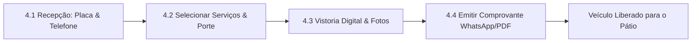

# Manual do Usuário — Lavaway (Lava Aê)
## Guia Operacional e Instruções de Uso do Sistema

> **Versão:** 1.0 — Monólito Modular .NET 10 & Blazor WebAssembly  
> **Público:** Gestores, Recepcionistas, Operadores de Pátio e Administradores da Plataforma.

---

## Sumário

1. [Visão Geral do Lavaway](#1-visão-geral-do-lavaway)
2. [Perfis de Acesso e Credenciais](#2-perfis-de-acesso-e-credenciais)
3. [Primeiros Passos e Configuração da Loja (Onboarding)](#3-primeiros-passos-e-configuração-da-loja-onboarding)
   - 3.1 [Perfil da Loja e Dados Cadastrais](#31-perfil-da-loja-e-dados-cadastrais)
   - 3.2 [Identidade Visual e Logomarca](#32-identidade-visual-e-logomarca)
   - 3.3 [Catálogo de Serviços e Preços por Porte](#33-catálogo-de-serviços-e-preços-por-porte)
   - 3.4 [Capacidade do Pátio (Boxes) e Equipe](#34-capacidade-do-pátio-boxes-e-equipe)
   - 3.5 [Conexão e Pareamento do WhatsApp](#35-conexão-e-pareamento-do-whatsapp)
   - 3.6 [Configuração do Gateway de Pagamento Pix / Pagar.me](#36-configuração-do-gateway-de-pagamento-pix--pagarme)
   - 3.7 [Meu Plano e Gestão de Cotas SaaS](#37-meu-plano-e-gestão-de-cotas-saas)
4. [Operação de Balcão e Recepção](#4-operação-de-balcão-e-recepção)
   - 4.1 [Localização e Cadastro Ágil de Clientes e Veículos](#41-localização-e-cadastro-ágil-de-clientes-e-veículos)
   - 4.2 [Abertura da Ordem de Serviço (OS)](#42-abertura-da-ordem-de-serviço-os)
   - 4.3 [Vistoria Digital de Entrada (Checklist, Avarias e Fotos de Perímetro)](#43-vistoria-digital-de-entrada-checklist-avarias-e-fotos-de-perímetro)
   - 4.4 [Emissão e Envio do Comprovante Digital (PDF) via WhatsApp](#44-emissão-e-envio-do-comprovante-digital-pdf-via-whatsapp)
5. [Controle de Pátio e Fluxo Kanban](#5-controle-de-pátio-e-fluxo-kanban)
   - 5.1 [Navegação no Quadro Kanban](#51-navegação-no-quadro-kanban)
   - 5.2 [Transição de Estados Operacionais](#52-transição-de-estados-operacionais)
   - 5.3 [Atribuição de Operadores / Lavadores](#53-atribuição-de-operadores--lavadores)
   - 5.4 [Registro de Refações com Justificativa](#54-registro-de-refações-com-justificativa)
   - 5.5 [Fotos Pós-Serviço e Comparativo "Antes e Depois"](#55-fotos-pós-serviço-e-comparativo-antes-e-depois)
   - 5.6 [Pronto para Retirada e Liberação do Veículo](#56-pronto-para-retirada-e-liberação-do-veículo)
6. [Agenda, Reservas e Atendimento WhatsApp](#6-agenda-reservas-e-atendimento-whatsapp)
   - 6.1 [Painel da Agenda Operacional](#61-painel-da-agenda-operacional)
   - 6.2 [Agendamento Conversacional pelo Chatbot do WhatsApp](#62-agendamento-conversacional-pelo-chatbot-do-whatsapp)
   - 6.3 [Prevenção Proativa de Faltas (Lembretes 24h e 2h)](#63-prevenção-proativa-de-faltas-lembretes-24h-e-2h)
7. [Financeiro, Caixa e Retenção](#7-financeiro-caixa-e-retenção)
   - 7.1 [Cobrança via Pix Automático (QR Code e Copia e Cola)](#71-cobrança-via-pix-automático-qr-code-e-copia-e-cola)
   - 7.2 [Frente de Caixa Diário e Conciliação](#72-frente-de-caixa-diário-e-conciliação)
   - 7.3 [Apuração Automatizada de Comissões](#73-apuração-automatizada-de-comissões)
   - 7.4 [Programa de Fidelidade e Cartão de Selos Digital](#74-programa-de-fidelidade-e-cartão-de-selos-digital)
   - 7.5 [Clubes de Assinatura e Créditos Recorrentes por Placa](#75-clubes-de-assinatura-e-créditos-recorrentes-por-placa)
   - 7.6 [Pós-Venda, Satisfação (CSAT), Reativação e LGPD](#76-pós-venda-satisfação-csat-reativação-e-lgpd)
8. [Backoffice da Plataforma (Administração Global do SaaS)](#8-backoffice-da-plataforma-administração-global-do-saas)
   - 8.1 [Gestão Global de Estabelecimentos (Tenants)](#81-gestão-global-de-estabelecimentos-tenants)
   - 8.2 [Sessão de Diagnóstico e Suporte (Impersonation)](#82-sessão-de-diagnóstico-e-suporte-impersonation)
   - 8.3 [Faturamento B2B, Planos SaaS e Inadimplência](#83-faturamento-b2b-planos-saas-e-inadimplência)
   - 8.4 [Painel de Saúde e Contingência do WhatsApp](#84-painel-de-saúde-e-contingência-do-whatsapp)
   - 8.5 [Métricas Globais (MRR, ARR, LTV) e Trilha de Auditoria Forense](#85-métricas-globais-mrr-arr-ltv-e-trilha-de-auditoria-forense)
9. [Perguntas Frequentes e Resolução de Problemas (FAQ)](#9-perguntas-frequentes-e-resolução-de-problemas-faq)

---

## 1. Visão Geral do Lavaway

O **Lavaway (Lava Aê)** é uma plataforma integrada de gestão para lava-jatos e centros de estética automotiva. O sistema centraliza todo o fluxo do estabelecimento: desde a chegada do cliente no balcão e vistoria com câmera do celular até o acompanhamento do pátio em tempo real, liquidação financeira com Pix, controle de caixa, apuração de comissões e automação completa de mensagens pelo WhatsApp.

### Principais Benefícios:
- **Segurança Multi-Tenant:** Cada estabelecimento possui seus dados, arquivos e configurações rigorosamente isolados.
- **Operação Rápida:** Check-in em segundos com busca de placas no padrão Mercosul e nacional antigo.
- **Zero Papel:** Vistoria fotográfica digital de 360°, diagrama de avarias e comprovantes térmicos e digitais em PDF transmitidos via WhatsApp.
- **Comunicação Ativa:** Chatbot que recebe agendamentos, envia lembretes para evitar faltas e dispara pesquisas de satisfação.
- **Fidelização e Receita Recorrente:** Controle de clubes de assinatura por placa de veículo e cartões digitais de selos.

---

## 2. Perfis de Acesso e Credenciais

O sistema possui controle de acesso baseado em papéis (RBAC):

| Perfil | Destinado a | Permissões Principais |
|---|---|---|
| **Administrador da Loja (`Administrator`)** | Proprietários e Gerentes do Lava-jato | Acesso total à loja: configurações de preços, equipe, comissões, faturamento, caixa diário, relatórios e pareamento do WhatsApp. |
| **Recepcionista (`Receptionist`)** | Operadores de Atendimento e Balcão | Abertura de OS, cadastro de clientes/veículos, vistorias, agenda, recebimentos no caixa e disparo de comprovantes. |
| **Operador / Lavador (`Operator`)** | Equipe de Pátio e Boxes | Consulta e movimentação dos cards no quadro Kanban, assunção de serviços, refações e galeria de fotos Antes/Depois. |
| **Equipe da Plataforma (`SuperAdmin`, `PlatformSupport`, `PlatformBillingAdmin`, `PlatformAuditor`)** | Operadores do SaaS Lavaway | Backoffice global, onboarding de novos lojistas, suporte assistido (*impersonation*), auditoria forense e faturamento de assinaturas. |

### Credenciais Padrão de Demonstração / Desenvolvimento:

> [!NOTE]  
> Em ambiente local ou de demonstração, o sistema é populado automaticamente pelo seeder com os seguintes acessos:
> - **Gestor da Loja:** `admin@lavaae.com` | Senha: `Admin123!`
> - **Recepção da Loja:** `recepcao@lavaae.com` | Senha: `Recepcao123!`
> - **SuperAdmin Plataforma:** `platform@lavaae.com` | Senha: `PlatformAdmin123!`

Para acessar:
1. Abra o navegador no endereço do sistema (`http://localhost:5199` ou URL do seu domínio).
2. Clique em **Entrar** ou acesse a rota `/login`.
3. Preencha seu e-mail e senha cadastrados.

---

## 3. Primeiros Passos e Configuração da Loja (Onboarding)

Antes de abrir a primeira ordem de serviço, o Administrador deve configurar as informações básicas da sua unidade. No menu lateral, acerte as seguintes seções:

```text
Configurações da Loja:
├── 09 Perfil da Loja        (/settings/profile)
├── 10 Serviços & Preços     (/settings/services)
├── 11 Capacidade & Equipe   (/settings/team)
├── 12 WhatsApp              (/settings/whatsapp)
├── 13 Meu Plano & Cotas     (/settings/subscription)
└── 14 Pagamentos & Gateways (/settings/payments)
```

### 3.1 Perfil da Loja e Dados Cadastrais
Acesse **Perfil da Loja** (`/settings/profile`):
1. **Dados Gerais:** Informe a Razão Social, Nome Fantasia, CNPJ, Telefone oficial com DDD e Endereço completo.
2. Esses dados serão impressos no cabeçalho dos comprovantes de entrada em PDF e nas mensagens automáticas de WhatsApp enviadas aos seus clientes.
3. Clique em **Salvar Alterações**.

### 3.2 Identidade Visual e Logomarca
Na mesma tela de perfil ou no assistente guiado:
1. **Logomarca:** Faça o upload do arquivo de imagem do seu lava-jato (PNG, JPG ou WebP de até 2MB).
2. **Paleta de Cores:** Defina a **Cor Primária** (destaque dos botões e comprovantes) e a **Cor Secundária** (fundos e contrastes).
3. **Prévia em Tempo Real:** Utilize o painel de pré-visualização para checar como a logomarca e as cores ficarão no comprovante digital da OS e na tela de acompanhamento web do cliente.

### 3.3 Catálogo de Serviços e Preços por Porte
Acesse **Serviços & Preços** (`/settings/services`):
1. Cadastre os serviços oferecidos (ex.: *Ducha Rápida*, *Lavagem Completa*, *Higienização de Bancos*, *Polimento Técnico*, *Vitrificação de Pintura*).
2. Para cada serviço, defina o tempo estimado de execução (em minutos) e o valor diferenciado por porte de veículo:
   - **Hatch / Sedan** (Veículo de passeio padrão)
   - **SUV** (Veículo utilitário esportivo)
   - **Picape / Van** (Veículos utilitários grandes)
   - **Moto** (Motocicletas e similares)
3. Marque os serviços que são elegíveis para fotos comparativas "Antes e Depois" (como polimentos e vitrificações).

### 3.4 Capacidade do Pátio (Boxes) e Equipe
Acesse **Capacidade & Equipe** (`/settings/team`):
1. **Boxes Simultâneos:** Configure a quantidade de vagas operacionais ativas no seu pátio. Essa informação alimenta a trava automática do agendamento para evitar superlotação.
2. **Colaboradores:** Cadastre os membros da equipe (Lavadores, Detalhadores, Recepcionistas), informando nome, telefone e papel.
3. **Regras de Comissão:** Crie regras de comissão flexíveis:
   - Tipo de cálculo: **Percentual (%)** ou **Valor Fixo (R$)**.
   - Vinculação por serviço específico ou cargo do colaborador.

### 3.5 Conexão e Pareamento do WhatsApp
Acesse **WhatsApp** (`/settings/whatsapp`):
1. Clique no botão **Conectar WhatsApp / Gerar QR Code**.
2. Abra o aplicativo do WhatsApp no celular oficial do lava-jato.
3. Vá em **Aparelhos Conectados** > **Conectar um aparelho** e aponte a câmera para o QR Code exibido na tela.
4. O sistema detectará a leitura instantaneamente e o indicador mudará para o status verde `Conectado`.
5. Utilize o cartão de **Teste de Mensagem** para disparar um "Olá" de validação para o seu próprio número.

> [!IMPORTANT]  
> Mantenha o telefone do lava-jato com conexão de internet ativa. Se o aparelho for desconectado, um banner de aviso surgirá no topo do sistema alertando para escanear um novo QR Code.

### 3.6 Configuração do Gateway de Pagamento Pix / Pagar.me
Acesse **Pagamentos & Gateways** (`/settings/payments`):
1. Escolha o seu provedor de pagamentos (ex.: **Pagar.me / Stone Co.** ou **Mercado Pago**).
2. Insira as credenciais de API (Chave Secreta e Chave Pública) fornecidas pela sua adquirente. O sistema armazena essas chaves com criptografia de ponta (AES-GCM 256 bits).
3. Clique em **Testar Conexão** para validar a autenticação com a adquirente.
4. Copie a **URL de Webhook** fornecida pelo Lavaway e cole no painel da sua credenciadora para viabilizar a confirmação automática das cobranças.

### 3.7 Meu Plano e Gestão de Cotas SaaS
Acesse **Meu Plano & Cotas** (`/settings/subscription`):
1. Visualize o plano contratado da sua loja (*Básico*, *Pro* ou *Enterprise*).
2. Acompanhe o velocímetro de consumo de cotas do mês corrente (volume de ordens de serviço abertas e quantidade de mensagens de WhatsApp disparadas).
3. Visualize suas faturas e acesse o Portal do Cliente Stripe para atualizar o cartão de cobrança da assinatura da plataforma.

---

## 4. Operação de Balcão e Recepção

A recepção é o coração do atendimento ao cliente. O fluxo operacional padrão foi desenhado para durar menos de 60 segundos por veículo.



### 4.1 Localização e Cadastro Ágil de Clientes e Veículos
Acesse a tela **Recepção** (`/reception`):
1. **Identificação da Placa:** Digite a placa do veículo no campo estilizado. O sistema aceita placas Mercosul (`ABC1D23`) ou formato tradicional antigo (`ABC-1234`).
2. **Localização Instantânea:**
   - Se o veículo ou cliente já tiverem histórico na loja, seus dados (nome, telefone, modelo e cor) serão carregados na hora.
   - Caso seja um novo cliente, informe o **Nome Completo** e o **WhatsApp com DDD**.
3. Clique em **Prosseguir para Abertura de OS**.

### 4.2 Abertura da Ordem de Serviço (OS)
Na tela **Nova Ordem de Serviço** (`/work-orders/new`):
1. **Confirmação do Porte:** Verifique ou alterne o porte do carro (*Hatch/Sedan*, *SUV*, *Picape/Van*, *Moto*).
2. **Seleção de Serviços:** Marque os serviços desejados pelo cliente. Os preços e tempos estimados calculam dinamicamente na tela.
3. **Previsão de Entrega:** O sistema soma as durações e projeta automaticamente o horário estimado de conclusão do veículo (`Previsão de Entrega`).
4. **Observações de Recepção:** Registre pertences deixados no carro (ex.: "óculos no porta-luvas") ou instruções do cliente (ex.: "atenção redobrada na sujeira do carpete").
5. Clique em **Abrir Ordem de Serviço**.

### 4.3 Vistoria Digital de Entrada (Checklist, Avarias e Fotos de Perímetro)
Logo após criar a OS, o sistema abre o modal de vistoria digital (`/work-orders/{id}/inspection`):

```text
Interface de Vistoria:
┌────────────────────────────────────────────────────────┐
│  DIAGRAMA VETORIAL: [Frente] [Traseira] [L.Esq] [L.Dir] │
│  Toque na imagem para registrar:                      │
│   ● Arranhão (Amarelo)                                │
│   ● Mossa / Amassado (Laranja)                        │
│   ● Trinca / Quebra (Vermelho)                        │
├────────────────────────────────────────────────────────┤
│  CHECKLIST DE ENTRADA:                                │
│   [x] Estepe presente     [x] Documento no veículo     │
│   [x] Chaveiro especial   [ ] Nível de combustível 1/2 │
├────────────────────────────────────────────────────────┤
│  FOTOS OBRIGATÓRIAS DE PERÍMETRO (Mínimo 4):          │
│   [📷 Frente] [📷 Traseira] [📷 Lat. Esq.] [📷 Lat. Dir.] │
└────────────────────────────────────────────────────────┘
```

1. **Diagrama Tátil de Avarias:** Toque diretamente nas vistas do carro para marcar pequenos arranhões, amassados pré-existentes ou trincas no para-brisa. Isso resguarda seu estabelecimento de reclamações indevidas.
2. **Checklist Rápido:** Marque os itens conferidos na entrada (estepe, pertences, rádio, nível de combustível).
3. **Fotos Obrigatórias:** Tire as 4 fotos dos quatro cantos do carro (Frente, Traseira, Lateral Esquerda e Lateral Direita).
4. Clique em **Finalizar Vistoria**.

> [!IMPORTANT]
> ### 🛡️ Cartilha de Boas Práticas e Privacidade na Vistoria (LGPD — Art. 6º)
> Para garantir a segurança jurídica do lava-jato e a total conformidade com a LGPD (Lei 13.709/2018), os atendentes e operadores de pátio **DEVEM** seguir estritamente as seguintes regras durante a vistoria e captura de fotos:
>
> 1. **Foco Estrito na Carroceria e Componentes:** As fotos de perímetro (Frente, Traseira, Lateral Esquerda, Lateral Direita) e fotos detalhadas de avarias devem registrar exclusivamente partes mecânicas, rodas, pneus, vidros e lataria do veículo.
> 2. **Proibição Absoluta de Fotografar Pessoas:** **NÃO fotografe rostos** do cliente, de acompanhantes, de crianças, de pedestres na rua ou de outros colaboradores. Se alguém estiver próximo ou visível no enquadramento/reflexo, solicite educadamente que se afaste ou altere o ângulo da câmera antes do disparo.
> 3. **Proibição de Fotografar Documentos Pessoais e Financeiros:** Verifique o interior do carro antes de fotografar detalhes internos. **NUNCA fotografe** CNH, RG, cartões bancários, faturas, contracheques ou correspondências deixadas no painel, portas ou assentos.
> 4. **Bens Pessoais e Objetos de Valor:** Caso o cliente tenha deixado óculos, relógios, notebooks ou carteiras, solicite cordialmente que os leve consigo. Se permanecerem sob custódia, registre **apenas textualmente** no campo *"Observações de Recepção"* (ex.: *"1 óculos de sol no porta-luvas"*), **sem realizar fotos de bens íntimos**.
> 5. **Transparência Ativa na Recepção:** Ao iniciar a vistoria, explique cordialmente ao cliente: *"Estamos registrando as fotos do estado de entrada do seu veículo para o seu próprio resguardo e segurança. As imagens vão anexadas no seu comprovante digital pelo WhatsApp e são tratadas exclusivamente para este serviço."*

### 4.4 Emissão e Envio do Comprovante Digital (PDF) via WhatsApp
Concluída a vistoria:
1. O sistema gera automaticamente um **comprovante em PDF** elegante com a logomarca da sua loja, dados da OS, previsão de entrega, tabela com as avarias marcadas e o **Aviso de Privacidade LGPD** com link público da política de proteção de dados (`/privacidade`).
2. Clique em **Enviar via WhatsApp**. O cliente receberá instantaneamente no celular o documento em PDF acompanhado de legenda transparente com a finalidade do tratamento e a instrução clara de opt-out: *"Envie 'PARAR' a qualquer momento para não receber mensagens promocionais"*.
3. Se o cliente preferir comprovante impresso, clique no botão **Imprimir**.

---

## 5. Controle de Pátio e Fluxo Kanban

A equipe de boxes acompanha o trabalho pela página **Pátio & Kanban** (`/yard`). O quadro atualiza em tempo real via SignalR: quando uma OS é movida por um usuário, todos os outros computadores e tablets da oficina recebem a atualização sem precisar recarregar a página.

### 5.1 Navegação no Quadro Kanban
O quadro é composto por 5 colunas operacionais sequenciais:

```text
┌──────────────┐   ┌──────────────┐   ┌──────────────┐   ┌──────────────┐   ┌──────────────┐
│  AGUARDANDO  │──>│  EM LAVAGEM  │──>│   SECAGEM    │──>│  CONTROLE DE │──>│  PRONTO PARA │
│              │   │              │   │  ACABAMENTO  │   │  QUALIDADE   │   │   RETIRADA   │
└──────────────┘   └──────────────┘   └──────────────┘   └──────────────┘   └──────────────┘
```

- Cada cartão exibe: **Placa estilizada**, **Modelo do Carro**, **Nome do Cliente**, **Serviços Contratados**, **Tempo Decorrido**, **Operador Atribuído** e **Indicador Financeiro** (Pago / Pendente).

### 5.2 Transição de Estados Operacionais
Existem duas formas de movimentar os veículos no quadro:
- **Arrastar e Soltar (Drag & Drop):** Clique e arraste o card de um veículo para a coluna seguinte.
- **Botões de Ação Rápida:** No rodapé do card, clique no botão com seta para a direita para avançar de estágio com um único toque (ideal para celulares e tablets com luva de serviço).

### 5.3 Atribuição de Operadores / Lavadores
1. No card do veículo, clique no ícone de colaborador (**Atribuir Operador**).
2. Selecione o lavador responsável por aquele atendimento.
3. A foto/iniciais do operador aparecerão no cartão, e a OS será vinculada para o cômputo futuro de comissões.

### 5.4 Registro de Refações com Justificativa
Se um veículo no *Controle de Qualidade* apresentar falhas no acabamento:
1. Clique no botão **Retornar / Refazer**.
2. O sistema abrirá um modal solicitando a **justificativa obrigatória** (ex.: "repassar aspiração interna nos bancos traseiros").
3. O veículo volta para a coluna de *Secagem/Acabamento* com um carimbo visual de refação, e o histórico da OS registra a ocorrência para fins de auditoria de qualidade.

### 5.5 Fotos Pós-Serviço e Comparativo "Antes e Depois"
Para serviços de estética, polimento e vitrificação:
1. No card da OS, clique no ícone **📸 Antes/Depois**.
2. Abra a galeria e capture as fotos de conclusão do trabalho (as fotos de "Antes" já foram obtidas na vistoria de entrada).
3. **Slider Comparativo:** O sistema gera um componente interativo com divisão central deslizante (Antes à esquerda e Depois à direita) para comprovar o resultado do trabalho.
4. Clique em **Enviar Comparativo no WhatsApp** para impressionar o cliente com a transformação do veículo.

### 5.6 Pronto para Retirada e Liberação do Veículo
Quando o carro entra na coluna **Pronto para Retirada**:
1. O sistema pode disparar automaticamente um aviso de veículo liberado no WhatsApp do cliente ("Seu carro está pronto, limpo e perfumado! Pode vir retirar.").
2. Ao entregar a chave ao cliente, clique no botão **🚗 Retirada Concluída**. O carro sai do quadro de pátio ativo e o horário de saída é registrado.

---

## 6. Agenda, Reservas e Atendimento WhatsApp

A tela **Agenda & Reservas** (`/scheduling`) permite gerenciar agendamentos presenciais, por telefone ou criados de forma 100% autônoma pelo robô do WhatsApp.

### 6.1 Painel da Agenda Operacional
- **Medidor de Ocupação:** Exibe a capacidade física de boxes por faixa horária. Dias e horários com vagas esgotadas ficam bloqueados automaticamente para novos agendamentos.
- **Filtros Rápidos:** Visualize as reservas para "Hoje", "Amanhã" ou datas futuras selecionadas no calendário.
- **Iniciar Atendimento:** Ao lado de cada reserva confirmada, clique em **Iniciar Atendimento**. O sistema transfere o cliente diretamente para a tela de Abertura de OS com placa, telefone e serviços já preenchidos.

### 6.2 Agendamento Conversacional pelo Chatbot do WhatsApp
Quando um cliente envia uma mensagem como *"Olá, quero agendar uma lavagem"* para o número do lava-jato:
1. O robô apresenta o menu de serviços cadastrados com os respectivos preços.
2. O cliente escolhe o tipo de veículo e os serviços desejados.
3. O robô consulta a disponibilidade de boxes em tempo real e oferece as opções de horários livres.
4. O cliente confirma e o agendamento é gerado com protocolo único (ex.: `#BK-2610-0042`), aparecendo imediatamente na agenda do estabelecimento.

### 6.3 Prevenção Proativa de Faltas (Lembretes 24h e 2h)
O Lavaway combate as faltas (*no-show*) com automação inteligente em segundo plano:
- **Lembrete de 24 Horas:** Disparado um dia antes do horário reservado.
- **Lembrete de 2 Horas:** Disparado no dia do atendimento.
- **Respostas do Cliente no WhatsApp:**
  - Digitar **1 (Confirmar):** A reserva ganha a badge verde `✅ Confirmado` na agenda.
  - Digitar **2 (Remarcar):** O robô apresenta novas datas e horários livres para reagendar.
  - Digitar **3 (Cancelar):** A vaga é liberada imediatamente na agenda da oficina.

---

## 7. Financeiro, Caixa e Retenção

### 7.1 Cobrança via Pix Automático (QR Code e Copia e Cola)
1. No card do Kanban ou no detalhe da OS, clique no botão **💠 Pix**.
2. O sistema exibe o QR Code dinâmico do Banco Central gerado pela sua adquirente configurada, juntamente com o código **Pix Copia e Cola**.
3. **Copiar em 1 Clique:** Clique no botão Copiar para colar no terminal ou maquininha.
4. **Enviar no WhatsApp:** Clique em enviar para que o cliente receba a chave e pague no próprio aplicativo bancário.
5. **Baixa Automática:** Assim que o cliente paga, a adquirente envia o webhook, o sistema detecta a compensação em menos de 3 segundos, altera a badge da OS para `💳 Pago` e dispara uma mensagem amigável de quitação.

### 7.2 Frente de Caixa Diário e Conciliação
Acesse **Caixa & Comissões** (`/cashier`):
1. **Abertura e Saldo do Dia:** O painel exibe o total recebido segregado por método de pagamento (Pix, Dinheiro, Cartão de Crédito e Cartão de Débito).
2. **Movimentações Manuais:**
   - **Aporte:** Clique em **Novo Aporte** para registrar troco inicial ou entradas avulsas de dinheiro.
   - **Sangria:** Clique em **Nova Sangria** para registrar retiradas de dinheiro da gaveta (pagamento de combustível, lanches, adiantamentos).
3. **Recebimento de OS no Balcão:** Para pagamentos presenciais em dinheiro ou cartão físico, use o modal de recebimento, informe o valor pago e o sistema calcula o troco exato.
4. **Fechamento Diário Cego:** No fim do expediente, o recepcionista informa o valor físico contado na gaveta. O sistema confronta com o valor apurado e gera o relatório de conferência auditada, acusando eventuais sobras ou faltas.

### 7.3 Apuração Automatizada de Comissões
Na aba de comissões do caixa:
1. Veja a lista dos lavadores e operadores que trabalharam no dia.
2. Cada serviço finalizado e quitado gera o valor de comissão correspondente conforme a regra configurada (percentual ou valor fixo).
3. Visualize os relatórios analíticos por colaborador para efetuar o pagamento semanal ou mensal de forma transparente.

### 7.4 Programa de Fidelidade e Cartão de Selos Digital
Acesse **Fidelidade & Selos** (`/loyalty`):
1. O sistema credita pontos ou selos automaticamente para cada serviço elegível concluído pelo cliente.
2. **Notificação de Proximidade:** Quando faltar apenas **1 serviço** para o cliente ganhar uma lavagem grátis (`Falta 1`), o sistema envia uma mensagem motivacional no WhatsApp convidando-o a retornar.
3. **Resgate do Benefício:** Ao completar a cartela (ex.: 10 selos), o recepcionista clica em **Resgatar Prêmio**. O saldo é debitado no extrato auditável e a gratificação é aplicada na OS.

### 7.5 Clubes de Assinatura e Créditos Recorrentes por Placa
Acesse **Assinaturas & Clubes** (`/subscriptions`):
1. **Planos Recorrentes:** Crie clubes mensais (ex.: *Clube VIP — 4 Lavagens Completas por Mês por R$ 149,90*).
2. **Vínculo por Placa:** Cadastre a assinatura associando a placa do veículo autorizado.
3. **Consumo de Créditos:** Ao abrir ou receber uma OS com aquela placa, o sistema acusa que o veículo possui créditos ativos. O pagamento é liquidado consumindo 1 crédito da assinatura, sem cobrança avulsa.

### 7.6 Pós-Venda, Satisfação (CSAT), Reativação e LGPD
Acesse **Pós-Venda & Retenção** (`/after-sales`):
1. **Pesquisa CSAT (1h após saída):** Exatamente 60 minutos após o carro ser retirado, o robô dispara uma pergunta rápida no WhatsApp: *"De 1 a 5 estrelas, qual nota você dá para a limpeza do seu carro hoje?"*.
   - Notas 4 e 5: O sistema envia um agradecimento e convida a avaliar no Google Meu Negócio.
   - Notas 1 a 3: O sistema pede desculpas e abre um alerta para o gerente entrar em contato e acolher o cliente.
2. **Campanhas de Reativação Automática:**
   - Configure réguas para clientes ausentes há **15, 30 ou 45 dias**. O robô dispara convites personalizados com desconto ou cortesia.
3. **Conformidade LGPD & Opt-Out Automático:**
   - O rodapé de todas as notificações de comprovante no WhatsApp e o comprovante em PDF emitido na recepção informam a finalidade estrita da vistoria e instruem sobre o direito de cancelamento de promoções.
   - O comprovante digital anexo e o link público de acompanhamento contêm link direto para a Política de Privacidade (`/privacidade`).
   - Se o cliente responder *"PARAR"*, *"SAIR"* ou *"STOP"*, o sistema bloqueia mensagens promocionais imediatamente respeitando o opt-out na tabela auditável `CustomerCommunicationPreferences`. O consentimento pode ser revertido caso o cliente envie *"QUERO"*.

---

## 8. Backoffice da Plataforma (Administração Global do SaaS)

Destinado aos operadores da empresa mantenedora do software Lavaway (acessível apenas por usuários com permissões `SuperAdmin`, `PlatformSupport`, `PlatformBillingAdmin` ou `PlatformAuditor`).

### 8.1 Gestão Global de Estabelecimentos (Tenants)
Acesse **Estabelecimentos (Tenants)** (`/platform/tenants`):
- Listagem completa de todos os lava-jatos clientes do SaaS.
- Visualização do status contratual: `Ativo`, `Em Período de Testes (Trial)`, `Inadimplente` ou `Cancelado`.
- Alteração de status com justificativa formal registrada em log.

### 8.2 Sessão de Diagnóstico e Suporte (Impersonation)
Quando um lojista abre um chamado de suporte e solicita ajuda técnica:
1. No registro do tenant, clique em **Acessar como Suporte (Impersonate)**.
2. Digite a justificativa técnica e o número do ticket de suporte.
3. O sistema entra no contexto do lava-jato com um **Banner de Diagnóstico Amarelo fixado no topo**.
4. O operador de suporte pode verificar telas, menus e dados exatamente como o lojista vê.
5. Ao terminar, clique em **Encerrar Sessão de Diagnóstico**. Todo o acesso fica gravado de forma imutável na trilha de auditoria.

### 8.3 Faturamento B2B, Planos SaaS e Inadimplência
Acesse **Faturamento & Planos SaaS** (`/platform/billing`):
- Gestão dos planos de assinatura do software (*Basic*, *Pro*, *Enterprise*).
- Integração com a Stripe (Checkout e Cobrança Recorrente).
- Aplicação de política de tolerância de inadimplência (carência de 5 dias antes de suspender novas aberturas de OS).

### 8.4 Painel de Saúde e Contingência do WhatsApp
Acesse **Saúde do WhatsApp** (`/platform/whatsapp`):
- Dashboard com o status em tempo real de todas as conexões de WhatsApp de todos os clientes da plataforma.
- Monitoramento contínuo: se a conexão de um lojista cair, o monitor detecta proativamente e envia um alerta ao lojista com link direto para escanear um novo QR Code.
- Ações manuais de teste de conectividade (*probe*) e histórico de incidentes.

### 8.5 Métricas Globais (MRR, ARR, LTV) e Trilha de Auditoria Forense
Acesse **Métricas & Observabilidade** (`/platform/metrics`) e **Auditoria** (`/platform/audit`):
- **Indicadores SaaS:** Acompanhamento de MRR (Receita Recorrente Mensal), ARR, taxa de cancelamento (*churn rate*), LTV e volume total transacionado em Pix nos lava-jatos.
- **Trilha de Auditoria:** Tabela forense inviolável (*append-only*) contendo quem fez, quando fez, qual IP, qual recurso foi afetado e o payload JSON de cada ação administrativa executada no sistema.

---

## 9. Perguntas Frequentes e Resolução de Problemas (FAQ)

### O que fazer quando a conexão do WhatsApp cair?
1. Verifique se o smartphone do estabelecimento está ligado e conectado à internet (Wi-Fi ou 4G).
2. Acesse **Configurações** > **WhatsApp** (`/settings/whatsapp`).
3. Se o status estiver `Desconectado`, clique em **Atualizar Pareamento / Gerar Novo QR Code**.
4. No celular, vá em Aparelhos Conectados no WhatsApp, desconecte a sessão antiga e aponte a câmera para o novo código.

### Como cadastrar veículos com placa do padrão antigo?
O sistema aceita os dois padrões vigentes no Brasil de forma transparente:
- **Padrão Antigo:** Digite no formato `ABC1234` ou `ABC-1234`.
- **Padrão Mercosul:** Digite no formato `ABC1D23`.
O sistema limpa traços e espaços e padroniza a busca automaticamente.

### Como cancelar uma Ordem de Serviço lançada por engano?
1. No quadro Kanban (`/yard`), clique no card da OS para abrir os detalhes.
2. Clique no menu de opções e selecione **Cancelar OS**.
3. Forneça o motivo do cancelamento. Caso tenha havido cobrança de adiantamento, registre o estorno correspondente no caixa.

### O cliente informou que não deseja receber mensagens promocionais. Como proceder?
- O cliente pode simplesmente responder com a palavra **PARAR** a qualquer momento em uma mensagem do WhatsApp.
- Alternativamente, o recepcionista pode acessar **Pós-Venda** > **Gestão LGPD** (`/after-sales`), localizar o telefone do cliente e marcar o interruptor de **Opt-Out** manualmente.

### O comprovante de pagamento Pix não baixou a OS automaticamente. O que pode ser?
1. Verifique se a chave de webhook no painel da sua adquirente (Pagar.me / Mercado Pago) está cadastrada corretamente com a URL do Lavaway.
2. Na página do Kanban, clique no card e abra o modal de Pix.
3. Clique em **Consultar Status Agora** para forçar uma consulta síncrona contra a adquirente.
4. Caso tenha sido pago em dinheiro físico ou máquina avulsa, registre a baixa manual através do botão de pagamento do Caixa.

### Como exportar ou fechar o caixa do dia?
1. Acesse **Caixa & Comissões** (`/cashier`).
2. Clique em **Fechar Caixa Diário**.
3. Informe os valores em espécie contados na gaveta.
4. Confira o resumo na tela e confirme. Um relatório com carimbo de data, hora e responsável será arquivado no histórico de fechamentos.

---

> [!TIP]  
> Para sugestões de novos recursos, dúvidas técnicas ou abertura de chamados de suporte, contate o administrador da sua organização ou consulte os canais oficiais da plataforma Lavaway.
