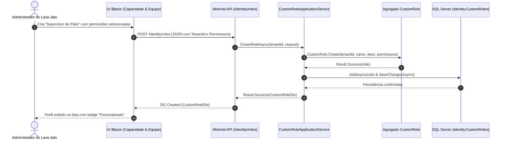

# ADR-0033: Perfis de Acesso (Roles) Personalizados e Autorização Granular por Tenant

## Status
Aceito e Implementado

## Contexto
O SaaS para lava-jato e estética automotiva atendia os usuários por meio de três perfis fixos mapeados no enum `ShopRole` (`Administrator`, `Receptionist`, `Operator`), com um mapeamento estático de permissões (`ShopRolePermissions`).
À medida que as operações dos estabelecimentos crescem, cada lava-jato necessita de papéis especializados e customizados (por exemplo: *Supervisor de Pátio*, *Caixa Líder*, *Polidor Técnico*, *Detailer Especialista*), com permissões específicas de acesso a módulos (ordens de serviço, movimentação de kanban, checklist, consulta de clientes, operação de caixa, tabela de serviços e configurações da loja).

Era indispensável permitir a criação, edição e exclusão de perfis personalizados por cada tenant, preservando integralmente o isolamento lógico de dados (`IMustHaveTenant`), sem risco de vazamento entre estabelecimentos e sem quebrar os perfis padrão do sistema.

## Decisão Arquitetural

Adotou-se uma arquitetura baseada em **Domain-Driven Design (DDD) + Arquitetura Hexagonal + RBAC baseado em Claims/Permissões**:

1. **Agregado de Domínio `CustomRole`:**
   * Entidade pura em `CarWashSaaS.Identity.Domain`, sem dependências de infraestrutura ou frameworks.
   * Implementa `IMustHaveTenant` para isolamento de dados por estabelecimento.
   * Chave primária baseada em UUID (`Guid.CreateVersion7()`).
   * Mantém invariantes de domínio:
     * Nomes não podem ser vazios e são limitados a 100 caracteres.
     * Perfis de sistema (`IsSystemRole = true`) são protegidos contra exclusão e renomeação.
     * Pelo menos uma permissão válida do enum `ShopPermission` deve ser atribuída.
     * Retornos encapsulados obrigatoriamente no padrão `Result<T>`.

2. **Isolamento Multi-Tenant no EF Core:**
   * A entidade `CustomRole` é mapeada no `IdentityModuleDbContext` sob o schema `identity`.
   * Índice único composto `(TenantId, Name)` garante unicidade por tenant sem colisão entre tenants distintos.
   * Filtro global de consulta (`HasQueryFilter`) aplicado via `IMustHaveTenant`.
   * `ValidateTenantWrites` previne mutações cross-tenant no interceptor do `SaveChangesAsync`.

3. **Autorização Orientada a Permissões (Claims-Based Authorization):**
   * Os tokens JWT emitem claims `"role"` com o nome do perfil e múltiplas claims `"permission"` correspondentes às permissões granulares ativas.
   * As políticas de segurança no ASP.NET Core (`Program.cs`) utilizam `RequireAssertion`, permitindo o acesso tanto aos papéis legados de sistema quanto a qualquer perfil customizado que possua a claim `"permission"` necessária (ex.: `CreateWorkOrders`, `ManageCashier`, etc.).

4. **Experiência do Usuário no Blazor:**
   * Centralização na página de **Capacidade & Equipe** (`/settings/team`) através de uma 3ª aba: **"🛡️ Perfis & Permissões"**.
   * Componente reutilizável `RoleModal.razor` para cadastro e edição com permissões categorizadas.
   * Seleção dinâmica de perfis no cadastro/edição de colaboradores (`TeamMemberModal.razor`).

## Diagrama Arquitetural de Fluxo (Mermaid)

## Consequências
* **Positivas:**
  * Flexibilidade total para os lojistas configurarem suas hierarquias e permissões operacionais.
  * Compatibilidade reversa completa com usuários e testes existentes.
  * Forte isolamento multi-tenant garantido em banco e validado em testes automatizados.
  * Aderência estrita às diretrizes do `agents.md` (DDD, Hexagonal, Result Pattern, NetArchTest).
* **Mitigações:**
  * Perfis com usuários associados são bloqueados para exclusão até que todos os colaboradores sejam migrados para outro perfil.
