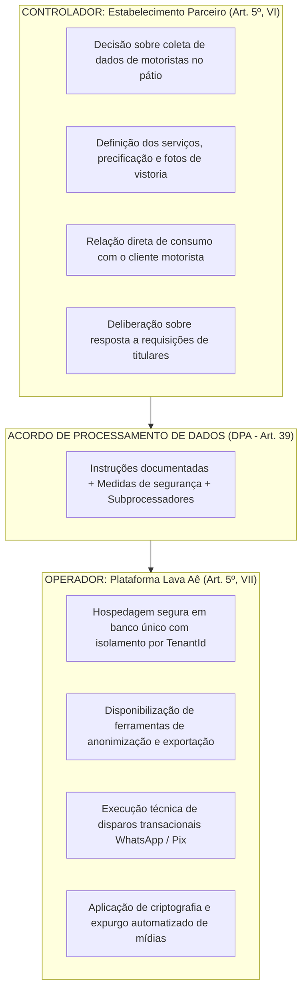

# Acordo de Processamento de Dados Pessoais (DPA — Data Processing Agreement)

> **Lava Aê (Lavaway SaaS) — Plataforma de Gestão para Lava-Jatos e Estética Automotiva**  
> **Conformidade Regulatória:** Lei Federal nº 13.709/2018 (LGPD), Artigos 5º (VI e VII), 39, 46 e 48  
> **Canal Oficial do Encarregado (DPO):** `privacidade@lavaway.com.br`  
> **Versão:** 1.0 — Outubro de 2026  
> **Status:** Documentação Viva (Living Documentation) versionada com a arquitetura

---

## 1. Preâmbulo e Partes Contratantes

Este **Acordo de Processamento de Dados Pessoais (DPA)** constitui anexo contratual compulsório e indissociável dos [Termos de Uso do Serviço](file:///home/rony/LPR/lavaway/src/Frontend/CarWashSaaS.Client.Web/Pages/TermsOfServicePage.razor), celebrado entre:

1. **OPERADOR:**  
   **Lava Aê Tecnologia e Soluções Digitais Ltda.**, pessoa jurídica de direito privado, desenvolvedora e mantenedora da plataforma SaaS **Lava Aê**, doravante denominada simplesmente **Lava Aê** ou **Operador**.

2. **CONTROLADOR:**  
   O estabelecimento comercial, lava-jato, centro de estética automotiva ou oficina de detalhamento automotivo assinante do serviço, devidamente qualificado no ato do cadastro e contratação do plano SaaS, doravante denominado **Estabelecimento Parceiro**, **Lojista** ou **Controlador**.

Ambas as partes atuam conjuntamente na garantia da privacidade, autodeterminação informativa e segurança dos dados pessoais tratados no contexto das operações de atendimento automotivo, em estrita observância à Lei Geral de Proteção de Dados Pessoais (**LGPD — Lei nº 13.709/2018**).

---

## 2. Topologia de Responsabilidades (Controlador vs. Operador)

O modelo arquitetural e de negócios da plataforma adota a segregação de esferas de responsabilidade definida no [Registro das Operações de Tratamento de Dados Pessoais (ROPA)](file:///home/rony/LPR/lavaway/docs/lgpd/registro-operacoes-tratamento-ropa.md):

### 2.1 Papel do Estabelecimento Parceiro (Controlador)
O Estabelecimento Parceiro é o detentor exclusivo das decisões sobre a finalidade e necessidade da coleta dos dados de seus motoristas clientes no balcão/pátio, competindo-lhe:
* Assegurar a legitimidade e a base legal (Art. 7º, V — Execução de Contrato ou Art. 7º, IX — Legítimo Interesse) para a abertura de Ordens de Serviço (OS) e envio de notificações transacionais;
* Instruir sua equipe de atendimento para não capturar fotos de pessoas, documentos pessoais ou pertences deixados no interior dos veículos durante a vistoria;
* Atender às manifestações e requisições de direitos formuladas pelos titulares em seu balcão ou canais próprios.

### 2.2 Papel do Lava Aê (Operador)
O Lava Aê atua estritamente como **Operador**, prestando serviços técnicos de computação em nuvem, gestão operacional de pátio, cobrança Pix, mensageria e armazenamento de arquivos de vistoria sob comando do Controlador. O Lava Aê não utiliza os dados pessoais custodiados para finalidades autônomas, promocionais de terceiros ou comercialização de bases de dados.

---

## 3. Escopo e Natureza dos Dados Pessoais Tratados

O presente DPA abrange todas as operações de tratamento automatizado de dados pessoais efetuadas pelo Operador por conta e ordem do Controlador no software, detalhadas no ROPA:

| Categoria de Titular | Dados Pessoais Tratados | Finalidade Estrita no SaaS | Base Legal do Controlador |
| :--- | :--- | :--- | :--- |
| **Motoristas / Clientes Finais** | Nome completo, número de WhatsApp/telefone, placa veicular, modelo/ano do veículo, histórico de ordens de serviço. | Identificação do veículo no pátio, emissão da OS digital, cálculo de serviços e envio de aviso de prontidão. | Execução de Contrato (Art. 7º, V) |
| **Veículos / Fotos de Pátio** | Fotografias da lataria, rodas, vidros e eventuais avarias pré-existentes. | Comprovação do estado de recebimento do veículo, vistoria de conformidade e mitigação de litígios. | Execução de Contrato (Art. 7º, V) / Legítimo Interesse (Art. 7º, IX) |
| **Colaboradores do Lojista** | Nome, e-mail institucional/profissional, perfil de acesso (Recepcionista, Lavador, Gerente). | Controle de acesso baseado em papéis (RBAC), atribuição de serviços no Kanban e auditoria de ações. | Execução do Contrato de Trabalho / Legítimo Interesse |
| **Registros de Pagamento** | Identificador de transação Pix / gateway, valor pago, data/hora e status de quitação. | Baixa de pagamentos, conciliação de caixa diário e faturamento da ordem de serviço. | Execução de Contrato (Art. 7º, V) / Obrigação Legal (Art. 7º, II) |

---

## 4. Obrigações e Garantias do Operador (Lava Aê)

Nos termos do Art. 39 da LGPD, o Lava Aê compromete-se e garante:

1. **Tratamento Vinculado:** Tratar os dados pessoais unicamente para o cumprimento do objeto do contrato de licença SaaS e conforme as instruções documentadas do Controlador.
2. **Confidencialidade Estrita:** Exigir de todos os seus colaboradores, engenheiros e prestadores de serviços compromisso formal de sigilo e confidencialidade, inclusive após o término do vínculo.
3. **Isolamento Lógico Absoluto (Multi-Tenancy):** Manter a integridade da arquitetura de isolamento lógico com banco único no Microsoft SQL Server, aplicando `IMustHaveTenant` e Global Query Filters em nível de ORM (EF Core) para erradicar o risco de vazamento cruzado (*cross-tenant data leakage*), conforme [agents.md](file:///home/rony/LPR/lavaway/agents.md).
4. **Minimização e Descarte:** Aplicar rotinas automatizadas de expurgo e retenção (`InspectionPhotoRetentionWorker` e higienização periódica de logs brutos de webhooks).
5. **Ferramental de Atendimento a Direitos:** Manter ativas e funcionais as interfaces de autodeterminação informativa no painel administrativo:
   * **Exportação do Dossiê do Titular:** Geração de arquivo interoperável JSON e relatório formatado em PDF (`CustomerDossierPdfGenerator`);
   * **Direito ao Esquecimento / Anonimização:** Endpoint e rotina irreversível de ofuscamento criptográfico dos dados pessoais de motoristas (`CustomerDataAnonymizationService`), preservando agregados fiscais.
6. **Assistência em Caso de Incidentes:** Cumprir fielmente o [Plano de Resposta a Incidentes de Segurança com Dados Pessoais](file:///home/rony/LPR/lavaway/docs/lgpd/plano-resposta-incidentes-seguranca.md), notificando o Controlador sem demora injustificada caso detecte qualquer incidente que possa acarretar risco ou dano relevante aos titulares.

---

## 5. Medidas Técnicas e Administrativas de Segurança (Art. 46)

O Operador implementa controles técnicos e organizacionais alinhados ao estado da arte e às melhores práticas da indústria:

```mermaid
flowchart LR
    subgraph DefesasTecnicas["Camada de Proteção Técnica"]
        T1["TLS 1.3 em trânsito com HSTS"]
        T2["TDE (Transparent Data Encryption) em repouso"]
        T3["Criptografia AES-256 de chaves de API"]
        T4["Presigned URLs temporárias no MinIO"]
    end

    subgraph DefesasLogicas["Isolamento Lógico no Backend"]
        L1["Global Query Filters por TenantId"]
        L2["Autenticação JWT com Roles RBAC"]
        L3["Auditoria Imutável em AdministrativeAuditEvents"]
    end

    subgraph DefesasAdmin["Governança Administrativa"]
        A1["Treinamento contínuo de desenvolvedores"]
        A2["Canal centralizado do DPO"]
        A3["Playbook de Resposta do CSIRT"]
    end

    DefesasTecnicas --> DefesasLogicas --> DefesasAdmin
```

1. **Criptografia em Trânsito e em Repouso:** Comunicação externa e interna protegida por TLS 1.3; criptografia em repouso (*Transparent Data Encryption - TDE*) no banco de dados e criptografia de chaves secretas de terceiros na base (`TenantWhatsAppConfig`, `TenantPagarMeConfig`).
2. **Armazenamento de Imagens Seguro:** Fotos de vistorias armazenadas em buckets isolados (MinIO / S3 compatível), acessíveis apenas por meio de URLs assinadas temporárias (*Presigned URLs*), impossibilitando indexação pública em motores de busca.
3. **Auditoria e Rastreabilidade:** Trilha de auditoria imutável (`AdministrativeAuditEvents`) registrando ações críticas, como exportação de dossiê, anonimização de clientes e alterações societárias de tenants.

---

## 6. Subprocessadores de Dados Autorizados

O Controlador concede autorização geral prévia para o Operador contratar **subprocessadores de dados** destinados à prestação de serviços auxiliares de infraestrutura de tecnologia, nos termos da tabela abaixo:

| Subprocessador | Categoria de Serviço | Atividades Executadas | Garantias Contratuais |
| :--- | :--- | :--- | :--- |
| **Provedor Cloud / VPS** | Hospedagem & Compute | Hospedagem dos contêineres Docker do monólito modular .NET 10 e instâncias SQL Server. | ISO 27001, SOC 2 Type II, criptografia em repouso. |
| **MinIO / Provedor S3** | Object Storage de Mídias | Armazenamento de fotos de vistorias automotivas com retenção configurável. | Controle estrito de acesso via API Keys e Presigned URLs. |
| **Evolution API / WhatsApp** | Mensageria Transacional | Envio de avisos de prontidão da OS, link de acompanhamento e chave Pix ao motorista. | Protocolo HTTPS TLS 1.3, tráfego efêmero sem retenção secundária. |
| **Pagar.me / Stripe** | Gateway de Pagamentos | Processamento seguro de transações financeiras Pix e cartões para planos SaaS e pátio. | Certificação PCI-DSS Level 1. |

O Operador assegura que todos os contratos firmados com subprocessadores impõem obrigações de proteção de dados substancialmente equivalentes às estabelecidas neste DPA. Qualquer alteração ou inclusão relevante de subprocessador será divulgada previamente no changelog da plataforma e na documentação viva.

---

## 7. Cooperação Mútua e Atendimento à ANPD

1. **Requisições de Titulares:** Caso o Operador receba diretamente solicitação de um cliente motorista de determinado lava-jato, o Encarregado de Dados (DPO) aplicará o procedimento do [Playbook Operacional do DPO](file:///home/rony/LPR/lavaway/docs/lgpd/playbook-dpo-respostas-titulares.md), orientando o titular a procurar o estabelecimento Controlador e notificando o lojista via painel ou e-mail cadastrado.
2. **Auditorias e Fiscalizações:** As partes comprometem-se a prestar mútua colaboração razoável caso qualquer delas seja notificada ou intimada pela Autoridade Nacional de Proteção de Dados (ANPD), Ministério Público ou órgãos de defesa do consumidor a prestar esclarecimentos sobre as operações de tratamento no pátio.
3. **Comunicação de Incidentes:** Havendo incidente de segurança com dados de pátio geridos pelo Operador, este enviará relatório detalhado contendo a natureza dos dados afetados, o volume estimado e as medidas tomadas, permitindo ao Controlador deliberar sobre a notificação à ANPD nos prazos da **Resolução CD/ANPD nº 15/2024**.

---

## 8. Término do Contrato, Portabilidade e Descarte de Dados

1. **Portabilidade Pós-Rescisão:** Em caso de encerramento da assinatura do SaaS, o Controlador terá prazo garantido de **30 (trinta) dias corridos** para realizar o download integral de sua base de dados (clientes, histórico de ordens de serviço, livro-caixa) por meio dos relatórios e exportações disponibilizados no sistema.
2. **Descarte e Retenção Residual:** Findo o prazo de 30 dias após o cancelamento definitivo, o Lava Aê procederá à inativação lógica e posterior expurgo seguro dos dados do tenant, ressalvada a guarda estritamente necessária ao cumprimento de obrigações fiscais, tributárias ou determinação judicial expressa (Art. 16, I e II da LGPD).

---

## 9. Registro de Aceite e Eficácia Jurídica

1. **Aceite Eletrônico Vinculante:** A adesão a este Acordo de Processamento de Dados ocorre por meio de manifestação eletrônica inequívoca no ato da criação de conta e contratação do período de trial em [Home.razor](file:///home/rony/LPR/lavaway/src/Frontend/CarWashSaaS.Client.Web/Pages/Home.razor), mediante seleção obrigatória do checkbox de concordância.
2. **Rastreabilidade Probatória:** Cada aceite é registrado com carimbo de tempo imutável (timestamp UTC), versão contratual vigente, e-mail do administrador e identificador único (`Guid`) do Tenant criado.
3. **Prevalência:** Em caso de divergência entre as cláusulas dos Termos Gerais de Uso e este DPA no que tange exclusivamente à proteção de dados pessoais, prevalecerão os termos deste Acordo.

---

> **Lava Aê Tecnologia e Soluções Digitais Ltda.**  
> Encarregado pelo Tratamento de Dados Pessoais (DPO): `privacidade@lavaway.com.br`  
> Referências de Arquitetura: [agents.md](file:///home/rony/LPR/lavaway/agents.md) | [ROADMAP_LGPD.md](file:///home/rony/LPR/lavaway/docs/roadmaps/ROADMAP_LGPD.md)
