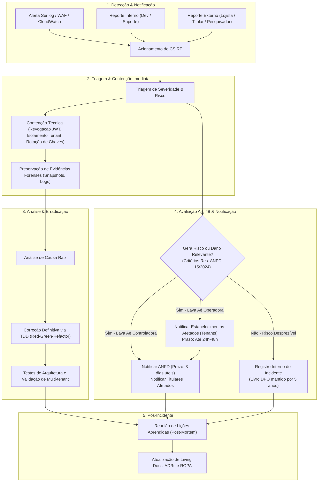
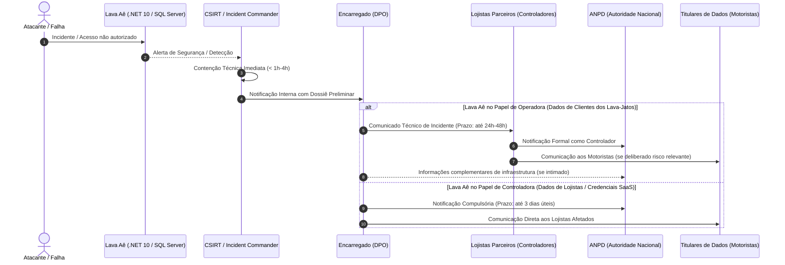

# Plano de Resposta a Incidentes de Segurança com Dados Pessoais (Art. 48 LGPD)

> **Lava Aê (Lavaway SaaS) — Plataforma de Gestão para Lava-Jatos e Estética Automotiva**  
> **Conformidade Regulatória:** Lei Federal nº 13.709/2018 (LGPD), Artigo 48 | Resolução CD/ANPD nº 15/2024 (Regulamento de Comunicação de Incidentes de Segurança)  
> **Canal Oficial do Encarregado (DPO):** `privacidade@lavaway.com.br`  
> **Canal de Emergência CSIRT (24/7):** `security@lavaway.com.br`  
> **Versão:** 1.0 — Outubro de 2026  
> **Status:** Documentação Viva (Living Documentation) versionada com a arquitetura

---

## 1. Visão Geral e Escopo

Este plano estabelece as diretrizes institucionais, operacionais e técnicas para detecção, contenção, mitigação, investigação e comunicação de incidentes de segurança da informação envolvendo dados pessoais tratados na plataforma **Lava Aê**.

Em conformidade com a arquitetura monolítica modular multi-tenant definida em [agents.md](file:///home/rony/LPR/lavaway/agents.md) e o mapeamento de papéis em [registro-operacoes-tratamento-ropa.md](file:///home/rony/LPR/lavaway/docs/lgpd/registro-operacoes-tratamento-ropa.md), o plano abrange tanto operações onde o Lava Aê atua como **Controlador** (dados de lojistas, credenciais de acesso, faturamento B2B) quanto onde atua como **Operador** (dados de clientes finais, veículos, ordens de serviço e vistorias executadas pelos estabelecimentos parceiros).

---

## 2. Comitê de Resposta a Incidentes de Segurança (CSIRT)

Em caso de suspeita ou confirmação de incidente, é convocado imediatamente o **Computer Security Incident Response Team (CSIRT)** do Lava Aê:

| Papel | Responsável | Atribuições Principais | Contato de Emergência |
| :--- | :--- | :--- | :--- |
| **DPO / Encarregado de Dados** | Líder de Privacidade | Condução jurídica, avaliação de risco aos titulares, mediação com a ANPD e redação de comunicados formais. | `privacidade@lavaway.com.br` |
| **Incident Commander (Tech Lead)** | Líder Técnico de Engenharia | Liderança operacional técnica, coordenação do isolamento, contenção e recuperação do monólito e serviços satélites. | `security@lavaway.com.br` |
| **Security / Infrastructure Lead** | Engenharia de Infra / DevOps | Auditoria forense de logs (SQL Server, Serilog, WAF, MinIO, RabbitMQ), isolamento de rede e rotação de credenciais. | `infra@lavaway.com.br` |
| **Customer Success & Suporte** | Líder de Suporte B2B | Contato direto e transparente com os administradores dos lava-jatos afetados (Tenants). | `suporte@lavaway.com.br` |

### Princípios de Comunicação do CSIRT
* **Canal Seguro Fora de Banda (Out-of-band):** Se houver suspeita de comprometimento da infraestrutura de e-mail corporativo ou chat padrão, a comunicação do CSIRT deve migrar para canal criptografado de contingência (Signal/chamada segura de voz).
* **Registro Contínuo de Linha do Tempo:** Todas as ações, timestamps em UTC, hipóteses e constatações devem ser registradas de forma imutável para a confecção do relatório forense.

---

## 3. Ciclo de Vida da Resposta a Incidentes (NIST SP 800-61 / LGPD)



---

## 4. Matriz de Severidade e Avaliação de Risco aos Titulares

A decisão de notificação à ANPD e aos titulares fundamenta-se no **Art. 48 da LGPD** e nos artigos 6º a 8º da **Resolução CD/ANPD nº 15/2024**, que definem que o incidente deve ser comunicado sempre que houver **risco ou dano relevante** aos direitos e liberdades dos titulares.

### 4.1 Critérios de Risco Relevante (Resolução CD/ANPD nº 15/2024)
Considera-se que o incidente acarreta risco relevante quando preencher cumulativamente ou isoladamente os seguintes quesitos:
1. **Natureza dos Dados:** Envolver dados sensíveis (Art. 5º, II), dados de crianças/adolescentes, dados financeiros (cartões, dados bancários de faturamento) ou dados de autenticação (hashes de senhas, segredos JWT).
2. **Volume Significativo de Titulares:** Comprometimento massivo de dados de motoristas ou lojistas.
3. **Potencial de Fraude ou Dano:** Risco concreto de furto de identidade, estelionato (engenharia social via WhatsApp utilizando placas e nomes de clientes), prejuízo financeiro ou dano moral.
4. **Violação de Confidencialidade ou Integridade Estrutural:** Acesso não autorizado a bases inteiras ou comprometimento das chaves de criptografia da base.

### 4.2 Tabela de Classificação de Severidade

| Nível | Descrição | Exemplo no Contexto Lava Aê | Prazo de Contenção | Comunicação Obrigatória |
| :--- | :--- | :--- | :--- | :--- |
| **P0 - Crítico** | Incidente massivo, vazamento de credenciais mestre, quebra de isolamento multi-tenant generalizada ou comprometimento total do banco SQL Server. | Vazamento de banco com dados de todos os lava-jatos; comprometimento da chave de assinatura JWT global; exposição pública de bucket com todas as fotos de vistoria. | < 1 hora | **Sim:** ANPD (3 dias úteis), Lojistas afetados (24h) e Titulares. |
| **P1 - Alto** | Vazamento restrito a um Tenant específico, comprometimento de chave de webhook ou credencial administrativa de um estabelecimento. | Falha de isolamento pontual que permitiu a um lojista visualizar a lista de motoristas de outro; exposição da chave da Evolution API de um tenant. | < 4 horas | **Sim:** Lojista parceiro afetado (24h); ANPD caso haja risco relevante. |
| **P2 - Médio** | Indisponibilidade temporária de segurança, tentativa de força bruta bloqueada pelo WAF, ou log acidental de PII em ambiente interno com acesso restrito. | Exibição de telefone de motorista em log do Serilog com acesso restrito à equipe técnica; timeout do serviço de expurgo de webhooks. | < 24 horas | **Não** (apenas registro interno no Livro de Incidentes do DPO, salvo reavaliação). |
| **P3 - Baixo** | Evento de segurança sem impacto em dados pessoais, falso positivo validado ou tentativa de scanning externo contida. | Varredura de portas bloqueada na borda; tentativa de injeção SQL neutralizada pelo EF Core. | < 72 horas | **Não.** |

---

## 5. Procedimentos Operacionais Padrão (SOPs) de Contenção Técnica

Em consonância com as regras de integridade de [agents.md](file:///home/rony/LPR/lavaway/agents.md), as seguintes medidas técnicas pré-aprovadas devem ser acionadas imediatamente pelo time de engenharia:

### SOP-01: Contenção de Falha de Isolamento Multi-tenant (Cross-Tenant Leakage)
1. **Identificação do Escopo:** Identificar imediatamente os `TenantId` (UUIDs) do inquilino originador e do inquilino inadvertidamente exposto.
2. **Corte de Sessões:** Revogar compulsoriamente os tokens JWT do tenant comprometido, forçando a invalidação de cache de sessão:
   ```csharp
   // Invalidar tokens emitidos antes do timestamp do incidente para o Tenant afetado
   await _tokenRevocationService.RevokeAllForTenantAsync(compromisedTenantId, DateTime.UtcNow);
   ```
3. **Isolamento de Endpoint:** Se a brecha estiver em uma API específica (ex.: endpoint sem `HasQueryFilter` ou com consulta SQL raw sem verificação de `TenantId`), acionar *Feature Flag* para desabilitar temporariamente a rota ou aplicar regra de bloqueio no WAF/Reverse Proxy.
4. **Preservação de Evidência:** Extrair snapshot dos logs do Serilog filtrados por `TenantId` e `TraceId` da requisição anômala para compor o dossiê forense.
5. **Correção TDD:** Construir teste de arquitetura/integração que reproduza a falha (`Should_Prevent_Cross_Tenant_Access()`) antes de aplicar o patch corretivo.

### SOP-02: Comprometimento de Chaves de Terceiros (WhatsApp / Gateways de Pagamento)
1. **Evolution API (WhatsApp):**
   * Acessar o painel da Evolution API e revogar a `ApiKey` da instância comprometida.
   * Gerar nova chave e atualizar a entidade criptografada `TenantWhatsAppConfig`.
   * Invalidar qualquer cache em memória do serviço `Messaging/WhatsApp`.
2. **Gateways de Pagamento (Pagar.me / Stripe):**
   * Revogar as chaves de API afetadas diretamente no dashboard do provedor.
   * Configurar novo segredo de validação de assinatura de webhook (`WebhookSecret`).
   * Auditar a tabela de log de eventos brutos de webhooks (`BillingWebhookEvents`) para verificar transações suspeitas ou consultas não autorizadas.

### SOP-03: Exposição de Mídias e Fotos de Vistoria (Bucket MinIO / S3)
1. **Revogação de Presigned URLs:**
   * Invalidar credenciais da *Access Key* utilizada para gerar assinaturas temporárias.
   * Forçar a expiração de todas as URLs públicas distribuídas nas últimas 24 horas.
2. **Auditoria de Acessos ao Bucket:**
   * Inspecionar o *Access Log* do MinIO para quantificar:
     - Quais chaves de objeto (`/inspections/{tenantId}/{vehicleId}/...`) receberam requisições `GET 200`.
     - Quantidade de IPs distintos que efetuaram download das imagens.
3. **Restrição de Política de Bucket:** Garantir que a política padrão do bucket permaneça `Private`, sem qualquer listagem pública (`GetObject` anônimo estritamente proibido).

---

## 6. Fluxo de Notificação e Prazos Compulsórios



### Prazos e Obrigações

1. **Notificação ao Lojista (quando Lava Aê for Operadora):**
   * **Prazo:** Em até **24 a 48 horas** a contar da confirmação do incidente.
   * **Objetivo:** Permitir que o lava-jato (Controlador) cumpra seus próprios deveres regulatórios e decida sobre as medidas preventivas para com seus clientes motoristas.
2. **Notificação à ANPD (quando Lava Aê for Controladora):**
   * **Prazo Regulamentar:** **3 (três) dias úteis**, contados a partir do momento em que o controlador tiver conhecimento de que o incidente acarretou risco relevante aos titulares (conforme Art. 7º da Resolução CD/ANPD nº 15/2024).
   * **Canal:** Formulário de Comunicação de Incidente de Segurança no sistema eletrônico da ANPD (Superintendência de Fiscalização).
3. **Notificação aos Titulares de Dados:**
   * **Prazo:** Sem demora injustificada, coordenado entre o DPO e o Controlador primário.
   * **Formato:** Mensagem clara, transparente, acessível por WhatsApp, e-mail ou aviso de segurança na plataforma.

---

## 7. Modelos Padronizados de Comunicação (Templates)

---

### Template 1: Notificação Preliminar de Incidente de Segurança à ANPD
* **Finalidade:** Submissão formal à ANPD pelo DPO quando o Lava Aê for o Controlador dos dados afetados ou responder solidariamente.
* **Canal:** Portal Eletrônico de Atendimento da ANPD / Sistema SEI.

```markdown
COMUNICAÇÃO DE INCIDENTE DE SEGURANÇA COM DADOS PESSOAIS
(Em conformidade com o Artigo 48 da LGPD e a Resolução CD/ANPD nº 15/2024)

1. IDENTIFICAÇÃO DO CONTROLADOR
- Razão Social: Lava Aê Tecnologia e Soluções Digitais Ltda.
- CNPJ: [CNPJ DA EMPRESA]
- Endereço da Sede: [ENDEREÇO COMPLETO]
- Encarregado pelo Tratamento de Dados Pessoais (DPO): [NOME DO DPO]
- E-mail institucional do DPO: privacidade@lavaway.com.br
- Telefone de Contato do DPO: [TELEFONE]

2. CARACTERIZAÇÃO DO INCIDENTE
- Data e hora estimada do início do incidente: [DATA/HORA UTC]
- Data e hora da detecção pelo Controlador: [DATA/HORA UTC]
- Natureza da violação: [ ] Perda [X] Acesso não autorizado [ ] Alteração [ ] Destruição
- Local/Sistema atingido: [Ex: Banco de dados SQL Server / Bucket MinIO / Módulo de Autenticação Identity]

3. CATEGORIAS E NÚMERO DE TITULARES AFETADOS
- Número aproximado de titulares envolvidos: [INFORMAR QUANTIDADE EXATA OU ESTIMADA]
- Categoria de titulares afetados: [Lojistas assinantes / Gestores de Lava-Jato / Funcionários]
- Dados pessoais comprometidos: [Ex: Nome, e-mail comercial, telefone, histórico de faturamento]
- Envolvimento de dados sensíveis ou vulneráveis: [NÃO / SIM - ESPECIFICAR]

4. MEDIDAS DE CONTENÇÃO E MITIGAÇÃO ADOTADAS
- Contenção técnica imediata: [Ex: Revogação de chaves comprometidas, isolamento de réplicas de leitura, bloqueio de IPs atacantes via WAF em DD/MM/AAAA às HH:MM]
- Correções estruturais: [Ex: Implementação de patch corretivo com testes automatizados de multi-tenancy e validação de Global Query Filter]
- Medidas de mitigação orientadas aos titulares: [Ex: Reset forçado de credenciais de acesso e orientações preventivas contra engenharia social]

5. RISCOS E POSSÍVEIS CONSEQUÊNCIAS AOS TITULARES
- Análise preliminar indica potencial de: [Ex: Risco baixo de transações indevidas, risco moderado de contatos fraudulentos via e-mail]
- Não foram expostos dados de cartão de crédito brutos (armazenamento tokenizado em conformidade com PCI-DSS).

6. COMUNICAÇÃO AOS TITULARES
- [X] Os titulares afetados já foram comunicados em [DATA] via e-mail/notificação na plataforma.
- [ ] Os titulares serão comunicados até [DATA PREVISTA].

7. INFORMAÇÕES COMPLEMENTARES
- O presente relatório reflete a apuração preliminar do CSIRT. Informações complementares serão submetidas no prazo regulamentar caso surjam novos fatos relevantes.

Data de envio: [DATA]
Assinatura: [NOME DO DPO] — Encarregado pelo Tratamento de Dados Pessoais
```

---

### Template 2: Notificação de Segurança ao Estabelecimento Parceiro (B2B — Lava Aê como Operadora)
* **Finalidade:** Comunicar o gestor/proprietário do lava-jato parceiro sobre incidente restrito aos dados de sua operação de pátio.
* **Canal:** E-mail com confirmação de leitura enviado ao contato administrativo registrado na assinatura + notificação no painel do SaaS.
* **Assunto:** `[URGENTE - SEGURANÇA LAVA AÊ] Comunicado Técnico de Segurança — Ações Adotadas e Instruções ao Estabelecimento {{NOME_ESTABELECIMENTO}}`

```markdown
Prezado(a) Gestor(a) e Administrador(a) do {{NOME_ESTABELECIMENTO}},

A equipe de Segurança da Informação e Privacidade do **Lava Aê** vem por meio deste, em estrito cumprimento às cláusulas de transparência do nosso Acordo de Processamento de Dados (DPA) e ao Artigo 48 da Lei Geral de Proteção de Dados (LGPD), comunicar formalmente um evento de segurança detectado em nossa infraestrutura.

1. RESUMO DO OCORRIDO:
No dia {{DATA_DETECCAO}} às {{HORA_DETECCAO}}, nosso sistema de monitoramento identificou uma anomalia em {{DESCRICAO_RESTRITA_DO_COMPONENTE}}. Como resultado, identificamos que dados cadastrais e de ordens de serviço tratados pelo seu estabelecimento sob nossa custódia operacional podem ter sido acessados de forma não autorizada.

2. QUAIS DADOS FORAM ENVOLVIDOS:
- Estabelecimento afetado: {{NOME_ESTABELECIMENTO}} (ID: {{TENANT_ID}})
- Registros potencialmente afetados: aproximadamente {{QUANTIDADE}} ordens de serviço e cadastros de motoristas.
- Dados pessoais identificados: {{LISTA_DADOS_EX: Placas de veículos, nomes de clientes e números de WhatsApp}}.
- **DADOS QUE NÃO FORAM AFETADOS:** Senhas de acesso, dados bancários e dados de cartão de crédito **NÃO** foram comprometidos em hipótese alguma.

3. MEDIDAS IMEDIATAS TOMADAS PELO LAVA AÊ:
- O incidente foi contido com sucesso pela nossa equipe de resposta a incidentes às {{HORA_CONTENCAO}} do mesmo dia.
- Todas as chaves e sessões de comunicação do seu estabelecimento foram renovadas automaticamente.
- Foi aplicado um patch de segurança definitivo em nossos servidores para prevenir qualquer reincidência.

4. ORIENTAÇÕES E PRÓXIMOS PASSOS:
Como seu estabelecimento é o **Controlador Primário** perante os clientes que frequentam seu lava-jato, disponibilizamos nosso time jurídico e o nosso Encarregado de Proteção de Dados (DPO) para auxiliá-lo na avaliação da necessidade de comunicação aos seus clientes e às autoridades:
- Recomendamos cautela com mensagens fraudulentas que usem indevidamente o nome de clientes.
- Nosso DPO está disponível diretamente no e-mail **privacidade@lavaway.com.br** ou pelo telefone de suporte de emergência para esclarecer quaisquer dúvidas e apoiar a sua gestão.

Reiteramos nosso compromisso inegociável com a segurança, a integridade dos dados e o sucesso do seu estabelecimento.

Atenciosamente,
**Comitê de Segurança da Informação e Privacidade**
Lava Aê Tecnologia e Soluções Digitais Ltda.
```

---

### Template 3: Comunicado de Segurança e Transparência aos Titulares de Dados (Clientes Finais / Lojistas)
* **Finalidade:** Comunicação direta a titulares em linguagem simples e empática, orientando medidas de prevenção.
* **Canal:** E-mail oficial disparado por canal confiável e/ou alerta em banner destacado no aplicativo web do Lava Aê.
* **Assunto:** `Comunicado de Segurança e Proteção aos Seus Dados — Lava Aê`

```markdown
Olá, {{NOME_TITULAR}},

No **Lava Aê**, a segurança, a confidencialidade e o respeito à sua privacidade são prioridades absolutas em todos os nossos serviços.

Escrevemos para informá-lo(a), com total transparência e em conformidade com a Lei Geral de Proteção de Dados (LGPD), sobre um evento de segurança identificado e neutralizado por nossa equipe de especialistas no dia {{DATA_INCIDENTE}}.

O QUE ACONTECEU?
Identificamos uma tentativa de acesso não autorizado aos nossos servidores que atingiu pontualmente dados associados ao seu cadastro. Nossa equipe técnica agiu de forma imediata e interrompeu o acesso poucas horas após a identificação, corrigindo a brecha de segurança de forma definitiva.

QUAIS INFORMAÇÕES FORAM ATINGIDAS?
- As informações potencialmente visualizadas foram limitadas a: {{CATEGORIAS_DADOS_EX: Nome, número de telefone e placa de veículo}}.
- **IMPORTANTE:** Nenhuma senha, dado de pagamento, código bancário ou informação financeira foi acessada ou exposta.

O QUE VOCÊ DEVE FAZER?
Você não precisa tomar nenhuma atitude complexa, mas, por medida de cautela e boas práticas de segurança, recomendamos:
1. Desconfie de mensagens que receba via WhatsApp, SMS ou e-mail em nome do Lava Aê ou de lava-jatos solicitando depósitos, Pix, códigos de validação ou senhas.
2. Nós **NUNCA** entraremos em contato solicitando sua senha ou dados de cartão de crédito.
3. Se você utiliza a mesma senha do Lava Aê em outros serviços, recomendamos que a altere como boa prática geral.

NOSSO COMPROMISSO
Já implementamos medidas técnicas de reforço e revisão em toda a nossa infraestrutura e notificamos as autoridades competentes.

Caso tenha qualquer dúvida ou deseje conversar com o nosso Encarregado de Proteção de Dados (DPO), envie uma mensagem para o e-mail: **privacidade@lavaway.com.br**.

Atenciosamente,  
**Equipe de Privacidade e Segurança da Informação**  
Lava Aê
```

---

### Template 4: Relatório Pós-Incidente (*Post-Mortem* Interno e Registro DPO)
* **Finalidade:** Dossiê interno imutável exigido para fins de auditoria, conformidade com o Art. 48 e histórico de lições aprendidas mantido por no mínimo 5 anos.
* **Local de Armazenamento:** Pasta restrita do DPO e arquivo interno de conformidade.

```markdown
RELATÓRIO DE PÓS-INCIDENTE DE SEGURANÇA (POST-MORTEM)
ID do Incidente: INC-{{ANO}}-{{NUMERO_SEQUENCIAL}}
Classificação: {{P0_CRITICO / P1_ALTO / P2_MEDIO / P3_BAIXO}}

1. DADOS GERAIS
- Data da Ocorrência: [AAAA-MM-DD HH:MM UTC]
- Data de Detecção: [AAAA-MM-DD HH:MM UTC]
- Data de Contenção Definitiva: [AAAA-MM-DD HH:MM UTC]
- Duração Total do Impacto: [X horas e Y minutos]
- Incident Commander: [NOME DO TECH LEAD]
- Encarregado DPO Responsável: [NOME DO DPO]

2. RESUMO EXECUTIVO DO INCIDENTE
[Descrição sucinta dos fatos ocorridos, vetor de ataque ou falha de configuração e escopo de sistemas impactados]

3. CAUSA RAIZ (ANÁLISE DOS 5 PORQUÊS)
- Por quê 1: [Ex: O lojista A conseguiu ver ordens de serviço do lojista B]
- Por quê 2: [Ex: A query de busca no repositório utilizou consulta personalizada sem o filtro TenantId]
- Por quê 3: [Ex: O método no Application Service não injetou o ICurrentTenantAccessor]
- Por quê 4: [Ex: Não havia teste de arquitetura específico cobrindo aquele use case de relatórios]
- Por quê 5 (Causa Raiz): [Ausência de validação obrigatória no pipeline de CI/CD para consultas que desabilitam IgnoreQueryFilters]

4. IMPACTO DETALHADO EM DADOS PESSOAIS
- Total de Titulares Afetados: [QUANTIDADE EXATA CONFIRMADA POR AUDITORIA DE LOGS]
- Tenants Afetados: [LISTA DE TENANT_IDS]
- Categorias de Dados Acessados: [LISTA DETALHADA]

5. CRONOLOGIA DETALHADA DOS FATOS (TIMELINE UTC)
- HH:MM - Evento inicial de anomalia registrado nos logs do sistema.
- HH:MM - Alerta disparado e triagem inicial pelo engenheiro de plantão.
- HH:MM - CSIRT convocado e ativação do procedimento de contenção.
- HH:MM - Contenção técnica aplicada (corte de rotas / rotação de chaves).
- HH:MM - Patch corretivo desenvolvido com teste TDD em branch de emergência.
- HH:MM - Deploy de hotfix concluído em produção e validação de estabilidade.
- HH:MM - Envio de notificações regulamentares aos lojistas e ANPD.

6. AÇÕES PREVENTIVAS E CORRETIVAS DEFINITIVAS
| ID da Ação | Descrição da Melhoria Técnica / Processual | Responsável | Prazo | Status |
| :--- | :--- | :--- | :--- | :--- |
| ACT-01 | Criar teste de arquitetura (NetArchTest) validando a injeção compulsória de IMustHaveTenant no novo endpoint | Engenharia | D+2 dias | Concluído |
| ACT-02 | Revisar rotinas de expurgo de logs no Serilog e mascaramento de PII | DevOps | D+5 dias | Em andamento |
| ACT-03 | Atualização da Matriz ROPA com novas regras de auditoria | DPO | D+7 dias | Concluído |

7. PARECER FINAL DO DPO
[Avaliação sobre encerramento do incidente, cumprimento dos prazos regulamentares da Resolução ANPD 15/2024 e arquivamento do dossiê no Livro de Incidentes]
```

---

## 8. Treinamento, Testes de Simulação (*Tabletop Exercises*) e Auditoria

1. **Simulações Periódicas (*Tabletop Exercises*):**
   * O CSIRT deve realizar no mínimo **1 (uma) simulação semestral** de incidente de segurança envolvendo os cenários de vazamento de tenant e comprometimento de instâncias do WhatsApp.
   * O exercício avalia o tempo de resposta, a clareza dos papéis e a eficácia das notificações.
2. **Auditoria de Conformidade e Versionamento:**
   * Qualquer alteração na infraestrutura do SaaS que introduza novos subprocessadores de dados (gateways, clouds, provedores de IA) exige a revisão imediata deste plano e do ROPA ([registro-operacoes-tratamento-ropa.md](file:///home/rony/LPR/lavaway/docs/lgpd/registro-operacoes-tratamento-ropa.md)).
   * Este documento constitui living documentation versionada junto ao código-fonte, nos termos do item 9 de [agents.md](file:///home/rony/LPR/lavaway/agents.md).
