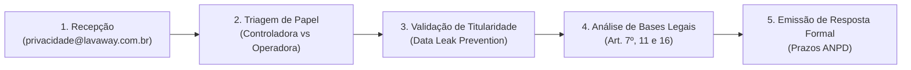

# Playbook Operacional do DPO: Atendimento a Requisições de Titulares (LGPD)

> **Lava Aê (Lavaway SaaS) — Canal do Encarregado de Proteção de Dados (Art. 41)**  
> **E-mail Oficial:** `privacidade@lavaway.com.br`  
> **Versão:** 1.0 — Outubro de 2026  
> **Classificação:** Documento Operacional e de Governança Interna / Living Documentation

---

## 1. Objetivo e Procedimento Operacional Padrão (SOP)

Este playbook orienta a equipe de atendimento, suporte técnico e o **Encarregado pelo Tratamento de Dados Pessoais (DPO)** do **Lava Aê** na recepção, triagem, validação de identidade e resposta formal a solicitações de exercício de direitos fundamentais por titulares de dados (Art. 18 da Lei Federal nº 13.709/2018 — LGPD).

### 1.1 Fluxo de Atendimento em 5 Etapas



1. **Recepção:** Solicitação protocolada via canal oficial (`privacidade@lavaway.com.br` ou canal `/dpo`). O protocolo deve registrar timestamp UTC, e-mail de origem e teor do pedido.
2. **Triagem de Papel:**
   * **Titular Lojista / Gestor (Lava Aê = Controladora):** Contas de acesso SaaS, faturamento de assinaturas, logs de acesso à plataforma.
   * **Titular Motorista / Cliente Final (Lava Aê = Operadora):** Ordens de serviço, veículos, histórico de lavagem, fotos de vistoria e contatos no WhatsApp. Cada estabelecimento lava-jato é o **Controlador**.
3. **Validação de Titularidade (Prevenção de Engenharia Social / Phishing):**
   * Antes de divulgar qualquer informação pessoal, o titular deve comprovar a titularidade do e-mail ou do telefone cadastrado (envio de código de validação, resposta a partir do e-mail cadastrado na conta ou confirmação de dados cadastrais essenciais).
4. **Análise de Bases Legais e Prazos de Retenção:**
   * Não atender pedidos de exclusão quando houver obrigação legal ou regulatória de retenção (ex.: 5 anos para OS e notas fiscais pelo CDC Art. 27 e legislação tributária; 6 meses para logs de conexão pelo Marco Civil da Internet Art. 15).
5. **Emissão de Resposta Formal nos Prazos da ANPD:**
   * **Resposta Simplificada:** Fornecida de imediato ou em até 48 horas, informando a existência ou não de tratamento.
   * **Declaração Clara e Completa:** Fornecida no prazo de até **15 (quinze) dias corridos** a contar da data do requerimento.

---

## 2. Modelos Padronizados de Resposta

---

### Template 1: Confirmação de Recebimento e Validação de Identidade (Triagem Anti-Fraude)
* **Quando utilizar:** Como primeira resposta a qualquer solicitação que demande acesso, alteração ou exclusão de dados pessoais, para garantir que o solicitante é de fato o titular.
* **Assunto:** `[Lava Aê - Privacidade] Protocolo {{PROTOCOLO}}: Confirmação de Recebimento de Solicitação LGPD`

```markdown
Prezado(a) {{NOME_SOLICITANTE}},

Confirmamos o recebimento de sua solicitação referente aos seus direitos de privacidade e proteção de dados pessoais sob a LGPD (Lei Federal nº 13.709/2018), registrada sob o protocolo número **{{NUMERO_PROTOCOLO}}**.

Para proteger seus dados contra acessos não autorizados e garantir a sua segurança (em conformidade com o Art. 18, § 1º da LGPD e medidas de segurança da informação), precisamos confirmar que esta solicitação foi efetivamente realizada pelo legítimo titular dos dados.

Por gentileza, responda a esta mensagem fornecendo as seguintes confirmações:
1. Confirmação do e-mail ou telefone cadastrado na plataforma ou no estabelecimento parceiro;
2. Se você é um cliente motorista, informe a placa do veículo associado ao seu atendimento e o nome do Lava-Jato onde o serviço foi realizado;
3. Se você é um lojista parceiro, informe o CNPJ ou razão social da sua conta.

**Atenção:** Nossa equipe **NUNCA** solicitará senhas de acesso, códigos de autenticação SMS/WhatsApp ou dados de cartão de crédito para atender à sua solicitação.

Assim que confirmarmos sua titularidade, seu pedido será processado dentro dos prazos legais estabelecidos pela Autoridade Nacional de Proteção de Dados (ANPD) — até 15 (quinze) dias corridos para declarações completas.

Atenciosamente,

**Encarregado pelo Tratamento de Dados Pessoais (DPO)**  
Lava Aê Tecnologia & Plataforma SaaS  
Canal Oficial: privacidade@lavaway.com.br  
https://lavaway.com.br/dpo
```

---

### Template 2: Resposta Imediata / Simplificada de Existência de Tratamento (Art. 18, I)
* **Quando utilizar:** Em até 48 horas após a confirmação de identidade, para atestar que os dados existem ou inexistem na plataforma.
* **Assunto:** `[Lava Aê - Privacidade] Protocolo {{PROTOCOLO}}: Confirmação de Existência de Tratamento de Dados`

```markdown
Prezado(a) {{NOME_SOLICITANTE}},

Em resposta à sua solicitação protocolada sob o nº **{{NUMERO_PROTOCOLO}}**, informamos de forma simplificada, nos termos do Art. 19, I da LGPD (Lei Federal nº 13.709/2018), que:

[Opção A - DADOS ENCONTRADOS:]
Confirmamos que o Lava Aê mantém em suas bases cadastrais dados pessoais vinculados à sua titularidade, utilizados para a finalidade de:
- {{FINALIDADES_IDENTIFICADAS: ex.: Gestão de conta SaaS como lojista parceiro / Execução de Ordem de Serviço pelo estabelecimento parceiro {{NOME_LOJA}}}}.
Caso deseje receber a Declaração Clara e Completa com o dossiê detalhado (origem, compartilhamentos e critérios de armazenamento), sua emissão ocorrerá em até 15 (quinze) dias corridos a partir desta data.

[Opção B - DADOS INEXISTENTES:]
Após busca criteriosa em nossos sistemas pelo e-mail e CPF/telefone informados, **NÃO** localizamos nenhum registro ou dado pessoal sob nossa custódia ativo ou histórico.

Permanecemos à disposição para eventuais esclarecimentos adicionais.

Atenciosamente,

**Encarregado pelo Tratamento de Dados Pessoais (DPO)**  
Lava Aê Tecnologia & Plataforma SaaS  
privacidade@lavaway.com.br
```

---

### Template 3: Atendimento Integral — Declaração Completa / Dossiê do Titular (Art. 18, II, IV e V)
* **Quando utilizar:** Envio formal do relatório estruturado de dados em até 15 dias da validação.
* **Assunto:** `[Lava Aê - Privacidade] Protocolo {{PROTOCOLO}}: Declaração Completa de Dados Pessoais (Art. 18 da LGPD)`

```markdown
Prezado(a) {{NOME_SOLICITANTE}},

Em cumprimento ao Art. 19, II da Lei Federal nº 13.709/2018 (LGPD) e dando seguimento ao protocolo **{{NUMERO_PROTOCOLO}}**, apresentamos a **Declaração Clara e Completa** acerca do tratamento de seus dados pessoais na plataforma Lava Aê:

### 1. Dados Pessoais Tratados
- **Identificação Cadastral:** {{NOME}}, {{TELEFONE}}, {{EMAIL}}.
- **Dados Operacionais / Veiculares:** Placa(s) {{PLACAS}}, Marca/Modelo {{VEICULOS}}.
- **Histórico de Serviços:** {{QUANTIDADE_OS}} ordens de serviço registradas entre {{DATA_INICIO}} e {{DATA_FIM}}.

### 2. Origem dos Dados
Os dados foram coletados diretamente no momento da abertura do cadastro ou da emissão da ordem de serviço para a realização dos serviços contratados.

### 3. Finalidade e Base Legal (Art. 7º da LGPD)
- **Execução do Contrato de Prestação de Serviços (Art. 7º, V):** Necessário para a execução da lavagem automotiva, contato sobre o status do veículo e emissão de comprovantes.
- **Cumprimento de Obrigação Legal e Regulatória (Art. 7º, II):** Guarda de registros fiscais e ordens de serviço por 5 anos (Código de Defesa do Consumidor, Art. 27).
- **Legítimo Interesse (Art. 7º, IX):** Vistoria digital com fotos de entrada para resguardo contra avarias pré-existentes e envio de pesquisas de satisfação de pós-venda (com opção de opt-out).

### 4. Compartilhamento com Terceiros
- **Provedor de Infraestrutura e Nuvem:** Armazenamento seguro de dados e imagens com criptografia em repouso e em trânsito.
- **Provedor de Mensageria:** Gateway oficial de envio de mensagens de prontidão de veículo via WhatsApp.
- **Intermediador de Pagamento:** Processamento seguro de pagamentos e Pix sem armazenamento de dados de cartão em nossos servidores.

### 5. Portabilidade dos Dados (Art. 18, V)
Em anexo a este e-mail, disponibilizamos o seu **Dossiê Digital em formato estruturado e interoperável (JSON / PDF seguro)** para uso ou transferência conforme sua conveniência.

Atenciosamente,

**Encarregado pelo Tratamento de Dados Pessoais (DPO)**  
Lava Aê Tecnologia & Plataforma SaaS  
privacidade@lavaway.com.br
```

---

### Template 4: Solicitação de Cliente Final / Motorista (Lava Aê como Operadora — Art. 39 c/c Art. 41)
* **Quando utilizar:** Quando um cliente motorista solicita ao Lava Aê a alteração ou exclusão de dados mantidos por um lava-jato específico.
* **Assunto:** `[Lava Aê - Privacidade] Protocolo {{PROTOCOLO}}: Esclarecimento sobre Papéis e Encaminhamento ao Estabelecimento Controlador`

```markdown
Prezado(a) {{NOME_SOLICITANTE}},

Recebemos sua manifestação através do nosso canal oficial de privacidade sob o protocolo **{{NUMERO_PROTOCOLO}}**, solicitando providências a respeito de seus dados associados ao veículo de placa **{{PLACA}}**.

Gostaríamos de prestar um esclarecimento importante sobre a nossa atuação:
O **Lava Aê** é uma empresa de tecnologia fornecedora da plataforma de software utilizada pelos estabelecimentos de lava-jato e estética automotiva. Nos termos do Art. 5º, VII e IX da LGPD:
- O **Lava-Jato onde você realizou o serviço ({{NOME_ESTABELECIMENTO}})** atua na qualidade de **Controlador**, sendo o responsável exclusivo por definir quais serviços foram prestados, emitir notas fiscais e autorizar alterações cadastrais.
- A plataforma **Lava Aê** atua exclusivamente como **Operadora**, realizando o processamento e a custódia técnica e segura desses registros a mando do estabelecimento.

### Providências Adotadas:
1. Notificamos formalmente a administração do estabelecimento parceiro **{{NOME_ESTABELECIMENTO}}** a respeito do seu pedido, com prazo prioritário de retorno.
2. Caso o estabelecimento aprove a anonimização de seu cadastro, a funcionalidade do Lava Aê ocultará de forma irreversível seu nome e telefone, desvinculando seu veículo daquele histórico pessoal, ressalvando unicamente a guarda das ordens de serviço para fins de garantia legal (conforme Art. 16, I da LGPD).

Caso prefira entrar em contato direto com a gerência do estabelecimento, você também pode solicitar a anonimização presencialmente ou pelo canal de contato do local.

Permanecemos acompanhando o protocolo até sua conclusão.

Atenciosamente,

**Encarregado pelo Tratamento de Dados Pessoais (DPO)**  
Lava Aê Tecnologia & Plataforma SaaS  
privacidade@lavaway.com.br
```

---

### Template 5: Deferimento de Anonimização / Eliminação com Ressalva de Retenção Legal (Art. 16 e 18, VI)
* **Quando utilizar:** Quando a anonimização for executada no sistema, esclarecendo que registros contábeis e fiscais são retidos por força de lei.
* **Assunto:** `[Lava Aê - Privacidade] Protocolo {{PROTOCOLO}}: Conclusão de Anonimização de Dados Pessoais (Art. 18, VI da LGPD)`

```markdown
Prezado(a) {{NOME_SOLICITANTE}},

Informamos que, em atendimento à sua requisição protocolada sob o nº **{{NUMERO_PROTOCOLO}}**, foi concluído o processo de **Anonimização Irreversível** de seus dados pessoais em nossos sistemas de acordo com o Art. 18, VI da LGPD (Lei nº 13.709/2018).

### Detalhamento das Ações Realizadas:
1. **Identificação Pessoal:** Seu nome foi substituído pelo identificador neutro `"Cliente Anonimizado (LGPD)"`.
2. **Telefone e E-mail:** Foram removidos das bases de contato e substituídos por hash criptográfico irreversível, impedindo contatos futuros ou reidentificação.
3. **Preferências e Mensageria:** Suas preferências foram revogadas e excluídas de todas as filas de envio de mensagens e campanhas de reativação via WhatsApp.
4. **Vínculo Veicular:** O veículo cadastrado foi desvinculado de seu perfil, permitindo que eventuais novos proprietários realizem serviços futuros sem qualquer menção aos seus dados pessoais.

### Ressalva Legal Obrigatória de Conservação (Art. 16, I da LGPD):
Esclarecemos que os registros de datas de atendimento, valores financeiros e serviços executados em Ordens de Serviço (OS) anteriores foram mantidos sob anonimização sem dados pessoais diretos, em estrito cumprimento às obrigações legais e tributárias brasileiras e ao Art. 27 do Código de Defesa do Consumidor (prazo prescricional de 5 anos para comprovação de prestação de serviços).

Agradecemos a confiança e estamos à disposição para qualquer dúvida remanescente.

Atenciosamente,

**Encarregado pelo Tratamento de Dados Pessoais (DPO)**  
Lava Aê Tecnologia & Plataforma SaaS  
privacidade@lavaway.com.br
```

---

### Template 6: Indeferimento Justificado / Oposição Improcedente
* **Quando utilizar:** Quando o pedido não puder ser atendido em razão de base legal concorrente (Art. 16 da LGPD, defesa judicial ou vigência contratual).
* **Assunto:** `[Lava Aê - Privacidade] Protocolo {{PROTOCOLO}}: Informação sobre Solicitação de Exclusão de Dados`

```markdown
Prezado(a) {{NOME_SOLICITANTE}},

Reportamo-nos à sua solicitação registrada sob o protocolo nº **{{NUMERO_PROTOCOLO}}**, na qual foi requerida a exclusão imediata de todos os registros e dados mantidos em nossa plataforma.

Após cuidadosa análise jurídica e técnica, informamos que **não foi possível proceder com a exclusão integral imediata** de determinados registros, pelos seguintes fundamentos jurídicos:

- **Impossibilidade Legal:** O Art. 16 da Lei nº 13.709/2018 (LGPD) autoriza e determina expressamente a conservação de dados pessoais, mesmo após o pedido de eliminação, para as hipóteses de:
  - *I - cumprimento de obrigação legal ou regulatória pelo controlador* (legislação fiscal, contábil e prazos prescricionais do Código de Defesa do Consumidor);
  - *II - estudo por órgão de pesquisa (garantida a anonimização);*
  - *IV - uso exclusivo do controlador, vedado seu acesso por terceiro, e desde que anonimizados os dados.*

Dessa forma, enquanto subsistir a vigência contratual ou o prazo prescricional de responsabilidade civil/tributária, os registros estritamente necessários serão conservados sob estrito sigilo e acesso restrito, não sendo utilizados para nenhuma outra finalidade operacional ou de marketing.

Caso discorde deste posicionamento, resguardamos seu direito de submeter a questão à Autoridade Nacional de Proteção de Dados (ANPD).

Atenciosamente,

**Encarregado pelo Tratamento de Dados Pessoais (DPO)**  
Lava Aê Tecnologia & Plataforma SaaS  
privacidade@lavaway.com.br
```

---

### Template 7: Confirmação de Revogação de Consentimento e Opt-Out de WhatsApp (Art. 18, IX)
* **Quando utilizar:** Quando o cliente solicitar a interrupção imediata de mensagens promocionais ou de pós-venda.
* **Assunto:** `[Lava Aê - Privacidade] Protocolo {{PROTOCOLO}}: Confirmação de Opt-Out / Revogação de Mensagens no WhatsApp`

```markdown
Prezado(a) {{NOME_SOLICITANTE}},

Confirmamos que a sua solicitação de **Revogação de Consentimento / Opt-Out** para o recebimento de mensagens promocionais, pesquisas de pós-venda e lembretes de retorno via WhatsApp (protocolo **{{NUMERO_PROTOCOLO}}**) foi processada com sucesso.

### Efeitos Imediatos:
- Seu número de telefone **{{TELEFONE}}** foi marcado com preferência de **bloqueio total de comunicações de marketing** no módulo de mensageria da plataforma.
- Você não receberá mais disparos de campanhas de reativação ou ofertas promocionais.

**Nota Operacional:** Caso você contrate um novo serviço de lavagem no estabelecimento no futuro, receberá exclusivamente as notificações estritamente essenciais para a execução do serviço (como o aviso de que seu veículo está pronto para retirada), com base na execução do contrato de serviço (Art. 7º, V da LGPD).

Você pode reativar suas preferências a qualquer momento entrando em contato conosco ou solicitando ao atendente do estabelecimento parceiro.

Atenciosamente,

**Encarregado pelo Tratamento de Dados Pessoais (DPO)**  
Lava Aê Tecnologia & Plataforma SaaS  
privacidade@lavaway.com.br
```

---

## 3. Registro e Auditoria de Solicitações (DSR Log)

Todas as solicitações recebidas devem ser registradas no livro de registros de solicitações de privacidade (DSR Registry), contendo:
* ID do Protocolo (UUID sequencial).
* Timestamp de abertura e timestamp de fechamento (para auditoria de SLA dos 15 dias).
* Canal de entrada.
* Papel do Titular (Lojista / Motorista).
* Tipo de Direito Exercido (Art. 18).
* Template utilizado e comprovação de anonimização/resposta.
