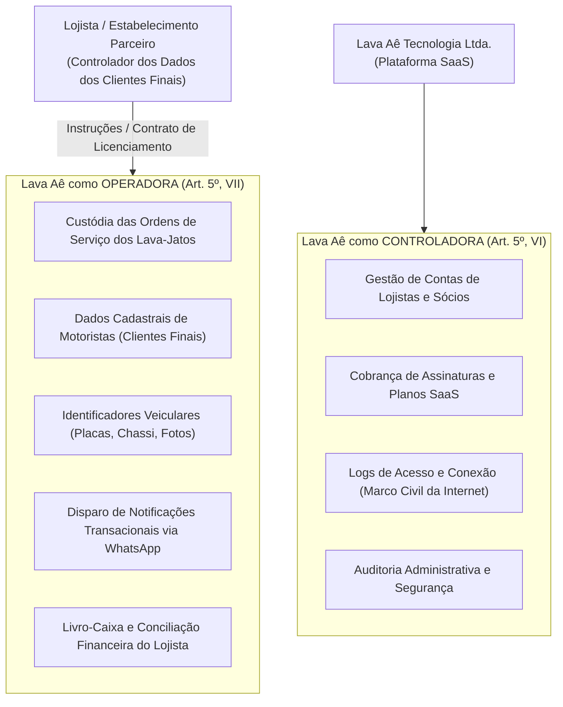
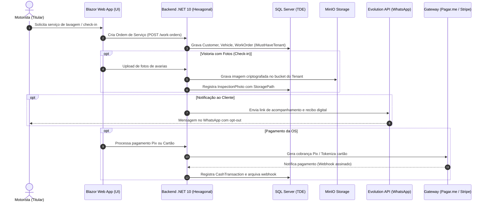
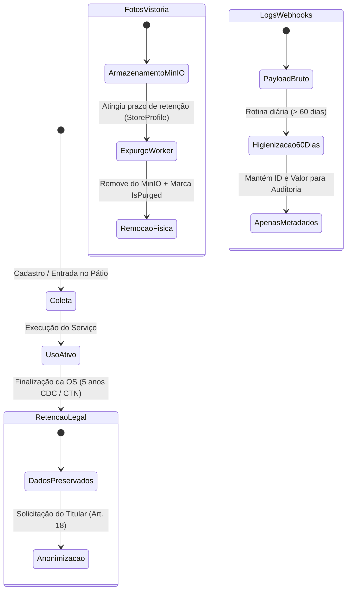

# Registro das Operações de Tratamento de Dados Pessoais (ROPA — Art. 37 LGPD)

> **Lava Aê (Lavaway SaaS) — Plataforma de Gestão para Lava-Jatos e Estética Automotiva**  
> **Conformidade Regulatória:** Lei Geral de Proteção de Dados (Lei Federal nº 13.709/2018 — LGPD), Artigo 37  
> **Canal Oficial do Encarregado (DPO):** `privacidade@lavaway.com.br`  
> **Versão:** 1.0 — Outubro de 2026  
> **Status:** Documentação Viva (Living Documentation) versionada com a arquitetura

---

## 1. Identificação dos Agentes de Tratamento

O **Lava Aê** opera sob um modelo de negócio B2B2C (*Software as a Service* multi-tenant). Para fins de aplicação da LGPD, os papéis exercidos dividem-se em duas esferas jurídicas e operacionais estritas:

### 1.1 Controlador
* **Para dados da relação B2B (Lojistas, Sócios, Faturamento SaaS, Logs da Aplicação):**  
  **Razão Social:** Lava Aê Tecnologia e Soluções Digitais Ltda.  
  **Papel:** Controladora de Dados.  
  **Contato:** `contato@lavaway.com.br` | `privacidade@lavaway.com.br`.

* **Para dados de clientes finais (Motoristas, Veículos, Histórico de Serviços de cada estabelecimento):**  
  **Controlador Primário:** Cada lava-jato ou estética automotiva assinante do SaaS (Tenant).  
  **Papel:** Controlador autônomo perante os motoristas atendidos em seu pátio.

### 1.2 Operador
* **Para a infraestrutura e software de gestão dos pátios:**  
  **Razão Social:** Lava Aê Tecnologia e Soluções Digitais Ltda.  
  **Papel:** Operadora de Dados, atuando estritamente sob as diretrizes do contrato de prestação de serviços e Acordo de Processamento de Dados (DPA) firmado com os lojistas.

### 1.3 Encarregado pelo Tratamento de Dados Pessoais (DPO)
* **Canal Centralizado:** `privacidade@lavaway.com.br`  
* **Playbook Operacional:** [playbook-dpo-respostas-titulares.md](file:///home/rony/LPR/lavaway/docs/lgpd/playbook-dpo-respostas-titulares.md)  
* **Atribuições:** Art. 41 da LGPD, mediação com titulares, comunicação com a ANPD e monitoramento de conformidade do monólito modular.

---

## 2. Topologia do Sistema e Medidas Técnicas de Segurança (Art. 46)

Em conformidade com [agents.md](file:///home/rony/LPR/lavaway/agents.md), todas as operações de dados no backend residem em um **Monolito Modular (.NET 10)** com **Arquitetura Hexagonal** e banco único no **Microsoft SQL Server**, aplicando os seguintes controles técnicos:

1. **Isolamento Multi-Tenant Inegociável:** Todas as tabelas que contêm dados de clientes e operações operam sobre a interface `IMustHaveTenant` e possuem **Global Query Filters** automáticos no EF Core (`e.TenantId == _currentTenantAccessor.TenantId`). O `SaveChangesAsync` injeta compulsoriamente o identificador, eliminando qualquer risco de vazamento cruzado (*cross-tenant data leak*).
2. **Identificadores UUID (Guid v4/v7):** Toda chave primária de entidade é gerada no domínio como `Guid`, prevenindo vulnerabilidades de enumeração seqüencial e *Insecure Direct Object Reference* (IDOR).
3. **Criptografia em Repouso (TDE):** Banco de produção protegido por *Transparent Data Encryption* (TDE) no SQL Server.
4. **Criptografia de Segredos de Terceiros:** Chaves de API da Evolution API, Pagar.me e Stripe são armazenadas cifradas na base (`TenantWhatsAppConfig`, `TenantPaymentGatewayConfig`).
5. **Observabilidade Sanitizada:** Provedores de log (Serilog) e tracing (OpenTelemetry) aplicam mascaramento compulsório de PII (telefones, e-mails, placas e tokens).
6. **Mídias Segregadas no MinIO:** Armazenamento de fotos de vistorias com caminhos estruturados por tenant e pré-assinados com expiração temporal (`ITenantObjectStorage`).

---

## 3. Inventário Detalhado das Operações de Tratamento (Matriz ROPA)

A tabela abaixo descreve exaustivamente os fluxos de tratamento mapeados no código-fonte da aplicação.

### 3.1 Módulo: Identity & Autenticação (CarWashSaaS.Identity)
* **Papel do SaaS:** Controladora

| Código | Operação / Finalidade | Entidades / Código | Titulares | Dados Pessoais Tratados | Base Legal (Art. 7º LGPD) | Prazos de Retenção | Compartilhamento / Subprocessadores |
| :--- | :--- | :--- | :--- | :--- | :--- | :--- | :--- |
| **ROPA-ID-01** | Autenticação, emissão de JWT e controle de sessões administrativas | [PlatformUser.cs](file:///home/rony/LPR/lavaway/src/Backend/Modules/Identity/CarWashSaaS.Identity.Domain/PlatformUser.cs), [RefreshToken.cs](file:///home/rony/LPR/lavaway/src/Backend/Modules/Identity/CarWashSaaS.Identity.Domain/RefreshToken.cs) | Lojistas, Sócios e Administradores | Nome completo, e-mail, hash de senha criptografada (Argon2/Identity), número de telefone | **Art. 7º, V** (Execução de Contrato de Licença de Software) | Vigência do contrato de assinatura + 5 anos após cancelamento (prescrição cível) | Banco SQL Server (produção). Não há compartilhamento externo. |
| **ROPA-ID-02** | Registro de trilha de auditoria e segurança contra invasões | [AdministrativeAuditEvent.cs](file:///home/rony/LPR/lavaway/src/Backend/Modules/Identity/CarWashSaaS.Identity.Domain/AdministrativeAuditEvent.cs) | Usuários do sistema e atendentes | Endereço IP, User-Agent, carimbo de data/hora (UTC), ID do usuário e ação executada | **Art. 7º, II** (Cumprimento de Obrigação Legal — Marco Civil da Internet, Art. 15) | Mínimo de 6 meses (Art. 15 da Lei 12.965/2014); máximo de 3 anos | Banco SQL Server e logs Serilog particionados. |

---

### 3.2 Módulo: Gestão de Lojas & Tenants (CarWashSaaS.Tenants)
* **Papel do SaaS:** Controladora

| Código | Operação / Finalidade | Entidades / Código | Titulares | Dados Pessoais Tratados | Base Legal (Art. 7º LGPD) | Prazos de Retenção | Compartilhamento / Subprocessadores |
| :--- | :--- | :--- | :--- | :--- | :--- | :--- | :--- |
| **ROPA-TN-01** | Cadastro de estabelecimento, perfil institucional e parametrização | [Tenant.cs](file:///home/rony/LPR/lavaway/src/Backend/Modules/Tenants/CarWashSaaS.Tenants.Domain/Tenant.cs), [StoreProfile.cs](file:///home/rony/LPR/lavaway/src/Backend/Modules/Tenants/CarWashSaaS.Tenants.Domain/StoreProfile.cs) | Titulares de lava-jatos (pessoas físicas ou sócios de PJ) | Nome empresarial, nome fantasia, CPF/CNPJ, e-mail de contato, telefone comercial, endereço físico completo | **Art. 7º, V** (Execução de Contrato) e **Art. 7º, II** (Obrigações fiscais e societárias) | Vigência do contrato + 5 anos fiscais (Art. 173 do Código Tributário Nacional) | Gateways de pagamento (Pagar.me/Stripe) para faturamento SaaS e emissão de notas. |

---

### 3.3 Módulo: Operações de Pátio & Ordens de Serviço (CarWashSaaS.YardOperations)
* **Papel do SaaS:** Operadora (sob comando e responsabilidade do Tenant Controlador)

| Código | Operação / Finalidade | Entidades / Código | Titulares | Dados Pessoais Tratados | Base Legal (Art. 7º LGPD) | Prazos de Retenção | Compartilhamento / Subprocessadores |
| :--- | :--- | :--- | :--- | :--- | :--- | :--- | :--- |
| **ROPA-YD-01** | Abertura de Ordem de Serviço, agendamento e identificação do cliente no pátio | [Customer.cs](file:///home/rony/LPR/lavaway/src/Backend/Modules/YardOperations/CarWashSaaS.YardOperations.Domain/Customer.cs), [Vehicle.cs](file:///home/rony/LPR/lavaway/src/Backend/Modules/YardOperations/CarWashSaaS.YardOperations.Domain/Vehicle.cs), [WorkOrder.cs](file:///home/rony/LPR/lavaway/src/Backend/Modules/YardOperations/CarWashSaaS.YardOperations.Domain/WorkOrder.cs) | Motoristas / Proprietários de Veículos | Nome, telefone (com normalização DDD/DDI), placa do veículo, marca, modelo, cor e ano | **Art. 7º, V** (Execução de Contrato de Prestação de Serviços Automotivos entre o motorista e o Lava-Jato) | 5 anos para histórico de OS e garantias (Art. 27 do Código de Defesa do Consumidor — CDC). Suporte a anonimização antecipada do titular via [Customer.cs](file:///home/rony/LPR/lavaway/src/Backend/Modules/YardOperations/CarWashSaaS.YardOperations.Domain/Customer.cs#L28-L35). | Evolution API (para envio do comprovante digital da OS e aviso de prontidão via WhatsApp). |
| **ROPA-YD-02** | Vistoria de entrada e registro de avarias pré-existentes (Check-in) | [VehicleInspection.cs](file:///home/rony/LPR/lavaway/src/Backend/Modules/YardOperations/CarWashSaaS.YardOperations.Domain/VehicleInspection.cs), [InspectionPhoto.cs](file:///home/rony/LPR/lavaway/src/Backend/Modules/YardOperations/CarWashSaaS.YardOperations.Domain/InspectionPhoto.cs), [InspectionDamage.cs](file:///home/rony/LPR/lavaway/src/Backend/Modules/YardOperations/CarWashSaaS.YardOperations.Domain/InspectionDamage.cs) | Motoristas e Proprietários | Fotos de alta resolução do veículo (lataria, rodas, vidros), placa aparente e apontamentos de danos | **Art. 7º, IX** (Legítimo Interesse do Lava-Jato e Proteção contra Falsas Acusações) e **Art. 7º, V** (Execução do Contrato) | **Expurgo automatizado:** Conforme configurado em [StoreProfile.InspectionPhotoRetentionDays](file:///home/rony/LPR/lavaway/src/Backend/Modules/Tenants/CarWashSaaS.Tenants.Domain/StoreProfile.cs#L62) (padrão: 90 dias, teto: 365 dias). Binários removidos do MinIO e marcados como `IsPurged = true`. | MinIO Object Storage (hospedagem privada de objetos binários). |
| **ROPA-YD-03** | Fotos comprobatórias de conclusão de serviço (Check-out) | [PostServicePhoto.cs](file:///home/rony/LPR/lavaway/src/Backend/Modules/YardOperations/CarWashSaaS.YardOperations.Domain/PostServicePhoto.cs) | Motoristas | Fotos de visualização do resultado final do serviço (brilho, acabamento) | **Art. 7º, IX** (Legítimo Interesse / Prestação de Contas) | Mesma política do ciclo de retenção de fotos da vistoria (expurgo no MinIO após prazo configurado). | MinIO Object Storage e Evolution API (quando enviadas no encerramento da OS). |
| **ROPA-YD-04** | Gestão de equipe, cálculo de comissões e atribuição de serviços | [TeamMember.cs](file:///home/rony/LPR/lavaway/src/Backend/Modules/YardOperations/CarWashSaaS.YardOperations.Domain/TeamMember.cs), [CommissionRule.cs](file:///home/rony/LPR/lavaway/src/Backend/Modules/YardOperations/CarWashSaaS.YardOperations.Domain/CommissionRule.cs) | Funcionários, Lavadores e Polidores | Nome, telefone, e-mail, função exercida, percentuais de comissão e total de serviços realizados | **Art. 7º, V** (Contrato de Trabalho / Prestação de Serviços) e **Art. 7º, II** (Obrigações Trabalhistas) | Vigência do vínculo trabalhista + 5 anos (prescrição trabalhista — Art. 7º, XXIX da CF/88). | Relatórios internos do Tenant. Sem subprocessamento externo. |
| **ROPA-YD-05** | Programa de fidelidade e pontuação por lavagens | [CustomerLoyaltyAccount.cs](file:///home/rony/LPR/lavaway/src/Backend/Modules/YardOperations/CarWashSaaS.YardOperations.Domain/CustomerLoyaltyAccount.cs), [LoyaltyTransaction.cs](file:///home/rony/LPR/lavaway/src/Backend/Modules/YardOperations/CarWashSaaS.YardOperations.Domain/LoyaltyTransaction.cs) | Motoristas cadastrados no programa | Identificador do cliente, saldo de pontos acumulados, histórico de transações de resgate | **Art. 7º, V** (Regulamento de Fidelidade / Execução Contratual) | Vinculado à conta do cliente; cancelado imediatamente em caso de solicitação de revogação/anonimização. | Sem compartilhamento externo. |
| **ROPA-YD-06** | Campanhas de reativação e mensagens a clientes inativos | [ReactivationCampaignRule.cs](file:///home/rony/LPR/lavaway/src/Backend/Modules/YardOperations/CarWashSaaS.YardOperations.Domain/ReactivationCampaignRule.cs), [ReactivationCampaignLog.cs](file:///home/rony/LPR/lavaway/src/Backend/Modules/YardOperations/CarWashSaaS.YardOperations.Domain/ReactivationCampaignLog.cs) | Clientes ausentes há mais de 30/60/90 dias | Nome do cliente, telefone, data da última visita, mensagem promocional enviada | **Art. 7º, IX** (Legítimo Interesse com salvaguarda de Opt-Out imediato) | Logs de envio mantidos por 180 dias; preferências de recusa (Opt-Out) mantidas em caráter permanente para bloqueio. | Provedor de mensageria Evolution API (WhatsApp). |

---

### 3.4 Módulo: Financeiro & Cobrança (CarWashSaaS.Billing)
* **Papel do SaaS:** Híbrido (Controladora no faturamento SaaS; Operadora nas transações do pátio)

| Código | Operação / Finalidade | Entidades / Código | Titulares | Dados Pessoais Tratados | Base Legal (Art. 7º LGPD) | Prazos de Retenção | Compartilhamento / Subprocessadores |
| :--- | :--- | :--- | :--- | :--- | :--- | :--- | :--- |
| **ROPA-BL-01** | Faturamento e cobrança de mensalidades dos planos do SaaS | [TenantSaasSubscription.cs](file:///home/rony/LPR/lavaway/src/Backend/Modules/Billing/CarWashSaaS.Billing.Domain/TenantSaasSubscription.cs), [SaasInvoice.cs](file:///home/rony/LPR/lavaway/src/Backend/Modules/Billing/CarWashSaaS.Billing.Domain/SaasInvoice.cs) | Titulares dos estabelecimentos parceiros | Nome/Razão Social, CPF/CNPJ, dados de cartão de crédito tokenizados, histórico de faturas | **Art. 7º, V** (Contrato SaaS) e **Art. 7º, II** (Legislação Tributária e Contábil) | 5 anos fiscais (Art. 173 CTN) | Provedores de faturamento: Pagar.me / Stripe / Banco Central (Pix). |
| **ROPA-BL-02** | Registro de pagamentos do pátio (Livro-caixa, Dinheiro, Cartão e Pix) | [CashTransaction.cs](file:///home/rony/LPR/lavaway/src/Backend/Modules/Billing/CarWashSaaS.Billing.Domain/CashTransaction.cs), [PixCharge.cs](file:///home/rony/LPR/lavaway/src/Backend/Modules/Billing/CarWashSaaS.Billing.Domain/PixCharge.cs), [DailyCashClosing.cs](file:///home/rony/LPR/lavaway/src/Backend/Modules/Billing/CarWashSaaS.Billing.Domain/DailyCashClosing.cs) | Motoristas (pagadores) e Operadores de Caixa | Valor pago, forma de pagamento, ID da transação Pix (*EndToEndId*), identificador da OS | **Art. 7º, II** (Obrigação Legal e Fiscal do Lava-Jato) e **Art. 7º, V** (Execução de Contrato) | 5 anos fiscais a contar do encerramento do exercício | Gateways de pagamento integrados de cada tenant (Pagar.me / Mercado Pago / PSP Pix). |
| **ROPA-BL-03** | Auditoria e conciliação de webhooks transitórios de pagamento | [ProcessedPaymentWebhook.cs](file:///home/rony/LPR/lavaway/src/Backend/Modules/Billing/CarWashSaaS.Billing.Domain/ProcessedPaymentWebhook.cs), [ProcessedSaasWebhookEvent.cs](file:///home/rony/LPR/lavaway/src/Backend/Modules/Billing/CarWashSaaS.Billing.Domain/ProcessedSaasWebhookEvent.cs) | Pagadores | Identificador do evento, gateway de origem, metadados de status (payload bruto higienizado) | **Art. 7º, IX** (Prevenção a fraudes e garantia de integridade) | **Expurgo automatizado:** Rotina [BillingWebhookPurgeApplicationService](file:///home/rony/LPR/lavaway/src/Backend/Modules/Billing/CarWashSaaS.Billing.Application/BillingWebhookPurgeApplicationService.cs#L12) descarta o payload bruto após 60 dias. | Subprocessado pelos gateways originadores (Pagar.me, Stripe). |

---

### 3.5 Módulo: Comunicação & WhatsApp (CarWashSaaS.WhatsApp)
* **Papel do SaaS:** Operadora

| Código | Operação / Finalidade | Entidades / Código | Titulares | Dados Pessoais Tratados | Base Legal (Art. 7º LGPD) | Prazos de Retenção | Compartilhamento / Subprocessadores |
| :--- | :--- | :--- | :--- | :--- | :--- | :--- | :--- |
| **ROPA-WA-01** | Notificações transacionais de status de Ordem de Serviço | [OutboundWhatsAppMessage.cs](file:///home/rony/LPR/lavaway/src/Backend/Modules/WhatsApp/CarWashSaaS.WhatsApp.Domain/OutboundWhatsAppMessage.cs) | Motoristas | Número de telefone (com DDI/DDD), primeiro nome, modelo e placa do veículo, link de acompanhamento | **Art. 7º, V** (Execução de Contrato de Serviço) | Logs de envio mantidos por 90 dias para fins de confirmação de entrega. | Evolution API (instância Baileys/WhatsApp do estabelecimento). |
| **ROPA-WA-02** | Sessões de autoatendimento e agendamento via Chatbot | [ChatbotConversationSession.cs](file:///home/rony/LPR/lavaway/src/Backend/Modules/WhatsApp/CarWashSaaS.WhatsApp.Domain/ChatbotConversationSession.cs) | Motoristas | Telefone, mensagens de texto transitórias, opções de serviço e data/horário selecionados | **Art. 7º, V** (Procedimentos preliminares a contrato a pedido do titular) | **Expurgo automatizado:** Rotina [WhatsAppTransientDataPurgeApplicationService](file:///home/rony/LPR/lavaway/src/Backend/Modules/WhatsApp/CarWashSaaS.WhatsApp.Application/WhatsAppTransientDataPurgeApplicationService.cs#L12) expurga sessões inativas após 60 dias. | Evolution API. |
| **ROPA-WA-03** | Gestão de preferências de comunicação e Opt-Out compulsório | [CustomerCommunicationPreference.cs](file:///home/rony/LPR/lavaway/src/Backend/Modules/WhatsApp/CarWashSaaS.WhatsApp.Domain/CustomerCommunicationPreference.cs) | Motoristas | Telefone normalizado, indicador de permissão para marketing, carimbo de data/hora do opt-out | **Art. 7º, IX** (Garantia de direitos e autodeterminação informativa) e **Art. 8º** | Armazenamento permanente (para evitar envio de novas mensagens de reativação). | Sem compartilhamento externo. |

---

## 4. Subprocessadores e Terceiros Envolvidos

O diagrama a seguir sintetiza as integrações com serviços terceiros e o fluxo de dados pessoais de cada componente:

### 4.1 Tabela Consolidada de Subprocessadores

| Nome do Subprocessador | Sede / Região | Finalidade no Sistema | Dados Transferidos | Medidas de Salvaguarda |
| :--- | :--- | :--- | :--- | :--- |
| **MinIO Object Storage** | Servidor Privado / Cloud Segura (Brasil) | Hospedagem de imagens de vistorias automotivas e avarias | Fotografias de veículos com placas visíveis | Buckets privados, URLs pré-assinadas com expiração e política de retenção via cronjob |
| **Evolution API** | Servidores Próprios do Tenant / Cloud Parceira | Disparo de mensagens automáticas via WhatsApp (status, recibos, reativação) | Telefone, primeiro nome, placa e mensagem personalizada | Conexão isolada por Tenant (`TenantWhatsAppConfig`), canal seguro HTTPS/WSS |
| **Pagar.me / Stripe** | Brasil / Estados Unidos (com cláusulas padrão contratuais) | Processamento de transações de planos do SaaS e pagamentos no pátio | Nome, CPF/CNPJ, dados cadastrais de faturamento, tokens de pagamento | Certificação PCI-DSS Nível 1, criptografia ponta a ponta e descarte de webhooks brutos em 60 dias |
| **RabbitMQ** | Servidor Privado / Cluster Dedicado | Mensageria de eventos em memória/disco entre módulos | Eventos de domínio (ex.: `WorkOrderCreatedDomainEvent`) | Fila privada não exposta à internet, payloads efêmeros |
| **Microsoft SQL Server** | Cluster Cloud Privado (Brasil) | Banco de dados relacional principal | Todos os dados tabulares da aplicação | TDE (*Transparent Data Encryption*), backups cifrados, `IMustHaveTenant` |

---

## 5. Prazos e Mecanismos Automatizados de Retenção e Descarte (Art. 16)

O ciclo de vida dos dados tratados no **Lava Aê** obedece a regras de retenção implementadas diretamente na camada de aplicação:

1. **Fotos de Vistoria de Veículos (`InspectionPhoto`):**
   - **Prazo:** Parametrizável por loja entre 1 e 365 dias (padrão: 90 dias).
   - **Mecanismo:** A classe de aplicação de retenção executa varredura periódica, removendo fisicamente o arquivo do MinIO via [ITenantObjectStorage](file:///home/rony/LPR/lavaway/src/Shared/CarWashSaaS.Shared.Contracts/ITenantObjectStorage.cs) e invocando `MarkAsPurged()` no domínio.
2. **Webhooks Transitórios de Pagamento e WhatsApp:**
   - **Prazo:** 60 dias corridos.
   - **Mecanismo:** Rotinas [BillingWebhookPurgeApplicationService](file:///home/rony/LPR/lavaway/src/Backend/Modules/Billing/CarWashSaaS.Billing.Application/BillingWebhookPurgeApplicationService.cs) e [WhatsAppTransientDataPurgeApplicationService](file:///home/rony/LPR/lavaway/src/Backend/Modules/WhatsApp/CarWashSaaS.WhatsApp.Application/WhatsAppTransientDataPurgeApplicationService.cs) higienizam payloads brutos preservando apenas métricas agregadas de auditoria.
3. **Anonimização Compulsória de Clientes:**
   - O método `Customer.Anonymize()` substitui dados identificáveis por pseudônimos (`"Cliente Anonimizado (LGPD)"`, telefone zerado) preservando a integridade referencial dos lançamentos contábeis.

---

## 6. Teste de Ponderação de Legítimo Interesse (LIA — *Legitimate Interests Assessment*)

Para as atividades fundamentadas no **Art. 7º, inciso IX da LGPD**, este registro documenta formalmente o teste de proporcionalidade em 3 fases:

### 6.1 Fotos de Vistoria de Entrada e Avarias
* **Finalidade Legítima:** Resguardar o estabelecimento contra acusações indevidas de danos que já estavam presentes no veículo quando da entrada no pátio e comprovar a integridade dos serviços executados.
* **Necessidade:** Inexistência de meio alternativo menos invasivo que possua eficácia probatória em caso de litígios de consumo perante o PROCON ou Poder Judiciário.
* **Balanceamento e Salvaguardas:**
  - As fotos enfocam componentes do veículo (lataria, rodas, pára-choques);
  - Orientação no manual aos atendentes para não fotografar passageiros nem documentos pessoais;
  - Descarte automático das fotos após o prazo de retenção (90 dias);
  - O motorista tem acesso transparente ao checklist através do link digital enviado em seu WhatsApp.

### 6.2 Mensagens de Reativação de Clientes Inativos
* **Finalidade Legítima:** Manutenção da viabilidade econômica do lava-jato através do contato com clientes que já realizaram serviços no local anteriormente.
* **Necessidade:** Canal direto de mensageria com taxa de leitura comprovadamente superior a e-mails ou anúncios estáticos.
* **Balanceamento e Salvaguardas:**
  - As mensagens são disparadas apenas para clientes com histórico pregresso de atendimento;
  - Todas as mensagens contêm instrução explícita de recusa (Ex.: *"Envie PARAR para não receber ofertas"*);
  - Quando o comando é recebido, a entidade `CustomerCommunicationPreference` bloqueia instantaneamente novos disparos;
  - O lojista não tem acesso a ferramentas de disparo em massa desordenado (*anti-spam guardrail*).

---

## 7. Governança e Revisão Periódica

1. **Gatilhos de Atualização:** Qualquer alteração em entidades de domínio, migrações de banco no EF Core que adicionem colunas com dados pessoais, ou novos provedores externos exigirão a atualização imediata deste ROPA no mesmo commit de código (regra de *Living Documentation* de [agents.md](file:///home/rony/LPR/lavaway/agents.md)).
2. **Ciclo de Revisão Formal:** Anual ou extraordinário mediante determinação da ANPD, apontamentos do DPO (`privacidade@lavaway.com.br`) ou incidentes de segurança.
