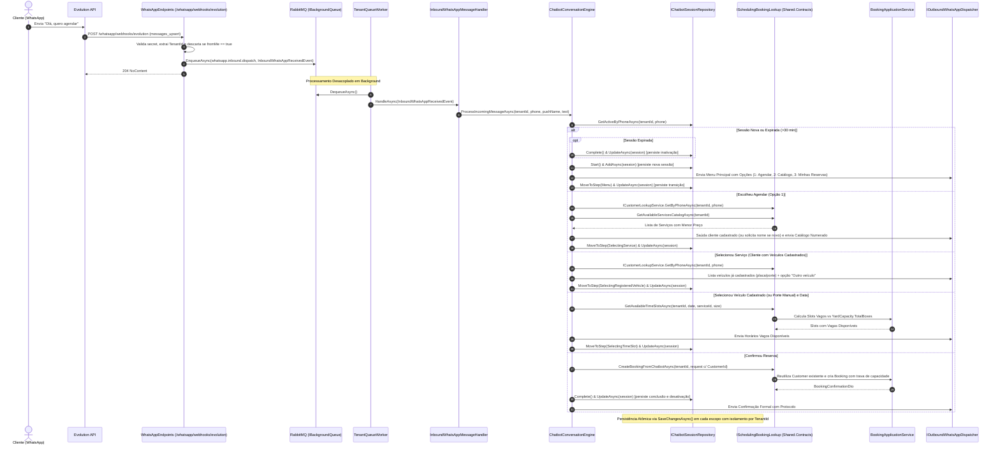
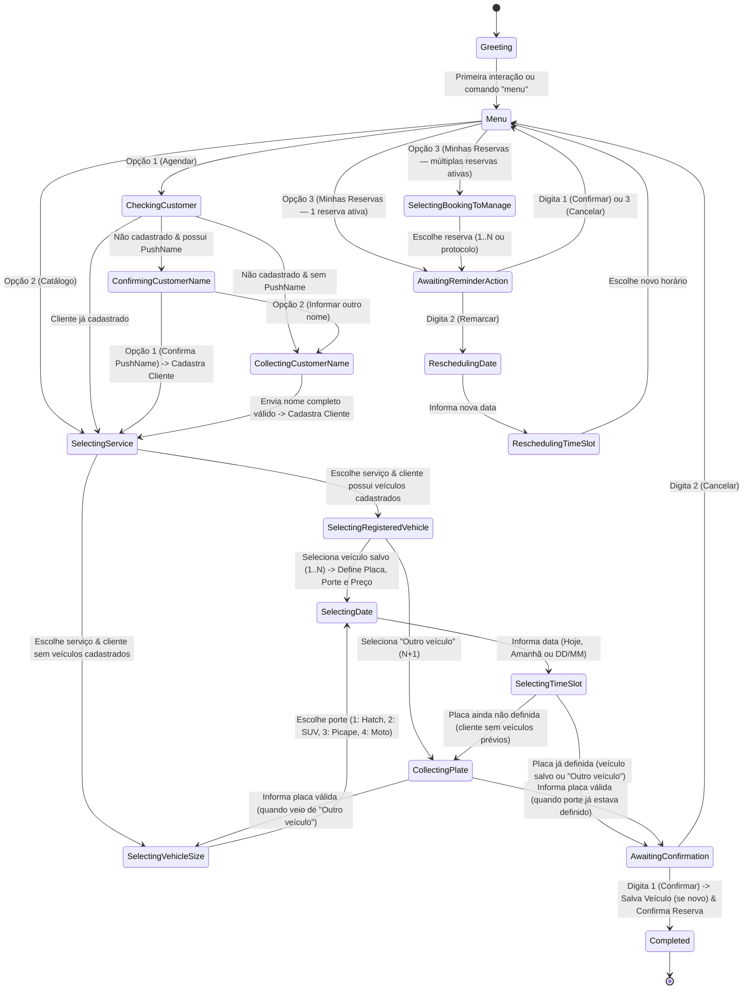
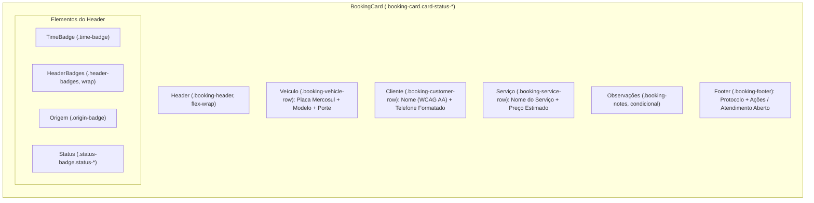

# Agendamento Conversacional via WhatsApp e Agenda Operacional — Subfase 4.3

## 1. Visão Geral & Objetivo

Permitir que clientes de lava-jatos e estética automotiva consultem o catálogo de serviços, verifiquem horários vagos e reservem horários pelo WhatsApp da loja de forma 100% autônoma através de um chatbot conversacional com máquina de estados. O sistema garante a prevenção de conflitos de capacidade física (`TotalBoxes`), gerencia sessões com timeout de 30 minutos e exibe as reservas em tempo real para a equipe na tela de **Agenda & Reservas**, com ação de check-in para abertura direta de Ordem de Serviço na recepção.

> **Padronização de Fuso Horário (`BrazilTime`):** A resolução de "Hoje" e "Amanhã" no `ChatbotConversationEngine`, bem como o filtro de horários já decorridos no dia atual em `BookingCapacityChecker`, utilizam `BrazilTime.Today` e `BrazilTime.CurrentTime` (`America/Sao_Paulo` / `UTC-03:00`), evitando bloqueio prematuro de vagas vespertinas ou virada de dia às 21h00 em servidores internacionais.

---

## 2. Diagrama de Sequência & Ingestão Assíncrona

---

## 3. Máquina de Estados da Conversa (FSM)

---

## 4. Especificações Executáveis (BDD)

### Cenário 1: Cliente agenda serviço com sucesso via WhatsApp
- **Dado** que o estabelecimento possui 2 boxes cadastrados na capacidade operacional,
- **E** o cliente envia uma mensagem de saudação pelo WhatsApp para a loja,
- **Quando** o cliente seleciona a opção de agendamento, escolhe o serviço "Lavagem Completa", o porte "Hatch / Sedan", a data de amanhã às 14:00 e informa a placa "ABC-1234",
- **E** confirma o agendamento digitando "1",
- **Então** o sistema cria uma reserva no status `Confirmed` com protocolo gerado,
- **E** envia mensagem de confirmação para o WhatsApp do cliente com o protocolo e endereço da loja,
- **E** a reserva passa a ser exibida na tela de Agenda & Reservas da equipe operacional.

### Cenário 2: Prevenção de conflito de capacidade física (Overbooking)
- **Dado** que o pátio possui capacidade de 1 box físico cadastrado,
- **E** já existe uma reserva ativa confirmada para o horário das 10:00 da manhã,
- **Quando** um segundo cliente tenta confirmar um agendamento para o mesmo horário das 10:00,
- **Então** o sistema rejeita a operação com erro de capacidade excedida (`booking.capacity.exceeded`),
- **E** o chatbot informa educadamente que a vaga acabou de ser preenchida e convida o cliente a selecionar outro horário vago.

### Cenário 3: Operador inicia atendimento a partir da reserva
- **Dado** que existe um agendamento confirmado na agenda para o veículo "ABC-1D23" do cliente "Carlos" com serviço e observações,
- **Quando** o cliente chega à loja e o operador clica no botão "Iniciar Atendimento" no card da reserva,
- **Então** o sistema prepara o contexto de check-in (assegurando cadastro de cliente e veículo se ainda não persistidos) e abre diretamente a tela de Abertura de OS (`/work-orders/new?bookingId={id}`),
- **E** a OS é carregada com cliente, veículo, serviço contratado pré-selecionado (Qtd 1) e observações preenchidas,
- **E** ao confirmar a abertura da OS, a reserva é vinculada ao `WorkOrderId` e tem seu status atualizado para `Arrived` ("Em Atendimento").

### Cenário 4: Cliente não cadastrado inicia agendamento e confirma PushName
- **Dado** que um cliente cujo número de WhatsApp não possui correspondência no cadastro do lava-jato (mesmo considerando variações com/sem DDI `55` e 8 ou 9 dígitos) envia mensagem com PushName "Mariana",
- **Quando** seleciona a opção 1 para agendar,
- **Então** o chatbot pergunta se confirma o cadastro com o nome "Mariana",
- **E** ao responder "1" (Sim), o sistema cadastra o cliente no tenant e avança diretamente para a escolha do serviço.

### Cenário 5: Cliente recorrente com veículos cadastrados seleciona veículo logo após o serviço
- **Dado** que um cliente já possui cadastro no lava-jato (localizado pelo número de WhatsApp com equivalência de DDI `55` e 8/9 dígitos) com os veículos "ABC1D23" (Hatch/Sedan) e "XYZ9876" (SUV),
- **Quando** escolhe agendar e seleciona o serviço desejado,
- **Então** o chatbot o reconhece pelo nome sem recadastrá-lo e apresenta imediatamente a lista numerada dos seus veículos já cadastrados (junto à opção "Outro veículo"),
- **E** ao escolher um veículo cadastrado, o sistema preenche automaticamente a placa, o porte e o valor correspondente ao porte daquele veículo, avançando direto para a escolha de data e horário,
- **E** caso escolha "Outro veículo", o chatbot solicita a nova placa e o porte antes de prosseguir para a escolha de data e horário.

### Cenário 6: Cliente com múltiplos agendamentos ativos escolhe qual reserva cancelar
- **Dado** que o cliente possui mais de um agendamento ativo a partir da data atual (localizados por equivalência de telefone `Customer.GetCandidateNormalizedPhones` ou vínculo `CustomerId`, ordenados cronologicamente),
- **Quando** o cliente acessa a opção 3 ("Meus agendamentos") ou envia "cancelar" no WhatsApp,
- **Então** o chatbot apresenta a lista numerada de seus agendamentos futuros e solicita que informe qual deles deseja gerenciar (`SelectingBookingToManage`),
- **E** ao selecionar o agendamento desejado e optar por cancelar ("3"), o sistema altera o status da reserva selecionada para `Cancelled`, limpa o carimbo `ConfirmedAtUtc` e atualiza automaticamente o painel de Agenda & Reservas.

---

## 5. Endpoints REST & Contratos

| Método | Rota | Autorização | Finalidade |
| :--- | :--- | :--- | :--- |
| `POST` | `/whatsapp/webhooks/evolution` | Anônimo (valida Secret) | Ingestão de mensagens recebidas (`messages_upsert`) |
| `GET` | `/scheduling/bookings` | `Receptionist` | Lista agendamentos do dia por data, status e busca |
| `GET` | `/scheduling/bookings/{id}` | `Receptionist` | Consulta detalhes de um agendamento |
| `POST` | `/scheduling/bookings` | `Receptionist` | Criação manual de reserva pela equipe |
| `POST` | `/scheduling/bookings/{id}/prepare-checkin` | `Receptionist` | Prepara contexto de check-in assegurando cliente/veículo e retornando dados para abertura da OS |
| `POST` | `/scheduling/bookings/{id}/cancel` | `Receptionist` | Cancelamento de reserva com justificativa |
| `GET` | `/scheduling/slots` | `Receptionist` | Consulta horários vagos e capacidade de boxes |

---

## 6. Especificação Visual do Componente BookingCard (Agenda Operacional)

### 6.1 Hierarquia Visual e Isolamento de Estilos

### 6.2 Diretrizes de Estilização e Acessibilidade (WCAG AA)
1. **Superfície Sólida do Card (`#122421`):** O container possui fundo escuro sólido e borda de destaque superior (`card-status-*`), prevenindo qualquer colisão de especificidade CSS com os badges de status internos.
2. **Badges Escopados:** Classes de status (`status-scheduled`, `status-confirmed`, `status-arrived`, `status-completed`, `status-cancelled`) são escopadas a `.status-badge`, mantendo `white-space: nowrap`.
3. **Responsividade sem Transbordamento:** Cabeçalho e rodapé utilizam `flex-wrap: wrap` e `gap: 6px-8px`, garantindo que cards em colunas de 320px acomodem múltiplos badges sem truncamento.
4. **Formatação de Dados:** Telefone exibido com máscara brasileira legível `(XX) XXXXX-XXXX` ou `(XX) XXXX-XXXX` e link direto para conversa via `wa.me`.

