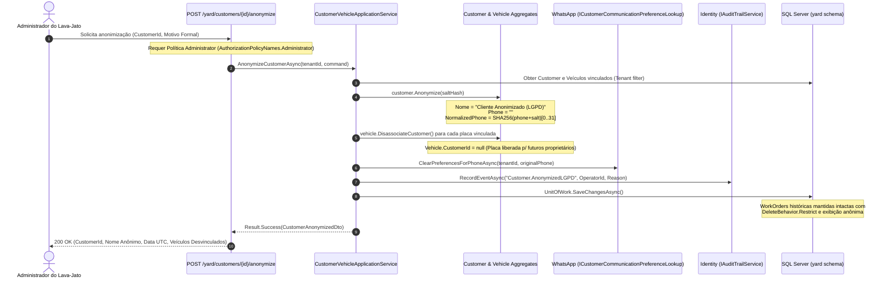

# Serviço de Anonimização de Dados do Cliente ("Direito ao Esquecimento" — Art. 18, VI) — Fase L2.1

## Objetivo
Implementar o fluxo técnico de atendimento ao **Direito de Eliminação e Anonimização dos Dados Pessoais** previsto no **Artigo 18, inciso VI da LGPD (Lei nº 13.709/2018)**, balanceando o direito do titular com as exigências de **Cumprimento de Obrigação Legal e Regulatória (Art. 16, inciso I)** para guarda fiscal e histórico operacional de Ordens de Serviço (Art. 26 e 27 do CDC e normas tributárias por 5 anos).

---

## 1. Arquitetura do Fluxo de Anonimização

---

## 2. Especificação BDD / Casos Executáveis

### Cenário 1: Anonimização de titular com desvinculação de placas e preservação de OS históricas
* **Dado** que um cliente "Carlos Eduardo" com telefone `(11) 98888-7777` possui o veículo `ABC1D23` e 3 Ordens de Serviço concluídas
* **Quando** o administrador executa a anonimização através de `AnonymizeCustomerCommand` com motivo formal
* **Então** o nome do cliente é substituído por `"Cliente Anonimizado (LGPD)"`
* **E** o telefone original é apagado e o `NormalizedPhone` é substituído por hash SHA-256 irreversível com salt
* **E** a propriedade `IsAnonymized` torna-se `true` e `AnonymizedAtUtc` é registrado
* **E** o veículo `ABC1D23` tem seu `CustomerId` desvinculado (`null`), permitindo novo cadastro futuro sem herança de histórico pessoal
* **E** as preferências de mensagens de WhatsApp são higienizadas
* **E** um evento `Customer.AnonymizedLGPD` é persistido em `identity.AdministrativeAuditEvents`
* **E** as 3 Ordens de Serviço históricas permanecem íntegras para fins fiscais, exibindo `"Cliente Anonimizado (LGPD)"`.

### Cenário 2: Rejeição de modificação ou re-anonimização em cliente já anonimizado
* **Dado** que um cliente já foi previamente anonimizado
* **Quando** uma tentativa de atualização cadastral (`UpdateCustomerAsync`) ou re-anonimização (`AnonymizeCustomerAsync`) for enviada
* **Então** a operação é rejeitada retornando erro do tipo `Conflict` com código `customer.anonymized` ou `customer.already_anonymized`.

### Cenário 3: Isolamento Multi-Tenant rigoroso
* **Dado** que o Cliente pertence ao `Tenant A`
* **Quando** um operador autenticado no `Tenant B` tenta acionar o endpoint de anonimização para aquele `CustomerId`
* **Então** a aplicação retorna `NotFound`, impedindo qualquer vazamento de existência ou alteração entre estabelecimentos.

---

## 3. Endpoints Disponíveis

| Método | Rota | Autenticação & Política | Payload | Retorno |
| :--- | :--- | :--- | :--- | :--- |
| `POST` | `/yard/customers/{customerId:guid}/anonymize` | Bearer JWT (`AdministratorPolicy`) | `{"reason": "string"}` | `200 OK` (`CustomerAnonymizedDto`) |
| `POST` | `/customers/{customerId:guid}/anonymize` | Bearer JWT (`AdministratorPolicy`) | `{"reason": "string"}` | `200 OK` (`CustomerAnonymizedDto`) |
