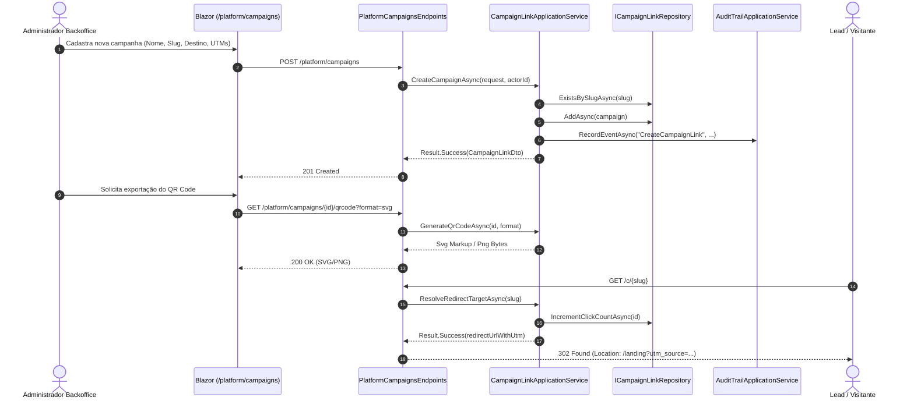

# Especificação Viva: Campanhas de Aquisição, Links UTM e QR Code no Backoffice (6.7)

## Visão Geral
Esta especificação viva descreve os requisitos de negócio e os comportamentos executáveis para o módulo de campanhas corporativas no Backoffice da plataforma Lavaway.

## Fluxo de Criação e Rastreamento de Campanhas

## Cenários BDD Executáveis

### Cenário 1: Criação com sucesso de link de campanha com slug amigável
- **Dado** que o operador possui perfil `SuperAdmin` ou `PlatformSupport`
- **Quando** enviar uma requisição para criar campanha com slug `black-friday` e destino `/#planos`
- **Então** o registro deve ser persistido com status ativo, `ClickCount = 0` e identificador `UUID`
- **E** um evento de auditoria administrativa deve ser registrado com a ação `CreateCampaignLink`.

### Cenário 2: Rejeição de slug duplicado
- **Dado** que já existe uma campanha cadastrada com o slug `expomec-2026`
- **Quando** o operador tentar criar outra campanha com o mesmo slug `expomec-2026`
- **Então** a operação deve falhar retornando `Result.Failure` do tipo `Conflict` (`campaign.slug_already_exists`).

### Cenário 3: Validação de segurança anti-open redirect
- **Dado** que o operador preenche um destino inválido como `https://site-malicioso.com`
- **Quando** tentar cadastrar a campanha
- **Então** a entidade de domínio deve rejeitar o destino com erro de validação, exigindo caminho relativo iniciado por `/`.

### Cenário 4: Resolução de link curto com parâmetros UTM
- **Dado** uma campanha ativa com slug `parceria-posto` e parâmetros UTM definidos
- **Quando** uma requisição pública acessar `/c/parceria-posto`
- **Então** a resposta deve ser HTTP 302 Found para o destino contendo a query string UTM completa
- **E** o contador de cliques deve ser incrementado atomicamente.
