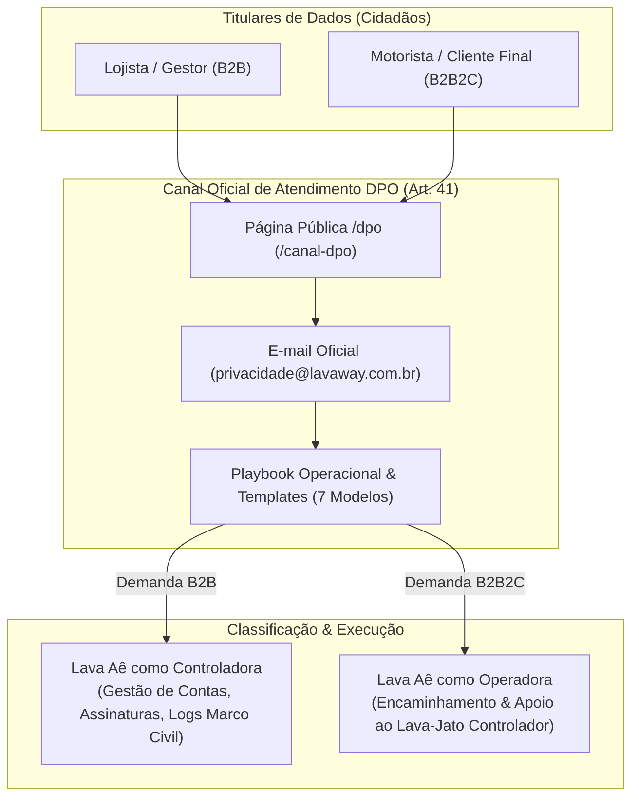
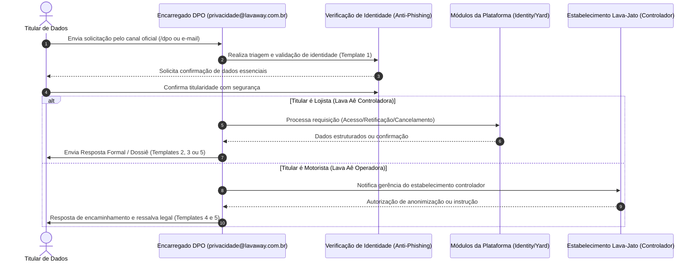

# Canal do Encarregado de Proteção de Dados (DPO — Art. 41) — Fase L1.2

## Objetivo
Estruturar e operacionalizar o canal oficial do **Encarregado pelo Tratamento de Dados Pessoais (DPO)** da plataforma **Lava Aê (Lavaway SaaS)**, em estrita conformidade com o **Artigo 41** da **Lei Geral de Proteção de Dados (LGPD — Lei nº 13.709/2018)** e as orientações da Autoridade Nacional de Proteção de Dados (ANPD). O canal viabiliza o exercício público, transparente e gratuito dos direitos dos titulares previstos no **Artigo 18**, prevendo modelos padronizados de resposta e distinção formal de papéis regulatórios.

---

## 1. Arquitetura do Canal e Papéis Regulatórios

O canal do DPO atende aos dois ecossistemas de relacionamento jurídico da plataforma:

---

## 2. Ciclo de Vida do Atendimento a Solicitações de Titulares (DSR)

---

## 3. Matriz de Prazos e Modelos de Resposta Padronizados

Conforme o regulamento da ANPD e o Artigo 19 da LGPD:

| Modelo | Finalidade / Direito (Art. 18) | Prazo Legal | Base Legal / Fundamentação |
| :--- | :--- | :--- | :--- |
| **Template 1** | **Validação de Identidade e Triagem Anti-Fraude** | Imediato (até 24h) | Art. 18, § 1º (segurança da informação e prevenção a vazamentos) |
| **Template 2** | **Resposta Simplificada de Confirmação** | Imediato / até 48h | Art. 19, I da LGPD |
| **Template 3** | **Declaração Completa / Dossiê do Titular & Portabilidade** | Até 15 dias corridos | Art. 19, II e Art. 18, II, IV e V |
| **Template 4** | **Atendimento ao Motorista (Lava Aê como Operadora)** | Até 5 dias úteis | Art. 39 c/c Art. 41 da LGPD |
| **Template 5** | **Anonimização com Ressalva de Retenção Obrigatória** | Até 15 dias corridos | Art. 18, VI c/c Art. 16, I (CDC Art. 27 e Código Tributário) |
| **Template 6** | **Indeferimento Justificado / Oposição Improcedente** | Até 15 dias corridos | Art. 16 e Art. 18, § 2º (cumprimento de dever legal) |
| **Template 7** | **Revogação de Consentimento e Bloqueio de WhatsApp** | Imediato (até 24h) | Art. 18, IX (Opt-out garantido e imediato) |

---

## 4. Componentes Entregues

1. **Página Pública Blazor:** `src/Frontend/CarWashSaaS.Client.Web/Pages/DpoChannelPage.razor` (rotas `/dpo` e `/canal-dpo`) com layout limpo e responsivo `LandingLayout`.
2. **Estilo CSS Isolado:** `src/Frontend/CarWashSaaS.Client.Web/Pages/DpoChannelPage.razor.css` com identidade visual coerente (Navy, Blue, Glassmorphism e cards de ações de direitos).
3. **Playbook Operacional do DPO:** `docs/lgpd/playbook-dpo-respostas-titulares.md` com texto integral e pronto para uso de todos os 7 templates de resposta.
4. **Links de Rodapés Atualizados:** Inclusão de links de navegação para `dpo` em `Home.razor`, `PrivacyPolicyPage.razor` e `TermsOfServicePage.razor`.

---

## 5. Matriz de Testes Executáveis (bUnit)

A suíte em `tests/Frontend/ComponentTests/CarWashSaaS.ComponentTests/DpoChannelComponentTests.cs` valida:
* `DpoChannelPage_ShouldNotHaveAuthorizeAttribute_AndShouldBePubliclyAccessible`: Acesso sem restrição ou necessidade de login para visitantes e clientes externos.
* `DpoChannelPage_ShouldRenderDpoOfficialEmail_AndDeadlines`: Presença do e-mail oficial `privacidade@lavaway.com.br`, menção expressa ao Art. 41 e exibição do prazo de até 15 dias.
* `DpoChannelPage_ShouldRenderInteractiveMailtoLinksForRights`: Presença de links `mailto:` interativos pré-estruturados para cada direito do Art. 18.
