# Criptografia em Repouso e Minimização de Dados Sensíveis — Fase L4.1

## Objetivo
Estabelecer salvaguardas técnicas criptográficas e operacionais de segurança da informação, em conformidade com o **Artigo 46 da LGPD (Lei nº 13.709/2018)** (medidas de segurança, técnicas e administrativas para proteger dados pessoais) e o **Artigo 6º, Inciso III** (Princípio da Necessidade e Minimização de Dados).

---

## 1. Topologia de Proteção em Três Camadas

```mermaid
graph TD
    subgraph DiscoFisico["Camada 1: Criptografia em Repouso no BD (TDE - Art. 46)"]
        SQL["SQL Server 2022 Standard"]
        DMK["Database Master Key (DMK - master)"]
        Cert["Server Certificate: LavawayTdeCert"]
        DEK["Database Encryption Key (AES-256)"]
        Files[("Arquivos .mdf, .ldf e Backups Criptografados")]
        
        DMK --> Cert --> DEK --> Files
        EndpointTde["GET /platform/observability/database/encryption-status"] -.->|Audit DMV| Files
    end

    subgraph NivelAplicacao["Camada 2: Criptografia Autenticada de Segredos (AEAD AES-GCM 256 bits)"]
        MasterSecret["Chave Mestra de Ambiente (SHA-256)"]
        Enc["PaymentCredentialsEncryptor / WhatsAppCredentialsEncryptor"]
        DBPagarMe["billing.TenantPaymentGatewayConfigs"]
        DBWhatsApp["whatsapp.TenantWhatsAppConfigs"]
        
        MasterSecret --> Enc
        Enc -->|Nonce 12B + Tag 16B + Ciphertext| DBPagarMe
        Enc -->|Nonce 12B + Tag 16B + Ciphertext| DBWhatsApp
    end

    subgraph Observabilidade["Camada 3: Minimização e Mascaramento de PII (Art. 6º, III)"]
        AppLogs["Logs e Requisições HTTP"]
        PiiRegex["PiiRegexMasker (Regex Compilados)"]
        SerilogEnricher["PiiDataMaskingEnricher (Serilog Pipeline)"]
        SafeLogs[("logs/lavaway-.json (Logs Higienizados)")]
        
        AppLogs --> SerilogEnricher --> PiiRegex --> SafeLogs
    end
```

---

## 2. Componentes e Implementação Técnica

### 2.1 Transparent Data Encryption (TDE) no SQL Server
* **Algoritmo:** `AES_256`.
* **Escopo:** Criptografia automática de páginas de dados e logs em repouso.
* **Scripts de Gestão:**
  - `scripts/sql/enable-tde.sql`: Script idempotente de ativação e provisionamento da Master Key, Certificado do Servidor e DEK.
  - `scripts/sql/backup-tde-keys.sql`: Script de salvaguarda do certificado `.cer` e chave privada `.pvk` para recuperação de desastres (DR).
* **Endpoint de Auditoria Operacional:**
  - `GET /platform/observability/database/encryption-status`
  - Retorna o status oficial reportado pela DMV `sys.dm_database_encryption_keys`.

### 2.2 Criptografia de Credenciais de Terceiros por Tenant (AEAD AES-GCM)
* **Entidades Protegidas:**
  - `[billing].[TenantPaymentGatewayConfigs]`: `PagarMeSecretKeyEncrypted`, `PagarMeWebhookSecretEncrypted`, `MercadoPagoAccessTokenEncrypted`, `MercadoPagoWebhookSecretEncrypted`.
  - `[whatsapp].[TenantWhatsAppConfigs]`: `EvolutionApiKeyEncrypted`, `WebhookSecretEncrypted`.
* **Garantias Criptográficas:**
  - Nonce aleatório de 12 bytes gerado via `RandomNumberGenerator` a cada operação de cifra.
  - Tag de autenticação de 16 bytes que impede adulteração e ataques de integridade (tampering).
  - Máscaras seguras nos contratos expostos ao usuário (ex.: `sk_live_••••••••1234`, `ev_••••••••5678`).

### 2.3 Sanitização de PII em Observabilidade
* **Motor Centralizado:** `PiiRegexMasker` em `CarWashSaaS.Shared.Contracts`.
* **Padrões Higienizados:**
  - **CPF:** Substituído por `***.***.123-**`.
  - **Telefone:** Substituído por `(11) *****-1234` ou `+55 (11) *****-1234`.
  - **E-mail:** Substituído por `u***@dominio.com`.
  - **Chaves de API / Segredos:** Substituído por formato mascarado.
* **Serilog Pipeline:** `PiiDataMaskingEnricher` e sanitização automática do `RequestPath` em `app.UseSerilogRequestLogging`.

---

## 3. Especificação BDD / Casos de Teste Executáveis

### Cenário 1: Criptografia e decriptação de credenciais com AES-GCM
* **Dado** que uma chave de API secreta `sk_live_1234567890abcdef` é cadastrada por um estabelecimento
* **Quando** o serviço `PaymentCredentialsEncryptor.Encrypt` ou `WhatsAppCredentialsEncryptor.Encrypt` é acionado
* **Então** o valor persistido na base é um texto cifrado em Base64 contendo nonce e tag de autenticação
* **E** duas chamadas com o mesmo plaintext geram ciphertexts completamente diferentes devido ao nonce aleatório
* **E** a decriptação recupera com fidelidade a chave original para comunicação segura com a adquirente ou gateway.

### Cenário 2: Rejeição de adulteração em credenciais (Tampering Detection)
* **Dado** que um registro de credencial criptografada foi adulterado no banco de dados (1 byte modificado)
* **Quando** o serviço de decriptação tenta processar a chave
* **Então** a biblioteca criptográfica rejeita a autenticação da tag GCM
* **E** o serviço retorna uma string vazia com segurança, sem expor exceções ou dados corrompidos.

### Cenário 3: Mascaramento automático de PII em mensagens de log estruturado
* **Dado** que uma requisição ou handler registra uma mensagem contendo CPF `"123.456.789-00"`, e-mail `"cliente@email.com"` e telefone `"11987654321"`
* **Quando** o evento é processado pelo Serilog
* **Então** o `PiiDataMaskingEnricher` e o `PiiRegexMasker` substituem os dados sensíveis pelas respectivas máscaras
* **E** o arquivo `logs/lavaway-.json` armazena unicamente metadados sanitizados, em plena conformidade com o princípio de minimização da LGPD.
