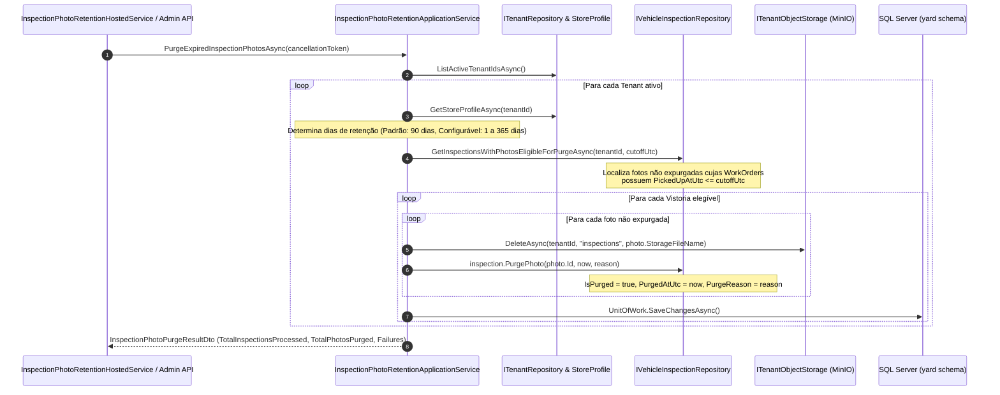

# Expurgo Automatizado de Fotos de Vistoria (InspectionPhotos) — Fase L3.1

## Objetivo
Implementar a rotina automatizada de descarte e expurgo físico e lógico de fotografias de vistoria veicular (`InspectionPhotos`), em estrita conformidade com o **Artigo 16 da LGPD (Lei nº 13.709/2018)** (término do tratamento e eliminação dos dados) e os princípios de **Finalidade e Necessidade / Minimização de Dados (Art. 6º, incisos I e III)**.

As fotos capturadas na recepção veicular visam resguardar a empresa e o cliente contra disputas de avarias preexistentes durante a execução do serviço. Uma vez concluído o serviço e entregue o veículo (`PickedUpAtUtc`), cessa a finalidade imediata de guarda das imagens de alta resolução após o decurso do prazo decadencial/retentivo.

---

## 1. Arquitetura e Ciclo de Retenção

---

## 2. Regras de Negócio e Parâmetros

1. **Gatilho de Retenção:**
   - O prazo é contabilizado estritamente a partir do momento em que o veículo foi retirado pelo cliente (`WorkOrder.PickedUpAtUtc`).
   - Vistorias de veículos ainda no pátio ou ordens não finalizadas nunca são expurgadas, independentemente do tempo decorrido desde o check-in.

2. **Período de Retenção Parametrizável por Loja:**
   - Configurado no perfil do estabelecimento (`StoreProfile.InspectionPhotoRetentionDays`).
   - Valor padrão: **90 dias**.
   - Intervalo permitido: entre **1 dia** e **365 dias** (teto regulatório do SaaS).

3. **Duplo Descarte (Físico + Lógico):**
   - **Físico:** Invocação do `ITenantObjectStorage.DeleteAsync` para remoção do arquivo no bucket S3/MinIO sob o prefixo `tenants/{tenantId}/inspections/{fileName}`.
   - **Lógico:** A entidade `InspectionPhoto` registra `IsPurged = true`, `PurgedAtUtc` e `PurgeReason = "LGPD Art. 16 - Política de Retenção Expirada"`. O registro da vistoria e os metadados de danos/avarias continuam preservados para fins de auditoria de processo.

4. **Tratamento de Acesso a Mídias Expiradas:**
   - Ao requisitar download ou streaming da foto (`GET /work-orders/{workOrderId}/inspection/photos/{photoId}`), a API retorna código **`410 Gone`** caso a imagem já tenha sido expurgada.
   - No frontend Blazor (`InspectionPhotoGallery`), fotos expurgadas exibem um card informativo estilizado com aviso amigável: *"Foto descartada pela política de retenção LGPD"*, prevenindo links quebrados.

---

## 3. Especificação BDD / Casos Executáveis

### Cenário 1: Expurgo com sucesso de fotos após término da retenção
* **Dado** que uma Ordem de Serviço foi entregue há 100 dias (`PickedUpAtUtc = Now - 100 dias`)
* **E** o tenant possui retenção configurada para o padrão de 90 dias
* **E** existem fotos de vistoria associadas armazenadas no MinIO
* **Quando** o serviço `InspectionPhotoRetentionApplicationService.PurgeExpiredPhotosForTenantAsync` é executado
* **Então** o arquivo binário correspondente é deletado fisicamente do MinIO via `ITenantObjectStorage.DeleteAsync`
* **E** a foto na base de dados é atualizada com `IsPurged = true` e `PurgedAtUtc` preenchido
* **E** uma tentativa posterior de obter o stream da foto via API retorna `410 Gone`.

### Cenário 2: Preservação de fotos dentro do prazo de retenção ou com veículo em pátio
* **Dado** que uma Ordem de Serviço foi entregue há 15 dias (`PickedUpAtUtc = Now - 15 dias`)
* **E** outra Ordem de Serviço foi criada há 120 dias mas o veículo ainda não foi retirado (`PickedUpAtUtc == null`)
* **Quando** a rotina de expurgo é executada
* **Então** nenhuma das fotos destas vistorias é excluída do MinIO nem marcada como expurgada.

### Cenário 3: Configuração personalizada por Tenant
* **Dado** que o Tenant "Lava-Jato Express" alterou sua retenção para 30 dias no perfil da loja
* **E** possui uma OS entregue há 45 dias
* **Quando** a rotina de expurgo é executada
* **Então** as fotos dessa OS são expurgadas considerando o limite de 30 dias estabelecido pelo estabelecimento.

---

## 4. Endpoints e Interfaces de Gestão

| Método | Rota | Autenticação & Política | Descrição |
| :--- | :--- | :--- | :--- |
| `POST` | `/yard/inspections/retention/run` | Bearer JWT (`AdministratorPolicy`) | Disparo manual imediato da rotina de expurgo pelo administrador |
| `GET` | `/work-orders/{workOrderId:guid}/inspection/photos/{photoId:guid}` | Bearer JWT | Download/Stream da foto (retorna `410 Gone` se expurgada) |
| `GET` | `/yard/store-profile` | Bearer JWT | Retorna perfil incluindo `InspectionPhotoRetentionDays` |
| `POST` | `/yard/store-profile` | Bearer JWT (`AdministratorPolicy`) | Salva perfil permitindo definir `InspectionPhotoRetentionDays` (1..365) |
| `PUT` | `/yard/store-profile` | Bearer JWT (`AdministratorPolicy`) | Atualiza perfil permitindo alterar `InspectionPhotoRetentionDays` (1..365) |
