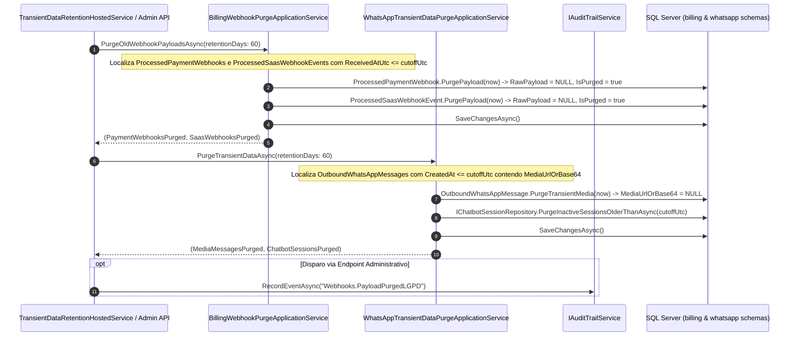

# Higienização de Payloads Brutos de Webhooks e Logs Transitórios — Fase L3.2

## Objetivo
Implementar a rotina automatizada e programada de descarte e higienização física e lógica de payloads brutos de webhooks e dados transitórios, em estrita conformidade com o **Artigo 16 da LGPD (Lei nº 13.709/2018)** (término do tratamento e eliminação dos dados) e os princípios de **Finalidade e Necessidade / Minimização de Dados (Art. 6º, incisos I e III)**.

Durante o ciclo de vida inicial de uma transação (pagamento Pix, faturamento de assinatura SaaS ou mensagens via WhatsApp), o recebimento de payloads brutos via webhook é legítimo e necessário para verificação criptográfica, conciliação e suporte operacional inicial. Contudo, após o período técnico decadencial de **60 dias**, cessa a necessidade da retenção de dados cadastrais brutos, endereços IP, detalhes de pagadores e mídias transitórias.

---

## 1. Arquitetura e Ciclo de Retenção

---

## 2. Regras de Negócio e Matriz de Preservação vs. Higienização

### 2.1 Prazo Padrão de Retenção Transitória
* **Período de Retenção:** **60 dias** contados a partir da data/hora de recepção (`ReceivedAtUtc` nos webhooks e `CreatedAt` nas mensagens).
* **Frequência de Execução:** Diária através do worker `TransientDataRetentionHostedService` ou sob demanda via API administrativa.

### 2.2 Matriz de Tratamento por Entidade

| Entidade / Tabela | Dados Higienizados (Descartados) | Metadados Preservados (Conformidade Fiscal/Auditoria) |
| :--- | :--- | :--- |
| **`[billing].[ProcessedPaymentWebhooks]`** (MercadoPago / Pagar.me / Pix) | `RawPayload` (JSON bruto com IPs, endereços, CPF do pagador e detalhes transitórios). | `Id`, `TenantId`, `Provider`, `EventId`, `TxId`, `Status`, `ReceivedAtUtc`, `ProcessedAtUtc`, `IsPurged = true`, `PurgedAtUtc`. |
| **`[billing].[ProcessedSaasWebhookEvents]`** (Stripe / Assinaturas do SaaS) | `RawPayload` (JSON bruto do evento de webhook da Stripe). | `Id`, `EventId`, `EventType`, `TenantId`, `ReceivedAtUtc`, `IsPurged = true`, `PurgedAtUtc`. |
| **`[whatsapp].[WhatsAppMessages]`** (Mensagens enviadas) | `MediaUrlOrBase64` (Binários pesados de imagens, faturas ou boletos temporários). | `Id`, `TenantId`, `RecipientPhone`, `Body`, `Status`, `ProviderMessageId`, `CreatedAt`, `SentAtUtc`, `DeliveredAtUtc`. |
| **`[whatsapp].[ChatbotSessions]`** (Sessões transitórias) | Sessões inativas ou concluídas há mais de 60 dias são removidas fisicamente. | Ordens de Serviço e agendamentos consolidados no pátio continuam preservados. |

---

## 3. Especificação BDD / Casos Executáveis

### Cenário 1: Higienização de webhook de pagamento com mais de 60 dias
* **Dado** que um evento de webhook foi recebido há 75 dias contendo o payload bruto `{"payer": {"cpf": "123", "ip": "192.168.1.1"}}`
* **E** o status da transação é `Processed` com identificador `tx_123`
* **Quando** o serviço `BillingWebhookPurgeApplicationService.PurgeOldWebhookPayloadsAsync` é executado
* **Então** o campo `RawPayload` é anulado (`null`)
* **E** a flag `IsPurged` é marcada como `true` com `PurgedAtUtc` preenchido
* **E** os identificadores `Provider`, `EventId`, `TxId` e `Status` permanecem intactos no banco de dados.

### Cenário 2: Preservação de webhook recente dentro do período de triagem
* **Dado** que um evento de webhook foi recebido há 10 dias com `RawPayload` preenchido
* **Quando** a rotina de retenção de 60 dias é executada
* **Então** o payload bruto é mantido intacto para fins de depuração e diagnóstico técnico
* **E** a flag `IsPurged` permanece `false`.

### Cenário 3: Higienização de mídia base64 de WhatsApp transitória
* **Dado** que uma mensagem com comprovante em PDF anexado (em base64) foi enviada com sucesso há 70 dias
* **Quando** o serviço `WhatsAppTransientDataPurgeApplicationService.PurgeTransientDataAsync` é executado
* **Então** o campo `MediaUrlOrBase64` é limpo (`null`), liberando espaço de armazenamento e evitando guarda indefinida de binários transitórios
* **E** o histórico de entrega (`Status = Sent/Delivered`, `SentAtUtc`) continua preservado para auditoria.

---

## 4. Endpoints e Observabilidade

| Método | Rota | Autorização | Descrição |
| :--- | :--- | :--- | :--- |
| `POST` | `/platform/observability/webhooks/retention/run` | Bearer JWT (`PlatformBillingAdmin`) | Disparo manual imediato da rotina de higienização de webhooks e dados transitórios |
| `GET` | `/platform/observability/webhooks` | Bearer JWT (`PlatformUser`) | Lista eventos de webhooks exibindo status de higienização (`IsPurged`, `PurgedAtUtc`) |
