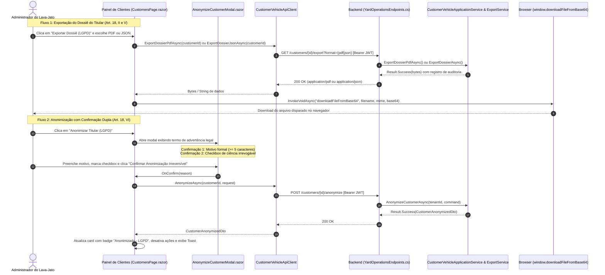

# Interface de Atendimento a Direitos LGPD no Painel Administrativo — Fase L2.3

## Objetivo
Disponibilizar no Painel Administrativo do lava-jato (tela de Gestão de Clientes) os mecanismos visuais e operacionais para atendimento célere, seguro e auditável às requisições dos titulares de dados pessoais (**Data Subject Requests — DSR**) estabelecidas pelo **Artigo 18 da LGPD (Lei nº 13.709/2018)**.

---

## 1. Arquitetura da Solução & Fluxo de Interação

---

## 2. Especificação BDD / Casos Executáveis

### Cenário 1: Visualização de Titular Anonimizado
* **Dado** que o operador administrativo acessa a tela de Gestão de Clientes
* **Quando** seleciona um titular cujos dados pessoais foram ofuscados (`IsAnonymized = true`)
* **Então** o sistema exibe o badge visual `Anonimizado - LGPD` no card da lista e no cabeçalho do cliente
* **E** exibe um banner de advertência informando que os dados pessoais foram permanentemente eliminados com a data do registro
* **E** os botões de edição cadastral ("Editar Dados") e re-anonimização ("Anonimizar Titular") não são renderizados
* **E** o link de "Conversar no WhatsApp" não é renderizado (número de telefone eliminado)
* **E** o botão "Exportar Dossiê (LGPD)" permanece disponível para conferência do dossiê anônimo.

### Cenário 2: Confirmação Dupla no Modal de Anonimização (Direito ao Esquecimento)
* **Dado** que o operador administrativo visualiza um cliente ativo
* **Quando** clica no botão "Anonimizar Titular (LGPD)"
* **Então** o modal `AnonymizeCustomerModal` é aberto com o termo de advertência da irrevogabilidade legal
* **E** o botão "Confirmar Anonimização Irreversível" permanece desabilitado
* **Quando** o operador digita o motivo formal da solicitação (mínimo de 5 caracteres)
* **E** marca o checkbox de ciência explícita de irreversibilidade
* **Então** o botão de confirmação torna-se ativo
* **Quando** o operador confirma a ação
* **Então** a requisição `POST /customers/{id}/anonymize` é disparada
* **E** o cliente é atualizado na interface com o nome `"Cliente Anonimizado (LGPD)"`, telefone limpo e badge ativo
* **E** uma notificação toast de sucesso é exibida ao usuário.

### Cenário 3: Exportação do Dossiê do Titular (PDF e JSON)
* **Dado** que o operador administrativo visualiza qualquer titular (ativo ou anonimizado)
* **Quando** clica em "Exportar Dossiê (LGPD)" e seleciona "Relatório PDF"
* **Então** o sistema requisita o binário autenticado em `GET /customers/{id}/export?format=pdf`
* **E** dispara o download imediato do arquivo `dossie-titular-{id}.pdf`
* **Quando** seleciona "Portabilidade JSON"
* **Então** o sistema requisita os dados estruturados em `GET /customers/{id}/export?format=json`
* **E** dispara o download imediato do arquivo `dossie-titular-{id}.json`.

---

## 3. Componentes e Contratos Envolvidos

| Componente / Arquivo | Responsabilidade |
| :--- | :--- |
| [CustomerVehicleMatchDto.cs](file:///home/rony/LPR/lavaway/src/Shared/CarWashSaaS.Shared.Contracts/CustomerVehicleMatchDto.cs) | Contrato compartilhado com campos `IsAnonymized` e `AnonymizedAtUtc`. |
| [CustomerVehicleSearchRepository.cs](file:///home/rony/LPR/lavaway/src/Backend/Modules/YardOperations/CarWashSaaS.YardOperations.Infrastructure/CustomerVehicleSearchRepository.cs) | Projeção do status de anonimização no banco SQL Server isolado por Tenant. |
| [CustomerVehicleApiClient.cs](file:///home/rony/LPR/lavaway/src/Frontend/CarWashSaaS.Client.Core/CustomerVehicleApiClient.cs) | Métodos de consumo HTTP autenticados: `AnonymizeAsync`, `ExportDossierPdfAsync` e `ExportDossierJsonAsync`. |
| [AnonymizeCustomerModal.razor](file:///home/rony/LPR/lavaway/src/Frontend/CarWashSaaS.Client.Components/AnonymizeCustomerModal.razor) | Modal com termo de advertência, motivo obrigatório e checkbox de ciência irrevogável. |
| [CustomersPage.razor](file:///home/rony/LPR/lavaway/src/Frontend/CarWashSaaS.Client.Web/Pages/CustomersPage.razor) | Página principal com listagem, badges `Anonimizado - LGPD`, banner de status e menu de exportação. |
| [index.html](file:///home/rony/LPR/lavaway/src/Frontend/CarWashSaaS.Client.Web/wwwroot/index.html) | Utilitário JS `window.downloadFileFromBase64` para download seguro de arquivos via Blob. |
