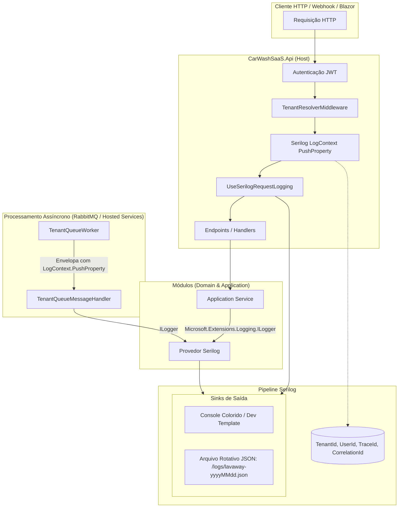

# Observabilidade Estruturada com Serilog — Subfase 6.6

Este documento consolida a arquitetura, modelo de contexto multi-tenant, fluxos de enriquecimento, formatos de saída e especificações de teste para observabilidade contínua e logs estruturados no backend do Lavaway.

---

## 1. Arquitetura do Pipeline de Logging

O Serilog atua como provedor unificado de logs para o Host ASP.NET Core (`CarWashSaaS.Api`). Todas as mensagens emitidas via `ILogger<T>` nos serviços de aplicação e infraestrutura fluem através do pipeline do Serilog, sendo enriquecidas com o contexto do tenant antes de serem despachadas para os sinks de saída.



---

## 2. Propriedades Estruturadas do Contexto Multi-Tenant

| Propriedade | Tipo | Descrição | Origem |
| :--- | :--- | :--- | :--- |
| `TenantId` | `Guid` (UUID) | Identificador único do estabelecimento em execução | `TenantResolverMiddleware` / Fila RabbitMQ |
| `UserId` | `Guid` / `string` | Identificador do usuário autenticado (`sub`) | JWT Token Claim |
| `UserRealm` | `string` | Escopo do usuário (`Shop` ou `Platform`) | JWT Token Claim |
| `TraceId` | `string` | Identificador de rastreamento distribuído W3C | `HttpContext.TraceIdentifier` / Activity |
| `RequestMethod` | `string` | Verbo HTTP (`GET`, `POST`, `PUT`, `DELETE`) | `UseSerilogRequestLogging` |
| `RequestPath` | `string` | Rota da API acessada | `UseSerilogRequestLogging` |
| `StatusCode` | `int` | Código HTTP retornado | `UseSerilogRequestLogging` |
| `Elapsed` | `double` | Tempo de processamento em milissegundos | `UseSerilogRequestLogging` |

---

## 3. Formato de Saída (JSON Estruturado)

Em ambientes de produção e homologação, os logs são salvos em arquivos rotativos diários (`logs/lavaway-.json`) com retenção de 14 dias:

```json
{
  "Timestamp": "2026-10-20T17:40:00.1234567-03:00",
  "Level": "Information",
  "MessageTemplate": "HTTP {RequestMethod} {RequestPath} responded {StatusCode} in {Elapsed:0.0000} ms",
  "Properties": {
    "RequestMethod": "POST",
    "RequestPath": "/yard/work-orders",
    "StatusCode": 201,
    "Elapsed": 34.5218,
    "TenantId": "3fa85f64-5717-4562-b3fc-2c963f66afa6",
    "UserId": "7c9e6679-7425-40de-944b-e07fc1f90ae7",
    "TraceId": "00-4bf92f3577b34da6a3ce929d0e0e4736-00f067aa0ba902b7-01",
    "SourceContext": "Serilog.AspNetCore.RequestLoggingMiddleware"
  }
}
```

---

## 4. Especificações Executáveis & Regras de Isolamento

1. **Pureza do Domínio e Aplicação:**
   - Nenhum módulo (`CarWashSaaS.Domain.*`, `CarWashSaaS.Application.*`) pode referenciar assemblies do `Serilog`.
   - Validado automaticamente pelo teste de arquitetura:
     ```csharp
     Types.InAssembly(assembly).ShouldNot().HaveDependencyOnAny("Serilog").GetResult()
     ```
2. **Presença do TenantId em Operações Autenticadas:**
   - Toda requisição com token JWT contendo `tenant_id` propaga esse valor para o `LogContext`.
   - Logs gerados dentro de `TenantQueueWorker` para eventos da fila assíncrona recebem o `TenantId` da mensagem.
