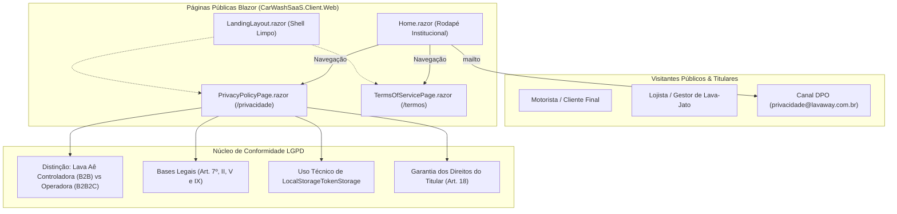
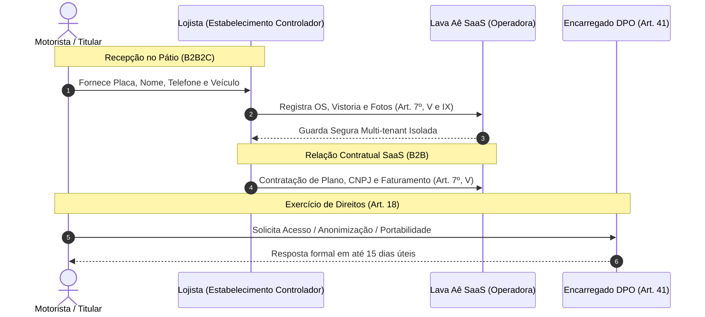
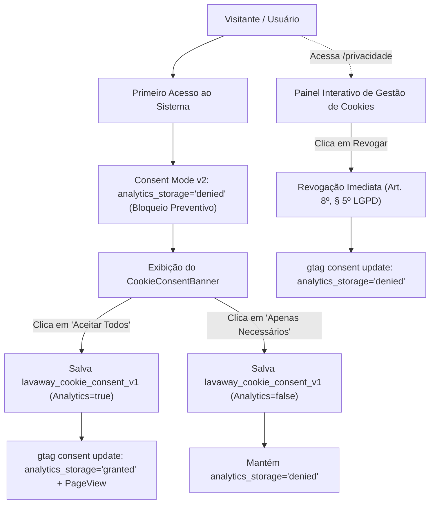

# Páginas Públicas de Política de Privacidade e Termos de Uso — Fase L1.1

## Objetivo
Disponibilizar páginas públicas institucionais e responsivas para a **Política de Privacidade** (`/privacidade`, `/privacy`) e os **Termos de Uso** (`/termos`, `/terms`) do **Lava Aê (Lavaway SaaS)**, assegurando transparência, atendimento aos princípios da **LGPD (Lei nº 13.709/2018)** e o Marco Civil da Internet (Lei nº 12.965/2014), sem exigir autenticação prévia de visitantes.

---

## 1. Arquitetura de Transparência e Acesso Público

---

## 2. Dupla Esfera de Responsabilidade Jurídica

A documentação viva reflete as duas esferas jurídicas de tratamento:

---

## 3. Resumo dos Componentes Implementados

| Componente | Rota | Layout | Papel Principal |
| :--- | :--- | :--- | :--- |
| **`PrivacyPolicyPage.razor`** | `/privacidade`, `/privacy` | `LandingLayout` | Apresenta a política completa de privacidade, distinção Controladora/Operadora, bases legais (Art. 7º), retenção/descarte, governança do Google Analytics (`G-FCCZJVXZG9`), painel interativo de revogação de consentimento (Art. 8º, § 5º), `LocalStorageTokenStorage` e canal do DPO. |
| **`TermsOfServicePage.razor`** | `/termos`, `/terms` | `LandingLayout` | Detalha as condições gerais de licenciamento SaaS, deveres éticos no WhatsApp, responsabilidades do lojista, SLA, faturamento, rescisão e foro. |
| **`CookieConsentBanner.razor`** | Global (`App.razor`) | Global | Banner flutuante responsivo de consentimento prévio nos termos da LGPD com opções "Aceitar Todos", "Apenas Necessários" e "Personalizar Escolhas", integrando Google Consent Mode v2. |
| **`Home.razor` (Footer)** | `/` | `LandingLayout` | Atualizado com links navegáveis e estilizados para `/termos`, `/privacidade` e link direto para o e-mail do DPO. |

---

## 4. Governança de Cookies e Google Analytics (Consent Mode v2)

Em estrita consonância com a LGPD (Lei nº 13.709/2018) e a [ADR-0029](../architecture/ADR-0029-google-analytics-e-consent-mode-lgpd.md):

---

## 5. Matriz de Testes Executáveis (bUnit & TDD)

Os testes automatizados em `tests/Frontend/ComponentTests/CarWashSaaS.ComponentTests/` garantem:

1. **`PrivacyPolicyPage_ShouldNotHaveAuthorizeAttribute_AndShouldBePubliclyAccessible`**: Valida que a página não possui `[Authorize]`, sendo acessível por visitantes anônimos.
2. **`TermsOfServicePage_ShouldNotHaveAuthorizeAttribute_AndShouldBePubliclyAccessible`**: Valida que a página de termos é 100% pública.
3. **`PrivacyPolicyPage_ShouldRenderCompleteLgpdContent_WithDpoAndRoles`**: Valida a presença de todos os requisitos regulatórios (Controladora, Operadora, Art. 7º, Art. 18, `LocalStorageTokenStorage`, e-mail do DPO, disclosure do Google Analytics `G-FCCZJVXZG9` e Google Consent Mode v2).
4. **`TermsOfServicePage_ShouldRenderCompleteClauses_WithB2bResponsibilities`**: Valida cláusulas contratuais B2B, regras de WhatsApp, planos, propriedade intelectual e legislação brasileira.
5. **`HomePage_Footer_ShouldContainNavigableLinksToPrivacyAndTerms`**: Valida que o rodapé da landing page contém links ativos e corretos para Termos e Privacidade.
6. **`CookieConsentBanner_WhenUserHasNotDecided_ShouldRenderBannerWithLgpdOptions`**: Valida a renderização inicial do banner com as opções da LGPD quando o titular não se manifestou.
7. **`CookieConsentBanner_WhenUserClicksAcceptAll_ShouldGrantConsentAndHideBanner`**: Valida que o clique em "Aceitar Todos" persiste consentimento com `Analytics = true` e oculta o banner.
8. **`CookieConsentBanner_WhenUserClicksNecessaryOnly_ShouldDenyAnalyticsAndHideBanner`**: Valida a preservação de privacidade ao optar apenas por necessários.
9. **`CookieConsentBanner_WhenCustomizing_CanToggleAnalyticsAndSave`**: Valida a seleção granular por categoria e salvamento de preferências.
10. **`PrivacyPolicyPage_WhenTogglingConsent_ShouldUpdateCookieConsentState`**: Valida a revogação e reativação dinâmica do consentimento diretamente na página de política de privacidade.

