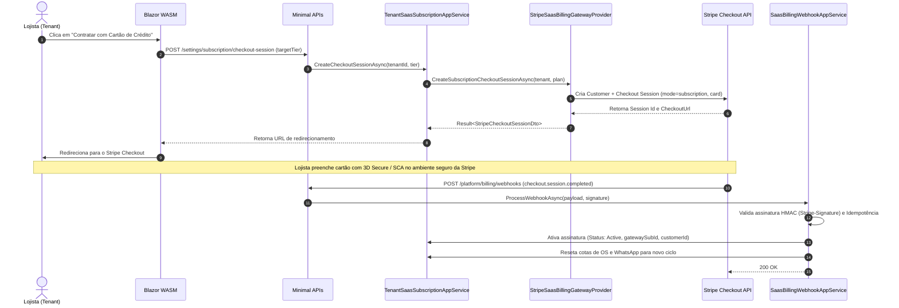

# Provedor Stripe para Faturamento Recorrente do SaaS via Cartão de Crédito

Este documento vivo descreve a integração da **Stripe** como provedor de faturamento recorrente do SaaS para os estabelecimentos (tenants), com cobrança exclusiva por **Cartão de Crédito**, sessões seguras de Stripe Checkout e gestão via Stripe Customer Portal.

---

## 1. Visão Geral da Arquitetura Hexagonal

```mermaid
graph TD
    subgraph Frontend [Blazor WebAssembly]
        UI[TenantSubscriptionSettingsPage / UpgradePlanModal]
    end

    subgraph Presentation [API Host]
        Endpoints[SaasBillingEndpoints: /settings/subscription/checkout-session]
        WebhookEndpoint[SaasBillingEndpoints: /platform/billing/webhooks]
    end

    subgraph Application [CarWashSaaS.Billing.Application]
        SubService[TenantSaasSubscriptionApplicationService]
        WebhookService[SaasBillingWebhookApplicationService]
    end

    subgraph Domain [CarWashSaaS.Billing.Domain - 100% Puro]
        GatewayPort[ISaasBillingGatewayProvider - Porta Hexagonal]
        SubEntity[TenantSaasSubscription]
        QuotaEntity[TenantQuotaUsage]
        InvoiceEntity[SaasInvoice]
    end

    subgraph Infrastructure [CarWashSaaS.Billing.Infrastructure]
        StripeAdapter[StripeSaasBillingGatewayProvider]
        SimulatedAdapter[SimulatedSaasBillingGatewayProvider]
        StripeSDK[Stripe.net SDK]
    end

    subgraph External [Stripe Cloud]
        StripeAPI[Stripe Checkout & Billing API]
        StripeEvents[Stripe Webhooks: checkout.session.completed, invoice.paid, invoice.payment_failed]
    end

    UI --> Endpoints
    Endpoints --> SubService
    WebhookEndpoint --> WebhookService
    SubService --> GatewayPort
    SubService --> SubEntity
    WebhookService --> GatewayPort
    WebhookService --> SubEntity
    WebhookService --> QuotaEntity
    WebhookService --> InvoiceEntity
    GatewayPort <|.. StripeAdapter
    GatewayPort <|.. SimulatedAdapter
    StripeAdapter --> StripeSDK
    StripeSDK --> StripeAPI
    StripeEvents --> WebhookEndpoint
```

---

## 2. Fluxo de Contratação e Upgrade via Stripe Checkout



---

## 3. Eventos de Webhooks e Transições de Estado

| Evento Stripe | Ação no Domínio Lavaway | Estado Resultante | Efeito em Outros Módulos |
| :--- | :--- | :--- | :--- |
| `checkout.session.completed` | Aplica o novo plano (`PlanTier`), ativa a assinatura do tenant, vincula IDs externos e reseta cotas para novo ciclo | `Active` | Libera cotas cheias para `YardOperations` e `WhatsApp` com base no novo plano contratado |
| `customer.subscription.updated` | Sincroniza alteração de plano ou status realizada no Stripe Customer Portal | Conforme evento | Atualiza cotas e capacidades do plano imediatamente |
| `invoice.paid` / `invoice.payment_succeeded` | Sincroniza plano (se alterado), renova ciclo por 30 dias e baixa a fatura | `Active` | Reseta cotas de OS e WhatsApp para o novo ciclo |
| `invoice.payment_failed` | Marca fatura como vencida e aplica prazo de tolerância de 5 dias | `GracePeriod` | Exibe banner âmbar de aviso sem bloquear operação imediata |
| *Carência expirada (> 5 dias)* | Avança suspensão por inadimplência | `Delinquent` | Bloqueia abertura de novas OS e envio de mensagens |
| `customer.subscription.deleted` | Cancela assinatura no domínio | `Canceled` | Bloqueia acesso operacional |
| Eventos informativos (`customer.created`, `payment_intent.created`, `setup_intent.created`, etc.) | Acknowledged sem mutação de estado | Inalterado | Registrado em `ProcessedSaasWebhookEvent` com retorno `200 OK` para prevenir retentativas |

> [!NOTE]
> Para garantir UX imediata e imunidade a variações de latência de webhooks na volta do Checkout, o frontend realiza conciliação síncrona via `POST /settings/subscription/checkout-session/sync` ao detectar `session_id`, garantindo atualização instantânea do plano em tela, enquanto o webhook assíncrono fornece garantia de entrega e reconciliação definitiva com idempotência estrita.

> [!NOTE]
> Eventos gerados durante a navegação/inicialização do Stripe Checkout que não carregam `tenant_id` ou que não representam transições de estado (como criação de cliente intermediário ou intenção de pagamento) são reconhecidos com HTTP 200 OK e logados, em estrita conformidade com as diretrizes de integração de webhooks da Stripe.

---

## 4. Segurança e Auditoria
- Chaves sensíveis (`Stripe:SecretKey` e `Stripe:WebhookSecret`) são injetadas estritamente via variáveis de ambiente / secrets.
- O payload de webhooks é validado criptograficamente com tolerância temporal de 300 segundos contra ataques de replay.
- Todos os `EventId` da Stripe são persistidos em `ProcessedSaasWebhookEvent` para garantir idempotência estrita.
