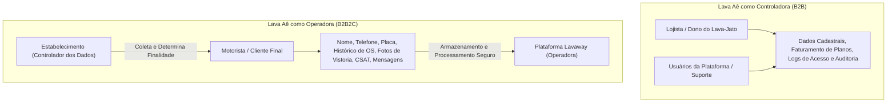
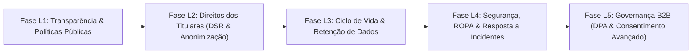

# Roadmap de Implementação e Adequação à LGPD — Lava Aê (Lavaway SaaS)

Este roadmap organiza as implementações técnicas, operacionais e regulatórias necessárias para garantir a total conformidade do **Lava Aê** com a **Lei Geral de Proteção de Dados Pessoais (LGPD — Lei Federal nº 13.709/2018)**.

---

## 1. Contexto e Papéis Regulatórios no Modelo SaaS

No modelo de negócio do Lava Aê, a plataforma opera sob dupla figura jurídica:

1. **Lava Aê como Controladora:** No relacionamento com os lojistas, administradores e funcionários de lava-rápidos (gerenciamento de contas, faturamento de assinaturas, auditoria de acesso e métricas globais).
2. **Lava Aê como Operadora:** No processamento e armazenamento dos dados pessoais dos clientes finais dos estabelecimentos (motoristas), onde cada **Estabelecimento (Tenant)** atua como o **Controlador** que define a coleta e a relação jurídica de consumo com o titular.

---

## 2. Visão Geral das Fases de Implementação

---

## Fase L1: Transparência, Governança & Políticas Públicas (Frontal)

**Objetivo:** Oferecer transparência completa e acessível a usuários, lojistas e motoristas sobre o tratamento de seus dados, canais de atendimento e termos contratuais de uso da plataforma.

### L1.1 Páginas Públicas de Política de Privacidade e Termos de Uso
- [x] Criar a página pública Blazor `/privacidade` (`PrivacyPolicyPage.razor`) acessível sem autenticação.
- [x] Criar a página pública Blazor `/termos` (`TermsOfServicePage.razor`) com as regras de uso do serviço.
- [x] Atualizar o rodapé institucional em [Home.razor](file:///home/rony/LPR/lavaway/src/Frontend/CarWashSaaS.Client.Web/Pages/Home.razor#L910-L915) transformando os `` estáticos em links navegáveis para `/termos` e `/privacidade`.
- [x] Detalhar na política:
  - Papel do Lava Aê como operador dos dados de motoristas e controlador das contas de lojistas.
  - Finalidades de coleta (execução do serviço de lavagem, contato de prontidão, vistoria e garantia).
  - Prazos de retenção e descarte.
  - Informações claras sobre cookies e armazenamento estritamente necessário (`LocalStorageTokenStorage`).

### L1.2 Canal do Encarregado pelo Tratamento de Dados (DPO — Art. 41)
- [x] Definir o endereço institucional de contato do DPO (`privacidade@lavaway.com.br`).
- [x] Incluir o canal de contato e identidade do encarregado nas páginas `/privacidade` e nos rodapés.
- [x] Criar modelo de resposta padrão para requisições de titulares recebidas via canal oficial ([playbook-dpo-respostas-titulares.md](file:///home/rony/LPR/lavaway/docs/lgpd/playbook-dpo-respostas-titulares.md)).
- [x] Disponibilizar página pública e responsiva do Canal do DPO (`/dpo` e `/canal-dpo`) com acionamento estruturado dos direitos do Art. 18.

---

## Fase L2: Atendimento aos Direitos dos Titulares (DSR — Data Subject Requests)

**Objetivo:** Permitir aos titulares de dados (e aos lojistas que os representam) exercer os direitos fundamentais garantidos pelo Art. 18 da LGPD de forma auditável e tecnicamente segura.

### L2.1 Serviço de Anonimização de Dados do Cliente ("Direito ao Esquecimento" — Art. 18, VI)
- [x] **Regra de Negócio Crítica:** Ordens de Serviço finalizadas e transações financeiras possuem base legal de **Cumprimento de Obrigação Legal e Regulatória** (Art. 16, I da LGPD, CDC e normas fiscais por 5 anos). Portanto, a exclusão não deve ser um `DELETE` físico em cascata nas tabelas operacionais e financeiras.
- [x] Implementar comando `AnonymizeCustomerCommand` no backend [CustomerVehicleApplicationService.cs](file:///home/rony/LPR/lavaway/src/Backend/Modules/YardOperations/CarWashSaaS.YardOperations.Application/CustomerVehicleApplicationService.cs):
  - Anonimizar nome para `"Cliente Anonimizado (LGPD)"`.
  - Limpar telefone e substituir `NormalizedPhone` por hash irreversível com salt para impedir reidentificação.
  - Desvincular placas e veículos associados àquele titular (permitindo que o veículo seja cadastrado futuramente por outro proprietário sem herdar vínculos pessoais do proprietário anterior).
  - Limpar preferências de comunicação no schema `whatsapp` (`CustomerCommunicationPreference`).
  - Registrar evento de auditoria no schema `identity` (`AdministrativeAuditEvent`) com identificador do operador que autorizou a anonimização e motivo formal.
- [x] Expor endpoint seguro: `POST /yard/customers/{id:guid}/anonymize` com política `Administrator`.

### L2.2 Dossiê do Titular e Portabilidade de Dados (Art. 18, II e V)
- [x] Implementar serviço de geração do Dossiê do Titular (`CustomerDataExportService`):
  - Compilar dados cadastrais do cliente (`Customer`).
  - Histórico de veículos associados (`Vehicle`).
  - Histórico de Ordens de Serviço (datas, serviços executados, valores, forma de pagamento e status).
  - Histórico de avaliações de pós-venda (CSAT/NPS: `SurveyRating`, `SurveyFeedback`).
  - Histórico de preferências e logs de comunicação no WhatsApp via contrato desacoplado `ICustomerWhatsAppHistoryLookup`.
  - Registro de auditoria administrativa de exportação em `AdministrativeAuditEvent` (`Customer.DataExportedLGPD`).
- [x] Implementar gerador nativo de PDF `CustomerDossierPdfGenerator` com layout institucional, grade de serviços e declaração de privacidade legal.
- [x] Expor endpoints seguros `GET /yard/customers/{id:guid}/export` e `GET /customers/{id:guid}/export` suportando `format=json` (portabilidade interoperável) e `format=pdf` (download de relatório para o titular) protegidos por política `Administrator`.

### L2.3 Interface de Atendimento a Direitos LGPD no Painel Administrativo
- [x] Adicionar botão "Exportar Dossiê (LGPD)" na visualização de detalhes do cliente.
- [x] Adicionar modal com confirmação dupla e termo de advertência "Anonimizar Titular (Direito ao Esquecimento - LGPD)" na gestão de clientes.
- [x] Exibir badge visual `Anonimizado - LGPD` para clientes cujos dados pessoais foram ofuscados.

---

## Fase L3: Ciclo de Vida e Retenção Automatizada de Dados (Art. 16)

**Objetivo:** Garantir o descarte de dados e mídias pessoais após o encerramento da finalidade de tratamento, minimizando a superfície de exposição e o custo de armazenamento.

### L3.1 Expurgo Automatizado de Fotos de Vistoria (`InspectionPhotos`)
- [x] Definir a política padrão de retenção de mídias de vistoria (ex.: retenção por 90 ou 180 dias após a entrega do veículo `PickedUpAtUtc`).
- [x] Criar o worker em background `InspectionPhotoRetentionWorker` (ou *HostedService* diário):
  - Identificar vistorias concluídas cujo prazo de retenção expirou.
  - Remover fisicamente os binários do storage MinIO via [ITenantObjectStorage](file:///home/rony/LPR/lavaway/src/Shared/CarWashSaaS.Shared.Contracts/ITenantObjectStorage.cs).
  - Marcar a entidade `InspectionPhoto` com status `Purged` ou substituir a URL pelo placeholder de foto expirada por política de retenção.
- [x] Permitir configuração de retenção por tenant nas configurações avançadas da loja (com teto máximo permitido de 365 dias).

### L3.2 Higienização de Payloads Brutos de Webhooks e Logs Transitórios
- [x] Criar rotina programada de expurgo de payloads brutos em tabelas de auditoria de webhooks de gateways de pagamento (`BillingWebhookEvents` do Pagar.me e Stripe) e WhatsApp após 60 dias.
- [x] Manter apenas metadados agregados, ID da transação, valor e status, descartando payloads brutos com dados de endereço, IP ou titular de cartão.

---

## Fase L4: Segurança da Informação, ROPA e Resposta a Incidentes

**Objetivo:** Formalizar as medidas de segurança técnicas e administrativas (Art. 46), mapear os fluxos de dados (Art. 37) e preparar planos de resposta a incidentes (Art. 48).

### L4.1 Criptografia em Repouso e Minimização de Dados Sensíveis
- [x] Validar configuração de TDE (*Transparent Data Encryption*) no banco de dados de produção SQL Server.
- [x] Garantir que chaves de API de terceiros (chaves secretas da Evolution API, Pagar.me Secret Keys, Stripe API Keys) permaneçam criptografadas na base (`TenantWhatsAppConfig`, `TenantPagarMeConfig`).
- [x] Manter e ampliar o mascaramento de dados pessoais (PII) em todas as camadas de observabilidade (Serilog, dashboards executivos e traces OpenTelemetry).

### L4.2 Matriz ROPA (Registro das Operações de Tratamento de Dados Pessoais — Art. 37)
- [x] Elaborar e versionar no repositório o documento [registro-operacoes-tratamento-ropa.md](file:///home/rony/LPR/lavaway/docs/lgpd/registro-operacoes-tratamento-ropa.md) detalhando:
  - Inventário completo de dados tratados.
  - Base legal associada a cada finalidade.
  - Categoria de titulares (Lojistas, Funcionários, Motoristas).
  - Compartilhamentos com terceiros (Evolution API, Pagar.me, Stripe, RabbitMQ, MinIO).
  - Prazos de retenção definidos.

### L4.3 Plano de Resposta a Incidentes de Segurança com Dados Pessoais (Art. 48)
- [x] Criar o manual de contingência [plano-resposta-incidentes-seguranca.md](file:///home/rony/LPR/lavaway/docs/lgpd/plano-resposta-incidentes-seguranca.md):
  - Procedimentos de contenção imediata de vazamentos.
  - Critérios de avaliação de risco e gravidade aos titulares.
  - Fluxo de notificação compulsória à ANPD (Autoridade Nacional de Proteção de Dados) e aos estabelecimentos afetados dentro do prazo regulamentar.

---

## Fase L5: Governança Contratual B2B & Consentimento Avançado

**Objetivo:** Resguardar juridicamente a relação B2B entre a plataforma SaaS e os lojistas, além de estender a transparência na ponta final de atendimento.

### L5.1 Acordo de Processamento de Dados (DPA — Data Processing Agreement)
- [x] Elaborar anexo contratual DPA nos termos de contratação e adesão dos planos do SaaS em [acordo-processamento-dados-dpa.md](file:///home/rony/LPR/lavaway/docs/lgpd/acordo-processamento-dados-dpa.md):
  - Estabelecendo formalmente o estabelecimento como Controlador e o Lava Aê como Operador.
  - Cláusulas de obrigação de confidencialidade da equipe e de subprocessadores (provedores de cloud e infraestrutura).
  - Cooperação mútua em caso de auditorias da ANPD ou exercício de direitos por motoristas.
  - Seção integrada [7. Proteção de Dados Pessoais e Acordo de Processamento (DPA — LGPD)](file:///home/rony/LPR/lavaway/src/Frontend/CarWashSaaS.Client.Web/Pages/TermsOfServicePage.razor#L148) nos Termos de Uso.
- [x] Adicionar checkbox obrigatório de concordância com os Termos e DPA no modal de contratação/trial de planos em [Home.razor](file:///home/rony/LPR/lavaway/src/Frontend/CarWashSaaS.Client.Web/Pages/Home.razor#L985) integrado a `RegisterTenantRequest` e trilha de auditoria administrativa `Tenant.TermsAndDpaAccepted`.

### L5.2 Notificação Transparente na Recepção e no WhatsApp
- [ ] Incluir no recibo digital / link de acompanhamento da Ordem de Serviço enviado via WhatsApp um rodapé transparente:
  - *"Seus dados e fotos de vistoria são tratados com segurança e exclusivamente para a prestação do serviço contratado. Para consultar nossa Política de Privacidade, acesse [link]. Envie 'PARAR' a qualquer momento para não receber mensagens promocionais."*
- [ ] Fornecer cartilha/orientação de boas práticas no `MANUAL_DO_USUARIO.md` orientando atendentes a não tirar fotos de pessoas nem de documentos/bens pessoais esquecidos no veículo durante a vistoria de entrada.

---

## 3. Matriz de Dados Pessoais e Bases Legais (Mapeamento ROPA)

| Entidade / Dado | Finalidade do Tratamento | Base Legal (Art. 7º LGPD) | Papel do SaaS |
| :--- | :--- | :--- | :--- |
| **Lojista: Nome, E-mail, Senha, CPF/CNPJ** | Acesso ao sistema, gestão de conta e emissão de cobranças de planos. | Execução de Contrato (Inciso V) | Controladora |
| **Motorista: Nome, Telefone, Placa** | Abertura de OS, identificação do veículo no pátio e aviso de prontidão do serviço. | Execução de Contrato (Inciso V) | Operadora |
| **Fotos de Vistoria do Veículo** | Registro de avarias pré-existentes e comprovação de integridade do serviço. | Execução de Contrato (Inciso V) / Legítimo Interesse (Inciso IX) | Operadora |
| **Histórico Financeiro / Pagamentos Pix** | Conciliação financeira, fechamento de caixa e cumprimento fiscal. | Cumprimento de Obrigação Legal/Regulatória (Inciso II) | Operadora |
| **Avaliações de Pós-Venda (CSAT)** | Medição de qualidade de serviço prestado pelo lava-jato. | Legítimo Interesse do Estabelecimento (Inciso IX) | Operadora |
| **Mensagens de Reativação WhatsApp** | Ofertas e avisos promocionais para clientes inativos. | Consentimento (Inciso I) / Legítimo Interesse (Inciso IX) com Opt-out garantido | Operadora |
| **Logs de Acesso e Auditoria Forense** | Segurança da informação e conformidade com o Marco Civil da Internet (Art. 15). | Cumprimento de Obrigação Legal (Inciso II) | Controladora |

---

## 4. Cronograma Sugerido de Execução

| Sprint | Foco | Entregáveis Principais |
| :---: | :--- | :--- |
| **Sprint 1** | **Transparência & Conformidade Frontal** | Páginas `/privacidade` e `/termos`, canais do DPO e atualização do rodapé de `Home.razor`. |
| **Sprint 2** | **Atendimento aos Direitos dos Titulares** | Endpoint e rotina de Anonimização de Clientes, exportação de Dossiê do Titular e interface no painel. |
| **Sprint 3** | **Retenção & Descarte Automatizado** | Worker de expurgo de fotos de vistoria antigas (`InspectionPhotoRetentionWorker`) e limpeza de webhooks. |
| **Sprint 4** | **Governança & Documentação Regulatória** | Documento ROPA, Plano de Resposta a Incidentes de Segurança e inclusão do DPA no onboarding de tenants. |
